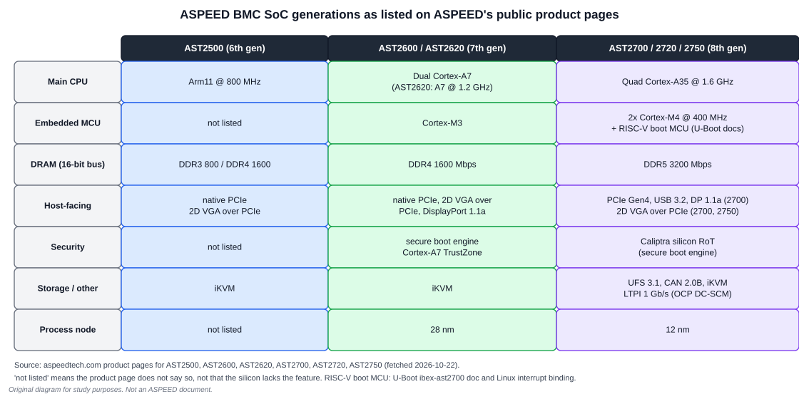
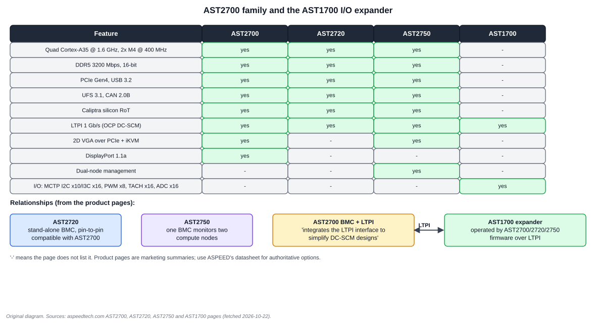

# 1. Family and Generations

## 1.1 What a BMC SoC is

A baseboard management controller (BMC) is a small computer that lives on a server board and manages the big computer. It reads sensors, controls fans, sequences power, provides remote console and remote media, and answers management APIs. The [OpenBMC textbook](../OpenBMC_Textbook/00_README.md) covers the software; this volume covers the silicon.

A BMC SoC therefore has an unusual mix of blocks compared with an application processor. It has few CPU cores but a huge number of low-speed management buses (I2C, I3C, GPIO, ADC, PWM, tachometer inputs, UART), host-facing interfaces (LPC or eSPI, KCS, a PCIe VGA device, USB virtual devices), and security blocks, because the BMC is the first thing powered and a high-value attack target.

## 1.2 The generations in one picture

The data comes from ASPEED's public product pages. The generation numbering is ASPEED's own: AST2500 is the 6th generation, AST2600 the 7th and AST2700 the 8th.

| Chip | Main CPU | Memory | Notable public claims |
| --- | --- | --- | --- |
| AST2500 | Arm11 @ 800 MHz | DDR3 800 / DDR4 1600 Mbps, 16-bit | PCIe 2D VGA, iKVM |
| AST2600 | dual Cortex-A7, plus an embedded Cortex-M3 | DDR4 1600 Mbps, 16-bit | 28 nm, secure boot engine, A7 TrustZone, PCIe, DisplayPort 1.1a |
| AST2620 | Cortex-A7 @ 1.2 GHz | DDR4 @ 1600, 16-bit | stand-alone; pin-to-pin compatible with AST2600 |
| AST2700 | quad Cortex-A35 @ 1.6 GHz, two Cortex-M4 @ 400 MHz | DDR5 3200 Mbps, 16-bit | 12 nm, PCIe Gen4, USB 3.2, UFS 3.1, CAN 2.0B, LTPI, Caliptra |
| AST2720 | same CPU complex as AST2700 | DDR5 3200 | stand-alone; pin-to-pin compatible with AST2700 |
| AST2750 | same CPU complex as AST2700 | DDR5 3200 | dual-node: one BMC monitors two compute nodes |
| AST1700 | none (I/O expander) | none | LTPI, MCTP over I2C/I3C, PWM, TACH, ADC |

Three takeaways:

1. **AST2600 to AST2700 is a bigger jump than 2500 to 2600.** The CPU architecture changes from 32-bit Armv7-A to 64-bit Armv8-A, the memory moves from DDR4 to DDR5, and the SoC gains PCIe Gen4, USB 3.2 and a hardware root of trust.
2. **The "27x0" suffix changes the feature set, not the generation.** The AST2720 and AST2750 share the AST2700's CPU complex and memory interface. The product pages differ in host-facing and multi-node features, shown below.
3. **The AST1700 is not a BMC.** It is an expander chip operated by the AST2700 family's firmware over LTPI.

## 1.3 The AST27x0 variants

How to read the matrix: a dash means the product page does not list the feature, not that the silicon lacks it. Treat it as a purchasing hint, then confirm with ASPEED's datasheet.

- **AST2700** is the full part: it lists 2D VGA over PCIe, iKVM and DisplayPort 1.1a.
- **AST2720** is a stand-alone BMC that is pin-to-pin compatible with the AST2700, which means a board can be designed for the AST2700 and populated with an AST2720. Its page lists neither VGA, iKVM nor DisplayPort.
- **AST2750** adds dual-node management ("a single BMC to monitor two computing nodes") and lists VGA and iKVM.
- **AST1700** lists LTPI at 1 Gb/s bandwidth carrying UART, GPIO, SGPIO and I2C; MCTP over I2C ×10 and I3C ×16; PWM ×8, TACH ×16 and ADC ×16.

## 1.4 Two details worth knowing early

**A two-domain structure.** Linux describes AST2700 peripherals under two bus nodes, `soc0` ("Main Domain peripherals") and `soc1`. The interrupt-controller binding says one INTC1 instance "is always present, on the SoC's IO die". That wording is the only public statement of the split. ASPEED's product page does not say how many dies the part has, so this book says *domains* and quotes "die" only when quoting the binding. Chapter 3 maps what sits where.

**A boot MCU you did not expect.** Upstream U-Boot's documentation states that AST2700 "integrates an IBex RISC-V 32-bits CPU as the boot MCU to execute the first stage bootloader, namely SPL". So an AST2700 has four processors of three different instruction sets: Cortex-A35 (AArch64), Cortex-M4 ×2 (Thumb-2) and the RISC-V boot MCU. This is a change from every earlier ASPEED BMC, and it affects debugging and secure boot (Chapters 3 and 4).

## 1.5 Where the family sits next to DC-SCM

The AST2700 page says that "in modular server architecture, AST2700 integrates the LTPI interface to help customers simplify DC-SCM designs". LTPI is the LVDS link defined in the OCP DC-SCM specification. The [DC-SCM textbook](../DC_SCM_Textbook/00_README.md) covers it, and its [last chapter](../DC_SCM_Textbook/07_ASPEED_on_DC_SCM_and_Review.md) compares an AST2600 with an external CPLD against an AST2700 with integrated LTPI.

## Worked exercise: which chip is on my board?

You are handed a BMC board and a serial console. List three independent pieces of evidence that tell you the chip family, from least to most reliable.

**Answer.**

1. The device-tree `compatible` string reported by the running kernel (`/proc/device-tree/compatible`, for example `aspeed,ast2600` or `aspeed,ast2700`). This tells you what image was built, not what silicon is fitted.
2. The kernel's SoC identification. The device trees include a `silicon-id` node under the SCU (AST2600 at SCU offset `0x14`, so register `0x1E6E_2014`; AST2700 at SCU0 offset `0x0`, so register `0x12C0_2000`). Kernel drivers expose that through the SoC device interface; check `/sys/bus/soc/devices/` on your kernel [verify on your kernel version]. This reads the silicon.
3. The package marking and the board's schematic. This is the only evidence that does not rely on software.

The lesson: an image built for one SoC can boot on a pin-compatible sibling (AST2620 on an AST2600 board; AST2720 on an AST2700 board), so confirm the silicon before debugging a "missing" feature.

## Review

1. Why can an AST2720 be fitted in an AST2700 footprint? **Answer:** ASPEED lists it as pin-to-pin compatible.
2. Which AST27x0 parts list dual-node support? **Answer:** the AST2750.
3. Does the AST1700 run Linux? **Answer:** the public pages say it is operated by AST2700-family firmware; it is an I/O expander, not an application SoC.

Next: [Chapter 2: AST2600 hardware](02_AST2600_Hardware.md)
