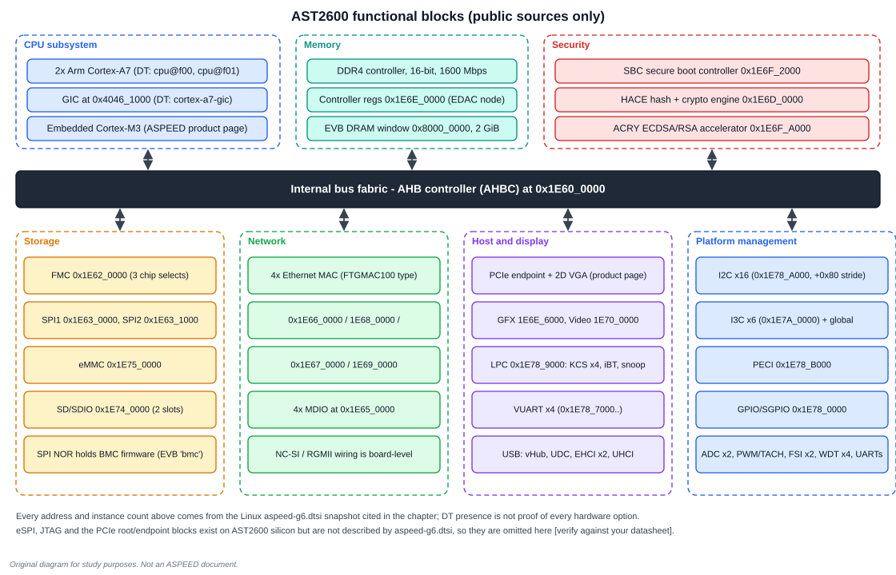
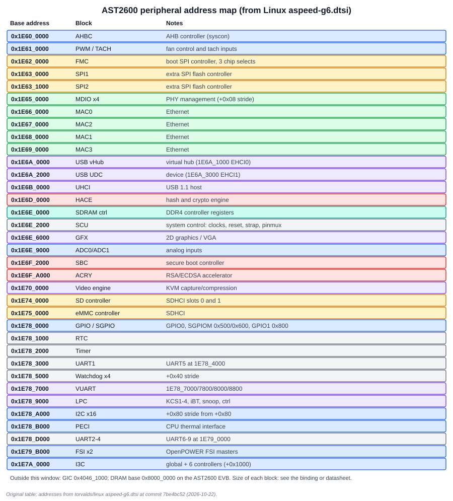

# 2. AST2600 Hardware

The AST2600 is a 28 nm, dual Cortex-A7 BMC SoC with an embedded Cortex-M3. This chapter walks it the way a hardware engineer would: compute, fabric, memory, storage, network, host interface, management I/O, then security.

## 2.1 Compute and memory

| Item | Value | Source |
| --- | --- | --- |
| Application CPU | two Arm Cortex-A7 (`cpu@f00`, `cpu@f01`) | Linux `aspeed-g6.dtsi` |
| Interrupt controller | Arm GIC at `0x4046_1000` | Linux `aspeed-g6.dtsi` |
| Embedded MCU | Arm Cortex-M3 | ASPEED product page |
| DRAM | DDR4, 16-bit bus, up to 1600 Mbps | ASPEED product page |
| DRAM controller registers | `0x1E6E_0000` | Linux (SDRAM EDAC node) |
| DRAM base on the AST2600 EVB | `0x8000_0000`, 2 GiB | Linux `aspeed-ast2600-evb.dts` |
| Security extension | Cortex-A7 TrustZone | ASPEED product page |

A 16-bit DDR4 bus at 1600 Mbps per pin has a peak of 16 × 1600 / 8 = **3.2 GB/s**. That is the ceiling for every consumer: the CPUs, the video engine, the VGA frame buffer and the DMA engines share it. It is worth keeping in mind when the video engine and KVM compression run while the CPUs are busy.

The EVB device tree also reserves memory for the video engine and the graphics frame buffer (`video_engine_memory`, `gfx_memory`). Hardware blocks that DMA need contiguous reserved memory, so boards carve out a reserved region for them; this is a recurring cause of "less RAM than I fitted".

## 2.2 The bus fabric and the address map

The AHB controller (AHBC) sits at `0x1E60_0000` and the peripheral window extends to about `0x1E7A_xxxx`.

Reading the map gives you several useful facts quickly.

- **Peripherals are packed in 4 KiB or 64 KiB slots.** For example the GPIO controller is at `0x1E78_0000`, the RTC at `0x1E78_1000`, the timer at `0x1E78_2000`, UART1 at `0x1E78_3000`. A 4 KiB stride is the default.
- **Multi-instance blocks use a small stride inside one slot.** The sixteen I2C controllers sit at `0x1E78_A000 + 0x80 × (N+1)`, so bus 0 is at `+0x80` and bus 15 at `+0x800`. The four watchdogs are `0x40` apart from `0x1E78_5000`. The MDIO controllers are `0x08` apart from `0x1E65_0000`.
- **Do not assume numbering is address-monotonic.** The Ethernet MACs are at `0x1E66_0000` (MAC0), `0x1E68_0000` (MAC1), `0x1E67_0000` (MAC2) and `0x1E69_0000` (MAC3). MAC1 sits above MAC2. A script that assumes `base + 0x10000 × N` will bind the wrong controller.

## 2.3 System control: the SCU

The System Control Unit at `0x1E6E_2000` holds clocks, resets, strap capture, pin multiplexing, silicon ID and several interrupt aggregators. The device tree shows:

- `silicon-id` at SCU offset `0x14`.
- `smp-memram` at offset `0x180`, used to start the second core.
- two SCU interrupt controllers at offsets `0x560` and `0x570`.
- a random-number register at `0x1E6E_2524` exposed to Linux as a `timeriomem_rng`.

The SCU is the register block you touch most during bring-up because **pin multiplexing lives there**. A peripheral can be perfectly healthy and still be disconnected from its package ball because the pin mux selects another function. The kernel's pinctrl driver programs it from the device tree. A board that does not work often has a pinctrl group missing from its `.dts`.

## 2.4 Storage

| Block | Base | Chip selects in the DT | Role |
| --- | --- | --- | --- |
| FMC (flash memory controller) | `0x1E62_0000` | 3 | boot SPI flash; BMC firmware |
| SPI1 | `0x1E63_0000` | 2 | additional SPI flash controller |
| SPI2 | `0x1E63_1000` | 3 | additional SPI flash controller |
| SD/SDIO | `0x1E74_0000` | two SDHCI slots | removable storage |
| eMMC | `0x1E75_0000` | one SDHCI | managed storage |

The FMC is where boot firmware is normally read from (typical practice; confirm your board's strap and flash layout). The EVB device tree labels its first chip select `bmc` and a second `pnor`, which is the typical pairing: BMC firmware in one flash and host BIOS (or POWER PNOR) in another. On server boards using DC-SCM, the host BIOS flash is on the SCM and is read by the HPM over QSPI (see the [DC-SCM signals chapter](../DC_SCM_Textbook/03_DC_SCI_Signals.md)).

## 2.5 Network

The device tree lists four Ethernet MACs (type `faraday,ftgmac100`) and four MDIO controllers. Whether a MAC drives a PHY over RGMII or an NC-SI sideband link to a NIC is a board decision. Linux handles the NC-SI case as a software layer above the MAC. On a DC-SCM, NC-SI uses an RMII-based transport at 50 MHz, covered in the DC-SCM textbook.

## 2.6 Host-facing interfaces

These are the blocks that let a host CPU talk to the BMC.

| Block | Base | Notes |
| --- | --- | --- |
| LPC | `0x1E78_9000` | KCS1-4, iBT, LPC control, snoop, reset controller, UART routing |
| VUART ×4 | `0x1E78_7000`, `7800`, `8000`, `8800` | host-visible virtual UARTs for serial-over-LAN |
| PCIe endpoint with 2D VGA | product page | host sees a VGA device |
| GFX | `0x1E6E_6000` | graphics / VGA block |
| Video engine | `0x1E70_0000` | KVM capture and compression |
| USB | vHub `0x1E6A_0000`, UDC `0x1E6A_2000`, EHCI ×2, UHCI | virtual hub for virtual media and HID |

KCS is the classic IPMI host interface. The four KCS channels appear at LPC offsets `0x24`, `0x28`, `0x2C` and `0x114`, plus an iBT (IPMI block-transfer) channel at `0x140`. eSPI exists on the AST2600 silicon but is not described by `aspeed-g6.dtsi`, so it is not drawn in the block diagram [verify against your datasheet].

## 2.7 Platform-management I/O

| Block | Count and base | Why a BMC needs it |
| --- | --- | --- |
| I2C | 16 controllers, `0x1E78_A000` | sensors, VRs, EEPROMs, PMBus |
| I3C | 6 controllers + global, `0x1E7A_0000` | faster sensor and DIMM buses |
| PECI | `0x1E78_B000` | CPU temperature and power telemetry |
| GPIO / SGPIO | `0x1E78_0000`, SGPIOM at `+0x500`/`+0x600` | button, LED, presence, serial GPIO to expanders |
| ADC | two controllers at `0x1E6E_9000` | voltage rails |
| PWM/TACH | `0x1E61_0000` | fan speed control and tachometer inputs |
| FSI | two masters at `0x1E79_B000` | OpenPOWER Flexible Service Interface |
| Watchdogs | four, `0x1E78_5000` | reset the BMC (or a host) on a hang |
| UART | UART1-9 (`0x1E78_3000` …) | debug console and subsystems |

The device-tree numbering is zero-based for I2C and one-based for UART and watchdog, which is a frequent source of off-by-one mistakes in scripts and bring-up notes.

## 2.8 Security engines

| Block | Base | Purpose |
| --- | --- | --- |
| SBC (secure boot controller) | `0x1E6F_2000` | register bank for the secure-boot hardware (Linux binding: "a register bank for interacting with the secure boot controller") |
| HACE | `0x1E6D_0000` | hash and crypto engine: digest, encrypt, decrypt |
| ACRY | `0x1E6F_A000` | ECDSA and RSA accelerator |
| RNG register | `0x1E6E_2524` | random numbers via the SCU |

Chapter 4 explains how SBC and the signed first-stage bootloader fit together.

## 2.9 Reading the address map as a debugging tool

When a driver fails to probe, the first question is whether the address in your device tree matches the hardware. Use the map this way:

1. Take the `reg` property of the failing node.
2. Find the nearest base in the map. If your address is not on a slot boundary, suspect a typo.
3. If the node uses a sub-offset (I2C bus, MDIO, watchdog), recompute the offset from the stride.
4. If a block works on one board and not another, compare the SCU pin-mux groups before the controller registers.

## Worked exercises

**1. Where is I2C bus 9's register block?** Bus N is at `0x1E78_A000 + 0x80 × (N+1)`. For N = 9: `0x1E78_A000 + 0x500 = 0x1E78_A500`. This agrees with the device tree (`i2c9` at `@500`).

**Answer check.** `i2c15` = `0x1E78_A000 + 0x800` = `0x1E78_A800`.

**2. How much peak DRAM bandwidth does a 16-bit DDR4-1600 interface offer?** 16 bits × 1600 Mb/s per pin = 25,600 Mb/s = 3.2 GB/s.

**3. A script computes the MAC3 base as `0x1E66_0000 + 3 × 0x1_0000`. What does it get, and what is wrong?** It gets `0x1E69_0000`, which happens to be right for MAC3, but the same formula gives `0x1E67_0000` for MAC1, whose real base is `0x1E68_0000`. Numbering is not address-monotonic.

## Review

- Which register block would you inspect first if a UART works at the boot ROM stage but not in Linux? **Answer:** the SCU pin-mux settings and the pinctrl group in the device tree.
- Which engine accelerates SHA digests: HACE or ACRY? **Answer:** HACE; ACRY is the ECDSA/RSA accelerator.
- Which block is the host's VGA device? **Answer:** the PCIe endpoint with 2D VGA, backed by the GFX block and a reserved frame buffer.

Next: [Chapter 3: AST27x0 hardware](03_AST27x0_Hardware.md)
