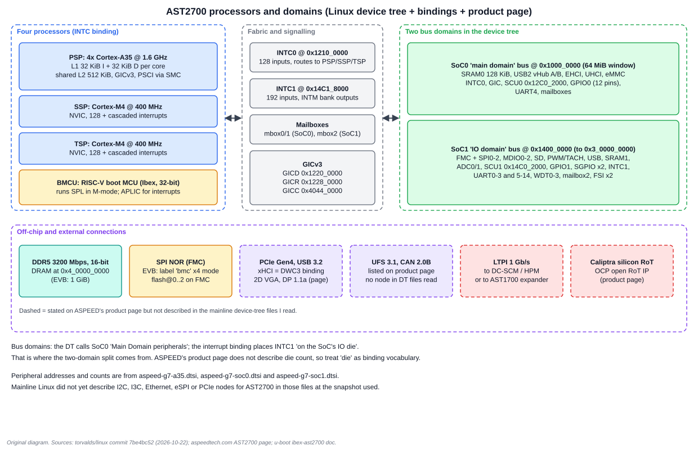
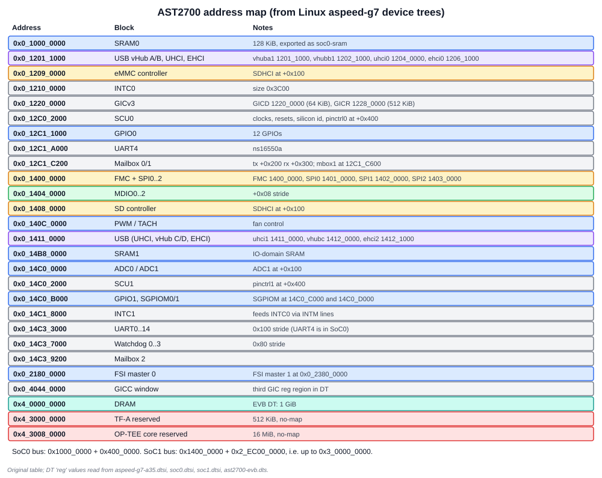
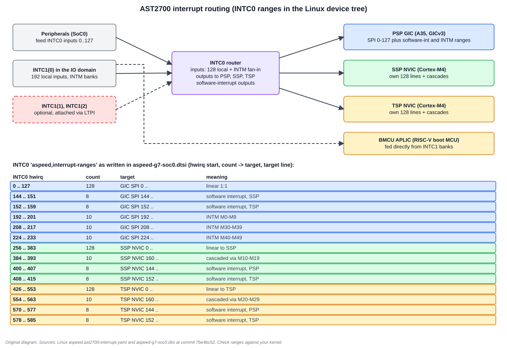

# 3. AST27x0 Hardware

The AST2700 family is a different machine from the AST2600. It has four processors, a split bus structure, a proper interrupt router, a silicon root of trust and a link (LTPI) that lets a BMC reach beyond its own package.

## 3.1 Four processors

The Linux interrupt binding names the processors that interrupts can be routed to.

| Name | Core | Role as named in the binding |
| --- | --- | --- |
| PSP | Cortex-A35 cluster | Primary Service Processor: runs Linux |
| SSP | Cortex-M4 @ 400 MHz | Secondary Service Processor |
| TSP | Cortex-M4 @ 400 MHz | Tertiary Service Processor |
| BMCU | RISC-V boot MCU (Ibex, 32-bit) | Boot MCU: runs the first-stage bootloader |

**PSP details from the device tree (`aspeed-g7-a35.dtsi`):**

- four `arm,cortex-a35` cores, started through PSCI over SMC;
- per core: 32 KiB L1 instruction cache (256 sets, 64-byte lines) and 32 KiB L1 data cache (128 sets, 64-byte lines);
- one shared 512 KiB L2 cache (1024 sets, 64-byte lines);
- an Arm GICv3 with distributor at `0x1220_0000` (64 KiB), redistributors at `0x1228_0000` (512 KiB) and a third region at `0x4044_0000`;
- the Arm architected timer and a PMU.

You can derive the associativity from those numbers: ways = size ÷ (sets × line size). L1 instruction: 32 KiB ÷ (256 × 64 B) = **2 ways**. L1 data: 32 KiB ÷ (128 × 64 B) = **4 ways**. L2: 512 KiB ÷ (1024 × 64 B) = **8 ways**. This is a useful sanity check when reading a device tree for a new part.

**SSP and TSP.** Each M4 has its own NVIC at `0xE000_E100` in its own private address space (the device tree places them in `secondary` and `tertiary` nodes, disabled by default). They run firmware such as Zephyr that ASPEED publishes ([Chapter 4](04_Boot_Security_and_Software.md)).

**BMCU.** The device tree describes it with a `riscv,cpu-intc` node. U-Boot documents that SPL boots on it in M-mode.

## 3.2 Two bus domains

The device tree defines two simple-bus nodes under the root, each with a one-to-one address translation:

| Bus | Base | Window | Contents (from the DT) |
| --- | --- | --- | --- |
| `soc0` | `0x1000_0000` | `0x400_0000` (64 MiB) | SRAM0, USB 2.0 vHub A/B, EHCI/UHCI, eMMC, INTC0, GIC, SCU0, GPIO0, UART4, mailboxes 0 and 1 |
| `soc1` | `0x1400_0000` | `0x2_EC00_0000` | FMC and SPI, MDIO, SD, PWM/TACH, USB, SRAM1, ADC, SCU1, GPIO1, SGPIO ×2, INTC1, UART ×14, watchdogs ×4, mailbox 2, FSI ×2 |

The `soc1` window ends at `0x1400_0000 + 0x2_EC00_0000 = 0x3_0000_0000`, so it covers 11.69 GiB of address space, far more than its on-chip peripherals need. The reason is not stated in the sources; it likely leaves room for apertures to blocks outside the DT files read (inferred).

The DT header comment calls `soc0` "Main Domain peripherals". The interrupt binding says INTC1 sits "on the SoC's IO die". Together those suggest soc0 is the processing side and soc1 the I/O side, but no ASPEED document I could read says so outright. Treat that as **inferred**.

**Peripheral counts that matter:**

- 15 UARTs in total: UART4 in soc0, UART0-3 and UART5-14 in soc1. The EVB uses UART12 as the console (`stdout-path = "serial0:115200n8"`).
- Two SCUs (`scu0` at `0x12C0_2000`, `scu1` at `0x14C0_2000`) with separate pin-control blocks (`soc0-pinctrl`, `soc1-pinctrl`). On AST2600 there was one SCU.
- Three MDIO controllers, four watchdogs, two SGPIO masters, two FSI masters.
- Three mailbox blocks for inter-processor messages (`mbox0`, `mbox1` in soc0; `mbox2` in soc1).

## 3.3 Memory map and trusted-firmware hooks

| Region | Address | Source |
| --- | --- | --- |
| DRAM | `0x4_0000_0000` | EVB DT: 1 GiB at that base |
| TF-A reserved | `0x4_3000_0000`, 512 KiB, no-map | `reserved-memory` node `trusted-firmware-a` |
| OP-TEE core reserved | `0x4_3008_0000`, 16 MiB, no-map | `reserved-memory` node `optee-core` |

The reserved nodes, plus `psci` and `optee` firmware nodes (`method = "smc"`), tell you the intended runtime model: **TF-A at EL3 provides PSCI; OP-TEE provides the secure OS**. See the [TF-A textbook](../Trusted_Firmware_A_Textbook/00_README.md) for the stages and PSCI. That the nodes exist is documented; that every production image uses TF-A and OP-TEE is inferred.

## 3.4 Interrupts: two controllers and four targets

The Linux binding documents a two-level design.

- **INTC0** is the primary controller. It has 128 local peripheral inputs, fan-in from up to three INTC1 instances, local and merged outputs, software-interrupt outputs, and configurable routes to the PSP, SSP and TSP.
- **INTC1** is secondary. It has 192 local inputs and banked outputs (INTM: 5 × 6 banks × 32 interrupts per bank), with routes to PSP, SSP, TSP and BMCU. One INTC1 is always present; two more "may be attached ... via LTPI".

The device tree's `aspeed,interrupt-ranges` property for INTC0 is a table of (first hwirq, count, target controller, first target line). The figure lists all fourteen rows. Three rules fall out of them.

1. **Local interrupts 0-127 map one-to-one to GIC SPI 0-127.** A normal Linux driver sees its device's INTC0 number as an SPI.
2. **The M4s see their own copy of the numbering.** INTC0 hwirq 256-383 are the SSP's NVIC lines 0-127; hwirq 426-553 are the TSP's NVIC lines 0-127. The ranges 384-393 and 554-563 are "cascaded via M10-M19" and "M20-M29", which are INTM bank lines from INTC1.
3. **Software-interrupt ranges exist between processors.** hwirq 144-151 and 152-159 go to GIC SPIs 144 and 152 (commented "sw int SSP" and "sw int TSP"). Each M4 also gets ranges at its NVIC lines 144 and 152 (commented "sw int PSP" and "sw int TSP"). The comments are terse, and for the TSP the second range is also commented "TSP", which may be a copy-paste slip. Check the binding and your SDK before relying on which processor signals which.

The practical consequence: a peripheral can interrupt the A35 *or* an M4 depending on firmware routing. A driver that works on the A35 does not automatically work on the SSP, because the interrupt number is different there.

## 3.5 Mailboxes and inter-processor communication

Each mailbox node has separate transmit and receive register windows (`tx` at `+0x200`, `rx` at `+0x300` for mbox0 at `0x12C1_C200`). The Linux binding `aspeed,ast2700-mailbox` describes them. The public sources I read do not define a message protocol on top of the mailboxes, so firmware images agree on one themselves. Mailbox registers plus the software-interrupt lines above are the signalling primitives the device tree exposes.

## 3.6 Connectivity: PCIe, USB, UFS, CAN, DisplayPort, LTPI

The product page lists these; mainline device trees describe only part of them.

| Interface | Product page | Mainline DT or binding |
| --- | --- | --- |
| PCIe | Gen 4, native | `aspeed,ast2700-pcie` binding (root-complex), no node in the `.dtsi` files read |
| USB | 3.2 | `aspeed,ast2700-xhci` (DWC3) binding; USB 2.0 vHub/EHCI/UHCI nodes exist |
| Storage | UFS 3.1 | none in the files read |
| CAN | 2.0B | none in the files read |
| Display | 2D VGA over PCIe, DisplayPort 1.1a | none in the files read |
| LTPI | 1 Gb/s | referenced by the interrupt binding (INTC1 via LTPI) |

Linux support for a block lags the silicon. When your board uses a block with no device-tree node, you will be using ASPEED's SDK kernel, not mainline.

## 3.7 Caliptra

The product page says the part "adapts 'Caliptra' which is a silicon RoT IP defined by OCP, to ensure the integrity and confidentiality of critical operations". ASPEED publishes `caliptra-sw` and `caliptra-mcu-sw` repositories. The public sources do not describe the boot-time interaction between Caliptra, the boot MCU and the A35, so this book does not either.

## 3.8 AST1700 and the multi-domain idea

The interrupt binding's statement that INTC1 instances can be attached through LTPI describes the AST1700's role: it extends the I/O of an AST2700 across an LVDS link. The AST1700 page lists MCTP over I2C (×10) and I3C (×16), PWM ×8, TACH ×16 and ADC ×16, i.e. fan control and sensing for a chassis that is physically distant from the BMC. The [DC-SCM textbook](../DC_SCM_Textbook/05_LTPI.md) explains LTPI itself.

## 3.9 What changed from AST2600

| Topic | AST2600 | AST27x0 |
| --- | --- | --- |
| CPU | 2 × Cortex-A7 (Armv7-A) | 4 × Cortex-A35 (Armv8-A, AArch64), 512 KiB L2 |
| Interrupts | GIC + SCU aggregators | GICv3 + INTC0/INTC1 router, four targets |
| Other processors | embedded Cortex-M3 | 2 × Cortex-M4 and a RISC-V boot MCU |
| Bus structure | one AHB peripheral window | `soc0` and `soc1` domains with two SCUs |
| DRAM | DDR4-1600, 16-bit | DDR5-3200, 16-bit |
| Secure boot | SBC + OTP, signed SPL verified by SoC | Caliptra silicon RoT; boot MCU SPL (details not public) |
| Host-facing | PCIe VGA, LPC/eSPI | PCIe Gen4, USB 3.2, VGA and DisplayPort (per page) |
| Remote I/O | none | LTPI to DC-SCM HPM or AST1700 |

## Worked exercises

**1. Which interrupt line does a peripheral on INTC0 hwirq 300 reach on the SSP?** 300 falls in 256-383, so it maps to SSP NVIC line 300 − 256 = **44**.

**2. hwirq 390?** 390 falls in 384-393, "cascaded to SSP via M10-M19", at SSP NVIC line 160 + (390 − 384) = **166**.

**3. hwirq 430?** 430 falls in 426-553, so TSP NVIC line 430 − 426 = **4**.

**4. hwirq 420?** None of the fourteen ranges covers 416-425. It is unrouted in this table. A driver using that number would never see an interrupt.

**5. What is the L2 way count?** 8, from 512 KiB ÷ (1024 sets × 64 B).

**6. A kernel log shows UART12 as the console but no output appears on your header.** UART12 is at `0x14C3_3B00` in soc1. Check, in order: the pin-control group in `soc1-pinctrl`, the clock gate in SCU1 and that the board's console header actually connects to the UART12 pins.

## Review

- Why do two SCUs exist? **Answer:** each bus domain has its own system controller and pin-control block (`syscon0`, `syscon1`).
- Who owns INTC1? **Answer:** the IO-domain block; its outputs feed INTC0 and, for BMCU interrupts, a RISC-V APLIC directly.
- What makes an interrupt number portable between the A35 and an M4? **Answer:** nothing; the same device appears at a different line on each target.

Next: [Chapter 4: Boot, security and software](04_Boot_Security_and_Software.md)
