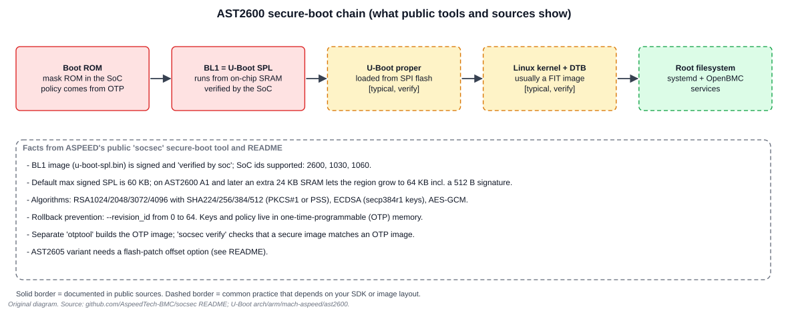
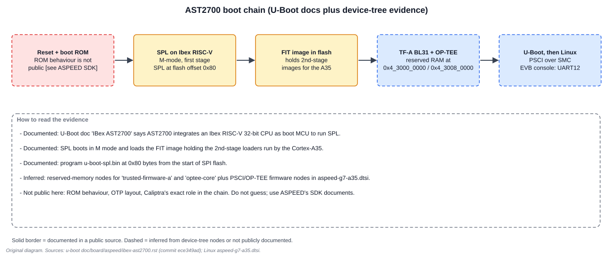

# 4. Boot, Security and Software

Hardware you cannot boot is only silicon. This chapter follows the first instructions executed on each chip, what verifies them, and which public software supports the parts.

## 4.1 AST2600: a verified first stage



ASPEED publishes a Python tool, `socsec`, that builds the signed first-stage image. Its README is the best public description of what the AST2600's boot hardware checks.

**Documented facts from the `socsec` README:**

| Fact | Detail |
| --- | --- |
| What is verified | the "BL1 image (e.g. u-boot-spl.bin), which will be verified by soc" |
| Supported SoC ids | `2600`, `1030`, `1060` |
| Size limit | by default socsec signs SPL images up to 60 KB, because historically the top of SRAM held the SPL stack |
| AST2600 A1 and later | an extra 24 KB of SRAM can hold the stack, so the verification region can use the whole 64 KB including a 512-byte signature |
| Algorithms | RSA 1024/2048/3072/4096 with SHA-224/256/384/512; RSA padding PKCS#1 or PSS; ECDSA with secp384r1 keys; AES-GCM |
| Rollback prevention | `--revision_id`, 0 to 64 |
| Key storage | keys and policy are set in one-time-programmable (OTP) memory; `otptool` builds the OTP image |
| Checking | `socsec verify` checks that a secure image and an OTP image are consistent |
| Optional encryption | AES encryption of part of the image ("mode 2"), with the AES key in OTP or wrapped by an RSA key |
| Variant | the AST2605 needs a flash-patch offset option |

**What that tells you about the hardware (inferred from the README).** The first stage lives in SRAM: the boot ROM loads a bounded region, checks its signature against keys programmed in OTP, and only then jumps to it. The signed region is small on purpose because the SRAM is small. Everything after that (U-Boot proper, kernel, rootfs) is verified by software the first stage starts, not by the ROM, so a secure product needs a second link in the chain.

**Three consequences:**

1. **You cannot simply grow SPL.** A 64 KB ceiling (60 KB on older parts) is a hard design limit. Features move to the second stage.
2. **OTP is irreversible.** One-time-programmable bits cannot be rewritten. Programming OTP on a board is a process step with its own approvals, not a bench experiment.
3. **Rollback needs a revision number.** The `--revision_id` field exists so a vulnerable but correctly signed old image cannot be reinstalled.

## 4.2 AST2700: a boot MCU before the application cores



U-Boot's `doc/board/aspeed/ibex-ast2700.rst` is short but important. It says:

- "AST2700 integrates an IBex RISC-V 32-bits CPU as the boot MCU to execute the first stage bootloader, namely SPL."
- "The U-Boot SPL will boot in M mode and load the FIT image which includes the 2nd stage bootloaders executed by the main processor Cortex-A35."
- Build with `make ibex-ast2700_defconfig`, and program `u-boot-spl.bin` at offset `0x80` of the SPI flash.

**Fitting that to the device tree.** The A35 device tree reserves `0x4_3000_0000` (512 KiB) for TF-A and `0x4_3008_0000` (16 MiB) for OP-TEE and declares PSCI and OP-TEE over SMC. So after SPL, the intended order is: second-stage loaders from the FIT image, TF-A BL31 at EL3, OP-TEE, U-Boot, then Linux. The [TF-A textbook](../Trusted_Firmware_A_Textbook/01_Boot_Stages_and_Handoffs.md) explains those stages. This order is **inferred** from the device tree and the FIT note, not stated end to end in one public document.

**What is not public here:** the boot ROM's behaviour, the OTP layout, and exactly where Caliptra sits in the chain. Do not fill those gaps with guesses. They affect your security design, so take them from ASPEED's SDK documents.

## 4.3 Why a RISC-V core first?

The public sources do not give a reason. Reasonable observations, labelled as such:

- A small boot core keeps the large, complex A35 cluster out of the earliest trust path (inference).
- Debugging changes: the first stage needs a RISC-V toolchain (ASPEED's `riscv-gnu-toolchain` fork is in its GitHub organisation), and your JTAG or trace tools must support it.
- The binding names it **BMCU**, with its own interrupt controller (APLIC) fed from INTC1, so it can also be a running processor, not just a boot stub (documented in the binding).

## 4.4 The software map

| Layer | AST2600 | AST27x0 |
| --- | --- | --- |
| First stage | U-Boot SPL (`arch/arm/mach-aspeed/ast2600/spl.c`) | U-Boot SPL on the RISC-V boot MCU (`ibex-ast2700_defconfig`) |
| Second stage | U-Boot proper | FIT image holding A35 loaders (TF-A, OP-TEE, U-Boot) |
| U-Boot SoC support | `arch/arm/mach-aspeed/ast2600` | `arch/arm/mach-aspeed/ast2700` (`lowlevel_init.S`, `arm64-mmu.c`, `platform.c`) |
| Linux device trees | `arch/arm/boot/dts/aspeed/aspeed-g6.dtsi`, `aspeed-ast2600-evb.dts` | `arch/arm64/boot/dts/aspeed/aspeed-g7-a35.dtsi`, `-soc0.dtsi`, `-soc1.dtsi`, `ast2700-evb.dts` |
| Microcontroller firmware | embedded Cortex-M3 | SSP and TSP Cortex-M4; ASPEED publishes Zephyr, mcuboot and Hubris repositories |
| Root of trust | SBC + OTP | Caliptra |
| Distribution | OpenBMC and ASPEED's SDK | OpenBMC and ASPEED's SDK |

**Mainline Linux coverage (snapshot).** The AST2700 device-tree files read contain nodes for the CPU complex, GICv3, INTC0/INTC1, SCUs, pinctrl, GPIO, SGPIO, UART, watchdog, mailbox, FMC and SPI, MDIO, SD/eMMC, PWM/TACH, ADC, FSI, USB 2.0 and SRAM. They contain no nodes for I2C, I3C, Ethernet MACs, eSPI, PCIe, UFS, CAN or video. Bindings exist for the PCIe root complex and the USB 3 xHCI, so the gap is narrowing. Check `git log` for the files before assuming. If your board needs those blocks today, use ASPEED's SDK kernel.

**ASPEED's public repositories** (GitHub organisation `AspeedTech-BMC`) include forks of OpenBMC, Linux and U-Boot, `socsec` and `fmc_imgtool` (an FMC image generator), `caliptra-sw`, `caliptra-mcu-sw` and `cptra_imgtool`, Zephyr and mcuboot forks, `cerberus`, `hubris`, and Rust crates named `ast1060-pac` and `ast1080-pac` (by name, peripheral-access crates). Repository existence does not imply that a given feature is supported on your part number.

## 4.5 Debugging notes by layer

| Symptom | First boundary to check |
| --- | --- |
| No output at all | power, reset, strap and console wiring; boot ROM cannot find or verify a valid first stage |
| Output stops after SPL | DRAM initialisation or loading the next stage (FIT or U-Boot image) |
| U-Boot prints, kernel silent | kernel command line console, device-tree `stdout-path`, UART pin mux |
| Kernel boots, a peripheral is missing | device-tree node, pinctrl group, clock gate in the SCU |
| Interrupt storm or no interrupt | INTC routing and hwirq number (AST2700); GIC/SCU controller (AST2600) |
| Works on one board, not another | board strap, flash layout, reserved-memory carve-out |

The [Linux kernel debugging textbook](../Linux_Kernel_Debugging_Textbook/00_README.md) covers the kernel-side tools.

## 4.6 Read-only lab: confirm the platform from a running BMC

Run these on a lab BMC you are authorised to inspect. They only read state.

```sh
cat /proc/device-tree/model
cat /proc/device-tree/compatible | tr '\0' '\n'
dmesg | grep -i -E 'aspeed|ast2[0-9]00' | head -n 40
grep -i -E 'aspeed|e60|e78|e7a' /proc/iomem | head -n 60
cat /proc/interrupts | head -n 40
ls /sys/bus/soc/devices/ 2>/dev/null
```

What to do with the output:

1. Compare each `/proc/iomem` entry's start address with the address-map figures in Chapters 2 and 3. Every entry should land on a base from the table.
2. On an AST2700, check that the console UART's address is `0x14C3_3x00` for the chosen UART (UART12 is `0x14C3_3B00`).
3. Note any block you expected that is **absent**. Then decide whether the hardware lacks it, the device tree lacks it or the driver failed to bind.

Minimal tools may omit `grep -i -E`, `tr` or `dmesg`. Use what your image provides.

## 4.7 Secure-boot hygiene (applies to both chips)

- Generate signing keys on controlled infrastructure. Never commit a private key, an AES key or an OTP image containing key hashes to a source repository. `socsec` supports an external signing helper so the private key stays in an HSM.
- Keep development and production keys distinct. A board fused with a development key hash cannot be re-keyed.
- Record, for every released image, its `revision_id`, the key identifier, the OTP configuration it targets and the digest of the signed first stage.
- Use `socsec verify` (AST2600) or the verification tool in ASPEED's SDK for your part before shipping.

## Exercises

**1. Why does the AST2600's first stage have a size limit?** Because the boot ROM verifies and runs it from on-chip SRAM, and the same SRAM holds its stack on older parts. The signed region must fit alongside the stack, giving the 60 KB default; A1 silicon's extra 24 KB lets it grow to 64 KB including the 512-byte signature.

**2. On an AST2700, who loads the Cortex-A35's first instruction?** SPL on the RISC-V boot MCU loads a FIT image whose second-stage loaders the A35 runs. The A35 does not start until the boot MCU has done that.

**3. A bring-up note says "SPL flashed at offset 0". What does the U-Boot doc say?** It says to program `u-boot-spl.bin` at offset **0x80** from the start of the SPI flash. A different offset needs a different image layout from ASPEED's tools.

**4. Why is `--revision_id` important to a vendor shipping a security fix?** It lets the SoC refuse older signed images, so an attacker cannot downgrade to the vulnerable but correctly signed release.

## Review

- Which public document states the AST2700 boot MCU is RISC-V? **Answer:** upstream U-Boot's `ibex-ast2700.rst`; the Linux interrupt binding also lists BMCU as "a RISC-V microcontroller".
- What is inferred, not documented, about the AST2700 chain? **Answer:** the TF-A, OP-TEE and U-Boot order after the FIT image, and Caliptra's role.
- Which AST2600 block holds the signing keys' policy? **Answer:** OTP memory, read by the secure-boot hardware.

Next: [Chapter 5: Bring-up labs and reference](05_Bringup_Labs_and_Reference.md)
