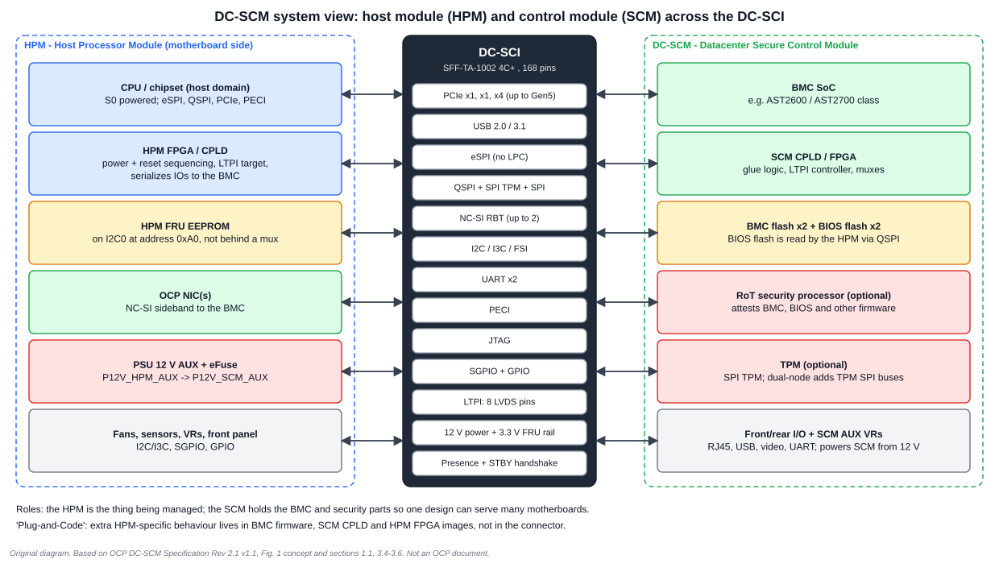
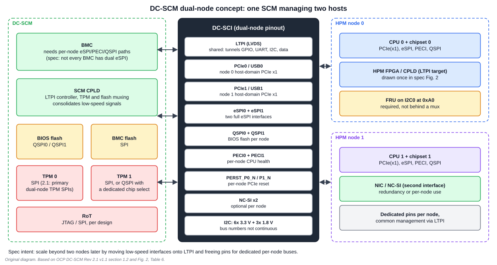

# 1. Architecture and Roles

## 1.1 Why DC-SCM exists

Before DC-SCM, every server motherboard carried a BMC, its flash, its security chips and its management wiring, all designed from scratch for that board. A change to the BMC or its security meant respinning the motherboard, which is large and complex.

The DC-SCM specification moves the management and security parts onto a small module. The spec states the benefits directly: common management and security can be deployed across a higher percentage of platforms; management and security upgrades can be deployed within a platform generation without redesigning the more complex components; and customer-specific solutions can be removed from motherboards.

## 1.2 The four terms

| Term | Meaning |
| --- | --- |
| **HPM** | Host Processor Module. Whatever is being managed: "the traditional CPU-memory complex but with the BMC and Security moved to the SCM". It is not limited to a standard processor architecture. |
| **HPM FPGA** | A programmable device on the HPM. Its main jobs are system power and reset control and serialising/de-serialising IOs between the HPM and the BMC. |
| **DC-SCM** (often SCM) | The Datacenter Secure Control Module itself. |
| **DC-SCI** | The Datacenter Secure Control Interface: the connector interface between the SCM and the HPM. |

## 1.3 What is on a DC-SCM

The specification's architecture lists these elements.

| Element | Role |
| --- | --- |
| BMC | specialised service processor monitoring the server's physical state |
| BMC flash | one or more devices holding BMC firmware |
| BIOS flash | one or more devices holding BIOS firmware, one per node |
| SCM CPLD | programmable logic with application-specific logic and the optional LTPI interface |
| RoT security processor | optional; attests BMC, BIOS and other firmware |
| TPM | optional dedicated chip holding cryptographic keys |

Note how the host reaches the BIOS flash: the **HPM is the initiator** on a QSPI bus whose flash devices live on the SCM. So the BMC can program, check and recover the firmware that the host executes, and a RoT can attest it, without the motherboard being involved.

## 1.4 Single node and dual node

The long-term goal stated in the specification is more than two independent nodes per module. Revision 2.x focuses on single-node and dual-node pin definitions. In the dual-node arrangement:

- low-speed interfaces are **consolidated over LTPI**, which frees pins;
- the freed pins carry interfaces dedicated to each socket: PCIe, eSPI and SPI, with per-node PERST (`PERST_P0_N`, `PERST_P1_N`), QSPI, PECI and optional NC-SI;
- the spec cautions that the dual-node diagram shows general connectivity options, **not** existing capabilities (for example, BMCs that have dual eSPI).

That caution matters: a connector that can carry two eSPI buses does not mean your BMC SoC has two eSPI controllers.

## 1.5 Plug-and-Code

The specification supports maximum electrical and mechanical interoperability, but leaves many signal allocations open. Full electrical interoperability needs an additional "design specification" aligning a specific HPM and SCM. With such a design specification, a model it calls **Plug-and-Code** is possible: multi-vendor HPM/DC-SCM interoperability through changes to **BMC firmware, DC-SCM CPLD and HPM FPGA firmware**, rather than hardware changes.

The practical meaning: the connector is standard but behaviour is firmware. Two cards that fit the same slot are not necessarily compatible, and the way the specification expresses this is the HPM FRU record read at boot (Chapter 4).

## 1.6 Interoperability: what a motherboard must still provide

The specification's platform-interoperability table states which interfaces are required and how an HPM terminates an unused one.

| Interface | Required? | If unused on the HPM |
| --- | --- | --- |
| NC-SI | no | no termination |
| eSPI | no | terminate |
| I2C[0] | **yes** (HPM FRU at 0xA0) | 10 kΩ |
| I2C_3V3, I2C_I3C_1V8, I3C[0:1] | no | 10 kΩ |
| SPI / QSPI / SPI_SCMCNTRL | no | none |
| USB, PCIe TX/RX, PCIe clock | no | none |
| PECI, PECI_VREF | no | PECI_VREF: connect to 1.0 V (S0) |
| UART[0:1], JTAG, battery | no | none |
| STBY boot sequence signals | **yes** | n/a |
| PRSNT[0:1] | **yes** | n/a |

Only three things are mandatory on the HPM: the FRU on I2C0, the STBY boot-sequence signals and the presence pins. Everything else is optional, which is why a very simple HPM can host a DC-SCM.

## Worked exercises

**1. A designer wants a second host's BIOS flash on the SCM. Which bus does the host use to read it?** A QSPI bus where the HPM is the initiator (`QSPI_HPMCNTRL`). A dual-node design provides two such buses.

**2. A dual-node connector carries two eSPI buses. Is a BMC with one eSPI controller compatible?** The connector allows it; whether this BMC can serve two nodes is a SoC capability question. The spec's note says the figure is not indicative of existing BMC capabilities.

**3. Name the three mandatory HPM-side items.** FRU EEPROM on I2C0 at 0xA0; the STBY boot-sequence signals; the two presence pins.

## Review

- What does the SCM do that the HPM does not? **Answer:** it holds the BMC, firmware flash, optional RoT and TPM and drives the boot-sequence handshake.
- What does "Plug-and-Code" change in a deployment? **Answer:** it moves HPM-specific behaviour into firmware images (BMC, SCM CPLD, HPM FPGA) instead of hardware changes.

Next: [Chapter 2: Mechanical and connector](02_Mechanical_and_Connector.md)
