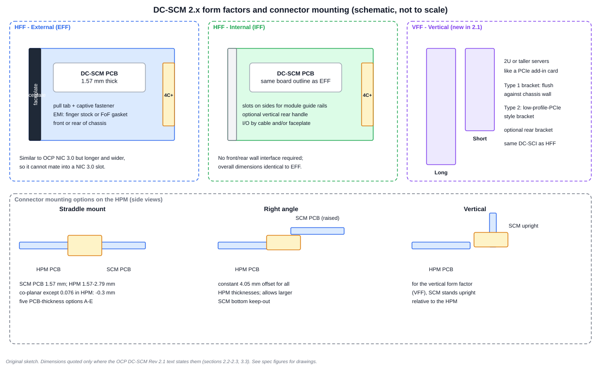
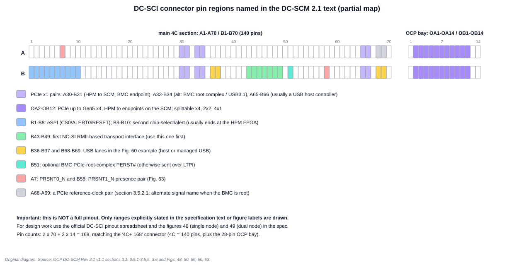

# 2. Mechanical Form Factors and the Connector

*The sketch is schematic and not to scale. Dimensions are quoted here only where the specification's text states them; the specification's drawings (its Figures 3-47) are the authority.*

## 2.1 The horizontal form factor (HFF)

The DC-SCM 2.x horizontal form factor resembles the OCP NIC 3.0 card, deliberately altered so the two cannot be confused.

- It is **longer and wider** than an OCP NIC 3.0, so a DC-SCM cannot enter a NIC 3.0 slot.
- The card-edge **key slot is shifted by 3.25 mm**, so neither an OCP NIC 3.0 module nor a DC-SCM 1.0 module can mate electrically in a DC-SCM 2.x slot.
- The connector is a **SFF-TA-1002 compliant 4C+**: a 4C connector with an extra 28-pin "OCP bay" defined in the OCP NIC 3.0 specification.
- The PCB is **1.57 mm (0.062 in) thick**.
- **DC-SCM 2.x cards are not backwards compatible with DC-SCM 1.0 cards.**

That pairing of keying, size and connector is why you can mix a NIC and a DC-SCM in one chassis without the risk of inserting one in the other's slot.

### Two usages of the HFF

| Variant | Where it goes | Features |
| --- | --- | --- |
| **EFF** External Form Factor | front or rear wall of the server; inserted and removed from outside | faceplate bracket; pull tab and captive fastener on each side of the bracket; front-panel interfaces may live on the card |
| **IFF** Internal Form Factor | embedded inside the server, with no direct front/rear interface, or with an internal latch | I/O by faceplate, cable or both; optional vertical rear handle for insertion and extraction |

The IFF's overall dimensions are **identical to the EFF**. The board outline has slots on each side so IFF modules can use module guide rails.

### Locking and retention features on the board outline

- Two small notches, one on each side edge, provide the same locking features as the OCP NIC 3.0 board. A baseboard may use one or both for an internal lock; if it does, the card can only be inserted or removed after actuating the lock.
- Two additional, wider side notches retain the module when the card and baseboard are assembled onto a tray before they go into the chassis. Guide rails have hook/slot features that engage them.

### EMI, insulation, rails and chassis opening

The specification also defines two EMI solutions (metal finger stock around the faceplate, or a fabric-over-foam gasket), HFF insulation requirements, module guide-rail dimensions and the chassis bay opening. A server designer needs those to ensure a front-mounted card does not leak emissions; a firmware engineer can skip them.

## 2.2 The vertical form factor (VFF), new in 2.1

The vertical form factor is for **2U or taller servers**, where the module is installed upright at the chassis front or rear wall, "similar to a PCIe AIC card". Standard front-panel interfaces are on the card and cables are used as needed.

| Property | Detail |
| --- | --- |
| Board depths | a **Short VFF** and a **Long VFF**; identical apart from length |
| PCB thickness | 1.57 mm for both |
| Faceplate bracket | **Type 1**: mounted flush against the inner surface of the chassis wall. **Type 2**: similar dimensions to a low-profile PCIe card, to sit beside low-profile PCIe cards using PCIe bracket features |
| Rear bracket | optional rear support bracket |
| Bracket sharing | Short and Long cards use the same faceplate bracket design |
| Connector | a **vertical** connector on the HPM (see below) |

In the 2.0 drafts, the VFF was only a placeholder: a note says it would be defined in a later version. Revision 2.1 adds Section 2.3, "Vertical Form Factor", with the dimensions, keep-out zones, brackets, chassis opening and EMI components. This is the largest single mechanical difference between 2.0 and 2.1 (Chapter 6).

## 2.3 Connector mounting options on the HPM

The SCM's gold fingers mate with a connector soldered to the HPM. The specification defines three styles.

| Style | Intended for | Key facts |
| --- | --- | --- |
| **Straddle mount** | coplanar SCM and HPM | SCM PCB must be 1.57 mm; HPM PCB may be 1.57-2.79 mm; thickness controlled to ±10%; five options A-E |
| **Right angle** | increased SCM bottom-side keep-out | constant **4.05 mm** offset regardless of HPM thickness |
| **Vertical** | the VFF | SCM stands upright relative to the HPM |

### Straddle-mount thickness table

| Option | SCM PCB | HPM PCB | Offset of SCM relative to HPM |
| --- | --- | --- | --- |
| A | 0.062 in (1.57 mm) | 0.062 in (1.57 mm) | coplanar (0 mm) |
| B | 0.062 in | 0.076 in (1.93 mm) | **-0.3 mm** |
| C | 0.062 in | 0.093 in (2.36 mm) | coplanar |
| D | 0.062 in | 0.105 in (2.67 mm) | coplanar |
| E | 0.062 in | 0.110 in (2.79 mm) | coplanar |

The 0.076 in HPM thickness is the odd one: it needs a −0.3 mm offset. HPM designers choose the stack-up first, then pick the connector option. The offset matters because it changes where the card's faceplate lands relative to the chassis opening.

## 2.4 The connector: 168 pins in two parts

The "4C+" connector has two parts, and the numbers reconcile:

| Part | Pins | Count |
| --- | --- | --- |
| 4C main section | A1-A70 and B1-B70 | 2 × 70 = 140 |
| OCP bay | OA1-OA14 and OB1-OB14 | 2 × 14 = 28 |
| **Total** | | **168** |

The figure draws only the pin ranges the specification text or figure labels name explicitly. It is not a full pinout. Use the specification's pinout diagrams (Figures 48 and 49, for single and dual node) and its pinout spreadsheet for design work.

**How to read the highlighted ranges (from the specification text):**

- **B1-B8** carry the eSPI bus (CS0, ALERT0, RESET). **B9-B10** provide a second chip-select and alert, usually terminated at the HPM FPGA.
- **A30-B31** and **A65-B66** are the two PCIe x1 pairs from the HPM to the SCM: the first typically connects to the BMC as a PCIe endpoint (video, MCTP over PCIe VDM, memory-mapped devices); the second usually feeds a USB host controller.
- **A33-B34** have three mutually exclusive uses: the BMC as a PCIe root complex, a host-domain x1 back to the HPM, or USB 3.1.
- **OA2-OB12** are the PCIe up-to-Gen5 x4 from the HPM to endpoints on or behind the SCM, splittable as x4, 2×x2 or 4×x1.
- **B43-B49** are the first NC-SI interface; use the first instance if you only need one.
- **B51** is an optional BMC PCIe-root-complex PERST#.
- **A7** and **B58** are the presence pair.

The mutually-exclusive uses show a theme: the connector reserves pins, and the SCM and HPM designs jointly decide what rides on them. That is why the FRU-based discovery in Chapter 4 exists.

## 2.5 Regulatory compliance

Every mechanical board assembly has to meet the safety requirements in the specification's Section 7, which covers environmental compliance, EMC, product safety and ESD immunity, with recommended compliance items listed separately. Plan test time for these when building a first spin.

## Worked exercises

**1. Why can't a DC-SCM 2.1 card be inserted into an OCP NIC 3.0 slot?** It is longer and wider than a NIC 3.0, and its card-edge key slot is shifted 3.25 mm, which prevents electrical mating by design. Both features are intentional.

**2. An HPM uses a 0.076 in (1.93 mm) PCB with a straddle connector. What offset applies?** −0.3 mm.

**3. Does a right-angle connector's offset change with HPM thickness?** No, it is a constant 4.05 mm.

**4. How many connector pins are in the OCP bay, and which pins carry the PCIe x4?** 28 pins (OA1-OA14 and OB1-OB14). The x4 uses OA2-OB12.

**5. A designer asks whether a vertical DC-SCM can be used in a 1U server.** The specification positions the VFF for 2U or taller servers installed like a PCIe add-in card. A 1U chassis would need a horizontal form factor.

## Review

- Which form factor is new in 2.1? **Answer:** the vertical form factor, in short and long versions.
- What are the two HFF usages? **Answer:** external (EFF) and internal (IFF).
- Which three connector styles exist? **Answer:** straddle mount, right angle and vertical.

Next: [Chapter 3: DC-SCI signals](03_DC_SCI_Signals.md)
