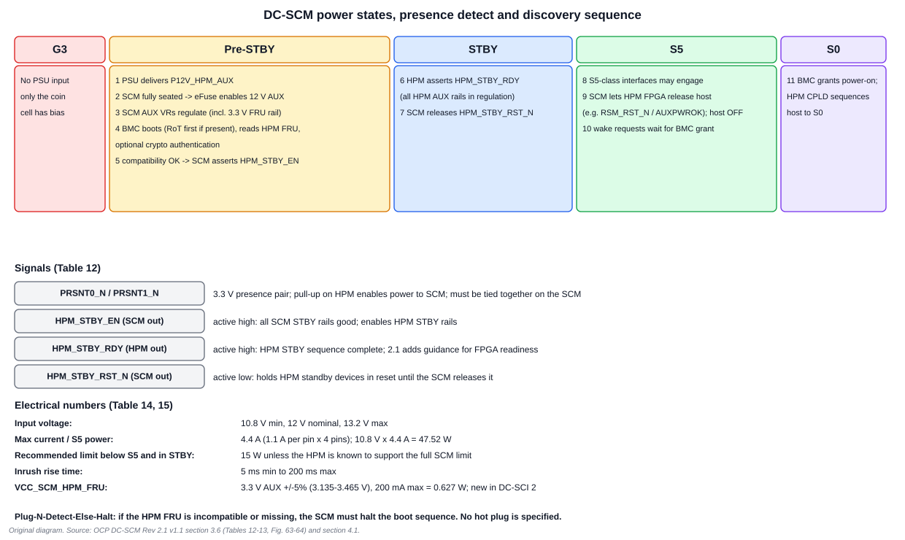

# 4. Power, Boot Sequence and the HPM FRU

## 4.1 Power states and the discovery sequence

Every DC-SCI signal is assigned a **minimum power state** in which bias is allowed. The common nomenclature:

| State | Meaning |
| --- | --- |
| G3 | no PSU input; only the coin cell has bias |
| Pre-STBY | PSU AUX power is delivered and the SCM boots enough to inspect the HPM |
| STBY | HPM AUX rails are good and the standby devices are out of reset |
| S5 | host off, standby devices on |
| S0 | host fully on |

*Revision 2.1 removed the "Pre-S5" terminology and uses STBY, to match the DC-SCI pinout spreadsheet.*

### The eleven steps

The specification gives a "typical boot flow" it advises against bypassing when interoperability matters.

| # | State | Step |
| --- | --- | --- |
| 1 | Pre-STBY | PSU input power delivers `P12V_HPM_AUX` |
| 2 | Pre-STBY | the DC-SCM, once fully seated, enables the HPM eFuse (if present), powering the SCM |
| 3 | Pre-STBY | SCM AUX voltage regulators regulate, including `VCC_SCM_HPM_FRU` |
| 4 | Pre-STBY | the SCM BMC boots (after a discrete RoT, if any) far enough to **read the I2C HPM FRU (required)** and optionally perform HPM crypto authentication |
| 5 | Pre-STBY | if compatibility passes, the SCM asserts `SCM_HPM_STBY_EN` |
| 6 | STBY | the HPM asserts `HPM_SCM_STBY_RDY` when all HPM AUX rails are in regulation |
| 7 | STBY | the SCM de-asserts `SCM_HPM_STBY_RST_N` |
| 8 | S5 | S5-classified interfaces may engage; `SCM_HPM_STBY_RST_N` can qualify them |
| 9 | S5 | the SCM allows the HPM FPGA to enable the host CPU/chipset (for example de-assert `RSM_RST_N` or assert `AUXPWROK`); the host enters S5 (off) |
| 10 | S5 | host wake requests vary; host power-on is typically blocked until the BMC grants it |
| 11 | S0 | the BMC grants power-on; the HPM CPLD sequences the host to S0 |

**Why steps 4-5 matter.** The SCM refuses to enable HPM standby power until it has read and accepted the HPM's identity. If the FRU is incompatible or never detected, the SCM must halt the boot sequence to avoid possible electrical stress. The spec calls this **"Plug-N-Detect-Else-Halt"**. It is a protective design: a mismatched card pair never gets a chance to damage itself.

**Step 10's meaning.** A BMC blocks host power-on until it has finished its security services, such as checking BIOS flash contents. This is what lets the BMC be the gatekeeper for the host's first instruction.

## 4.2 The presence and handshake signals

| Signal | Direction | Voltage | Description |
| --- | --- | --- | --- |
| `PRSNT0_N` | HPM output | 3.3 V | must connect to `PRSNT1_N` on the DC-SCM; pulled up on the HPM and used to enable power to the SCM |
| `PRSNT1_N` | HPM input | 3.3 V | must connect to `PRSNT0_N` on the SCM; grounded on the HPM |
| `HPM_STBY_EN` | SCM to HPM | 3.3 V | active high; all SCM STBY rails enabled and good; enables HPM STBY rails |
| `HPM_STBY_RDY` | HPM to SCM | 3.3 V | active high; HPM STBY power sequence complete and all STBY rails good |
| `HPM_STBY_RST_N` | SCM to HPM | 3.3 V | active low; holds HPM standby devices in reset until the SCM releases it |

The presence pair works like a loop-back: the card connects the two pins; a pull-up on the HPM then reads low only when a card is fully seated; that signal enables a protective eFuse feeding the SCM's 12 V AUX. The spec recommends the HPM disables AUX power to the DC-SCM when presence is not detected. It allows excluding the eFuse only if the DC-SCM is locked with screws or other mechanical means.

**No hot plug.** The DC-SCM is **not specified for hot insertion or removal**. The HPM should provide inrush control to protect the circuitry from damaged connector pins or accidental removal, and all DC-SCI I/O pull-ups should be on the HPM to avoid voltage leaks between the two.

**2.1 guidance on `HPM_STBY_RDY`.** A system that wants to use this pin as an FPGA-readiness indication should treat the HPM FPGA's start-up as part of the standby sequence (June 2024 clarification).

## 4.3 Electrical limits

| Parameter | Min | Nominal | Max |
| --- | --- | --- | --- |
| Input voltage | 10.8 V | 12.0 V | 13.2 V |
| Input current | n/a | n/a | 4.4 A (1.1 A per pin × 4 pins) |
| Input power in S5 | n/a | n/a | 47.52 W (10.8 V × 1.1 A × 4) |
| Input power below S5 | n/a | n/a | 15 W *recommended* |
| Inrush rise time | 5 ms | n/a | 200 ms |

The maximum includes connector temperature, age, noise/ripple and dynamic loading. The per-pin rating is already derated.

**The 15 W recommendation.** For DC-SCM/HPM compatibility, limit maximum power to 15 W in every state below S5, including STBY. This is not enforced if the HPM is known to support the full SCM power limit in those early states. It exists because the SCM's maximum exceeds many PSUs' AUX rail capability.

**`VCC_SCM_HPM_FRU`.** New in DC-SCI 2: a 3.3 V AUX supply sourced by the SCM to power the HPM FRU and optional circuits such as an authentication IC.

| Parameter | Min | Nominal | Max |
| --- | --- | --- | --- |
| Voltage | 3.135 V (-5%) | 3.3 V AUX | 3.465 V (+5%) |
| Current | n/a | n/a | 200 mA |
| Power | n/a | n/a | 0.627 W (3.135 V × 200 mA) |

The 200 mA limit is set for budget reasons, not the pin's current rating. It means the SCM can read the HPM's identity before the HPM's own power is on, which makes the early discovery step possible.

**Relaxation.** If HPM and SCM type discovery establishes specific hardware-interface compatibility and complete circuit awareness, the earliest permitted power state of a given signal may be relaxed. Revision 2.1 relaxed the early-power-state requirement in this way (Chapter 6).

## 4.4 The HPM FRU

The HPM must supply an FRU information device, typically a discrete EEPROM:

- placed **directly on I2C0**, not behind a mux or hub;
- responding **only** to 8-bit target address `0xA0`;
- supporting **2-byte** read/write offsets;
- capacity an even power of two from **256 bytes up to 64 KB** (still using 2-byte offsets);
- write-protected by default, with a recommended method (such as via the HPM FPGA) to override it;
- only reset by a full HPM power cycle, so the **DC-SCM must detect and recover** from bus anomalies like a bus-busy condition from an interrupted transaction.

### The MultiRecord the SCM reads

A MultiRecord Area record on the FRU lets the SCM decide what to do: update its own FPGA or BMC firmware, apply a platform profile, or halt. Record type ID is `0xC1`; the manufacturer ID is OCP's assigned `0x00A67F` (LSB first).

| Offset | Field | Notes |
| --- | --- | --- |
| 0h | Record Type ID | `0xC1` |
| 1h | End-of-list bit, reserved, **Record Format version** | `0000b` = DC-SCM 2.0, `0001b` = DC-SCM 2.1 |
| 2h-4h | length and checksums | per the IPMI FRU specification |
| 5h-7h | Manufacturer ID | OCP assigned `0x00A67F` |
| 8h | OCP HPM FRU OEM Record Version | 01h for the first record |
| 9h-Ah | **DC-SCI Revision** | `02h` for revision 2.*; major and minor bytes |
| Bh | DC-SCI Version | to match the supported DC-SCI |
| Ch-Dh | **LTPI Revision (least supported)** | populate with 00h 00h if not implemented |
| Eh | **LTPI Version (least supported)** | populate with 00h if not implemented |
| Fh | DC-SCM Type | `00h` = none defined; `01h`-`FFh` = HPM common-circuit design spec type |
| 10h-11h | **HPM Vendor ID** | PCI Vendor ID of the HPM maker (new in 2.1) |
| 12h-13h | **HPM Device ID** | assigned by the HPM vendor, starting at 0000h, sequentially; identifies an HPM *product*, not a hardware revision (new in 2.1) |

*Field names are as in the 2.1 text; confirm exact bit layouts in the specification's Table 18/19 before writing a parser. Revision 2.1 uses hexadecimal offsets throughout, and OEM FRU data, if used, begins at byte 32.*

**How an SCM uses it.** At step 4 above, the SCM reads this record and compares the DC-SCI revision/version and the LTPI least-supported revision with what it implements. A match proceeds; a mismatch halts. The `DC-SCM Type` field ties the HPM to a separate "HPM common circuit design" specification, which is how Plug-and-Code HPMs declare their design family.

## Worked exercises

**1. Compute the S5 power limit.** 10.8 V × 1.1 A per pin × 4 pins = 47.52 W.

**2. Compute the maximum FRU-rail power.** 3.135 V × 0.2 A = 0.627 W.

**3. The SCM reads FRU record format `0001b`. Which specification revision does the HPM claim?** DC-SCM 2.1.

**4. A power-on request arrives while the host is in S5. Who decides?** The BMC (SCM). The host power-on request is typically blocked until the BMC grants it.

**5. Why must the pull-ups for DC-SCI I/O be on the HPM?** To prevent voltage leaks between the HPM and a not-yet-powered SCM.

**6. The FRU part is 128 bytes. Is it allowed?** No. Capacity must be a power of two from 256 B to 64 KB (and must support 2-byte offsets).

## Review

- What is "Plug-N-Detect-Else-Halt"? **Answer:** the SCM halts the boot sequence if the HPM FRU is incompatible or undetected.
- Which new 2.0 power pin feeds the HPM FRU? **Answer:** `VCC_SCM_HPM_FRU`, 3.3 V AUX ±5%, 200 mA max.
- Which FRU fields did 2.1 add? **Answer:** HPM Vendor ID, HPM Device ID and the LTPI least-supported revision and version.

Next: [Chapter 5: LTPI](05_LTPI.md)
