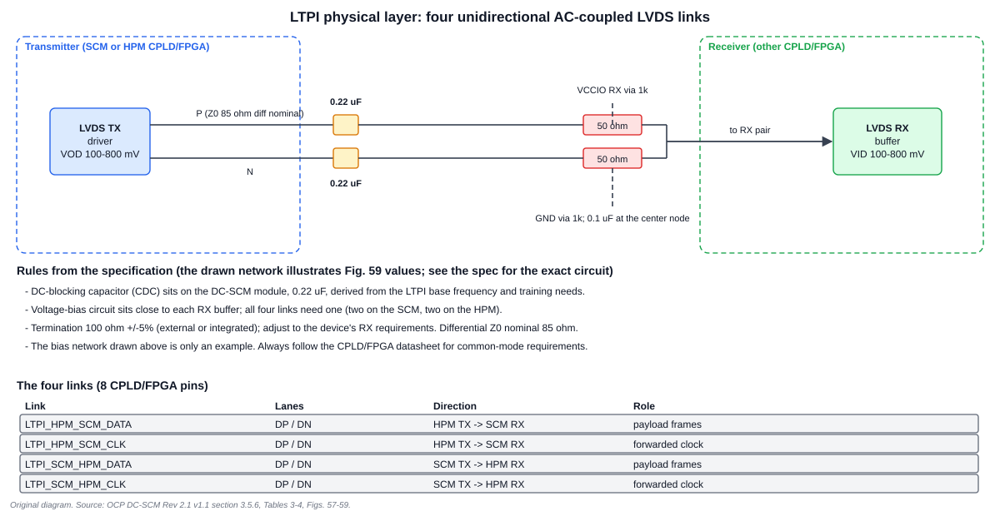
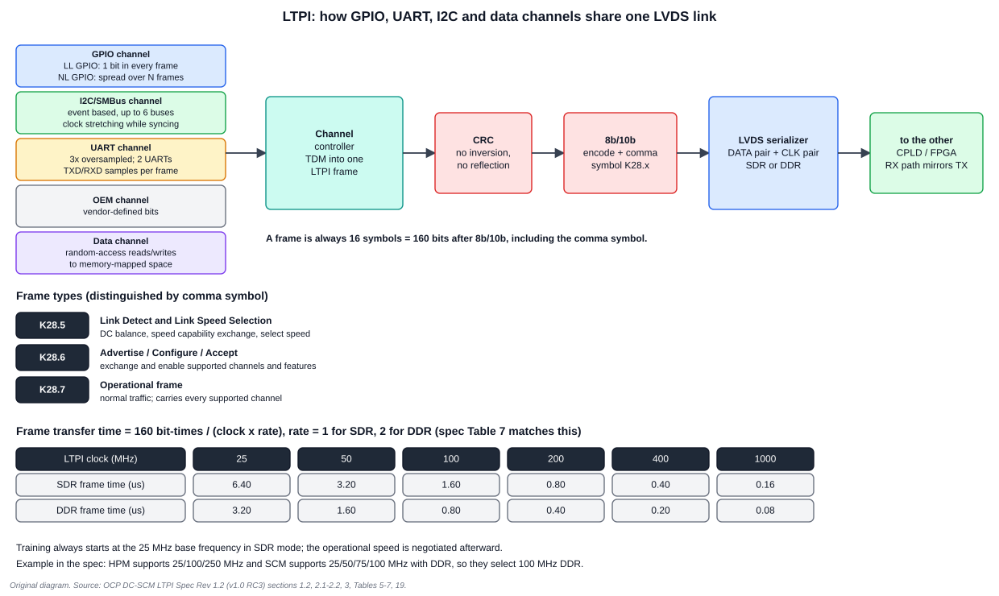
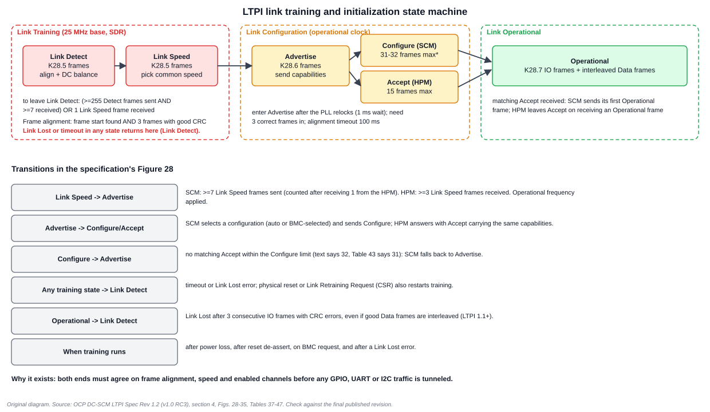

# 5. LTPI: the LVDS Tunneling Protocol and Interface

LTPI is how DC-SCM 2.x squeezes dozens of slow signals through four LVDS wire pairs. It exists because a connector with hundreds of dedicated GPIO, UART, I2C and button signals does not scale to many nodes and many platforms. This chapter explains the electrical layer, the frame format, the channels, link training and error handling, then the open reference IP.

## 5.1 The physical layer: four AC-coupled LVDS links

The DC-SCI uses **8 CPLD/FPGA LVDS differential pins**: four unidirectional links, each a differential pair.

| Link | Direction | Role |
| --- | --- | --- |
| `LTPI_HPM_SCM_DATA` (P/N) | HPM to SCM | payload frames |
| `LTPI_HPM_SCM_CLK` (P/N) | HPM to SCM | forwarded clock |
| `LTPI_SCM_HPM_DATA` (P/N) | SCM to HPM | payload frames |
| `LTPI_SCM_HPM_CLK` (P/N) | SCM to HPM | forwarded clock |

**Electrical rules (spec Tables 3-4 and section 3.5.6):**

| Item | Requirement |
| --- | --- |
| Coupling | AC-coupled, so CPLD/FPGAs with different I/O voltages can interoperate |
| DC-blocking capacitor (CDC) | 0.22 µF, placed on the DC-SCM module; derived from the base frequency and training needs |
| Bias circuit | close to each RX buffer; required on **all four links** (two on the SCM, two on the HPM) |
| Output / input differential swing | VOD and VID 100-800 mV |
| Termination | 100 Ω ±5% (external or integrated), tuned to the RX buffer's requirements |
| Differential impedance | Z0 nominal 85 Ω |

**Why AC coupling?** Many CPLD and FPGA receivers accept only a narrow common-mode range, and the two ends may run at different I/O voltages. A series capacitor passes the signal but blocks DC, and a bias network re-establishes the common mode the receiver needs. The price is that the signal must be **DC balanced**, which is why the link uses 8b/10b coding and why training begins by achieving DC balance.

The bias network in the figure illustrates the example values of the specification's Figure 59. The specification stresses it is an example: always follow the CPLD/FPGA datasheet for the receiver's input requirements. The April 2024 clarification states the common-mode requirement; May 2024 added LVDS Rtt recommendations (Chapter 6).

## 5.2 Channels and frames

LTPI multiplexes **channels** onto one stream of fixed-size frames using time-division multiplexing.

| Channel | How it is captured | Notes |
| --- | --- | --- |
| **GPIO** | sampling | Low-Latency (LL) GPIOs update every frame; Normal-Latency (NL) GPIOs share bits and update across several frames |
| **I2C/SMBus** | event/state detection | synchronous; the relay uses clock stretching while both ends synchronise; up to 6 buses |
| **UART** | sampling at 3× oversampling | two UARTs; flow-control bit in capabilities |
| **OEM** | vendor-defined | tunnel an OEM-specific interface |
| **Data** | random-access requests | reads and writes of memory-mapped space (the reference IP bridges it to an Avalon memory-mapped bus) |

**Every frame is 16 symbols, which is 160 bits** after 8b/10b encoding, including the comma symbol. The frame carries each channel in dedicated bit fields, and a CRC-8 (below).

### Frame types

| Comma symbol | Frame | Used for |
| --- | --- | --- |
| K28.5 | Link Detect and Link Speed Selection | DC balance, speed capability exchange, selecting the speed |
| K28.6 | Advertise, Configure, Accept | exchanging and enabling channels and features |
| K28.7 | Operational | normal operation; carries every supported channel. Data frames interleave with IO frames |

An "unexpected" comma symbol, such as K28.5 during Operational, counts as an error.

### CRC

Each frame carries a **CRC-8** with polynomial x⁸ + x² + x + 1, initial value 0, computed over the whole payload after the comma symbol, **without input inversion and without result inversion or reflection**. The "no inversion, no reflection" wording was added as a clarification (LTPI 1.1 lists it, and the reference IP's v1.05 for the November 2023 interoperability demo mirrors it); an implementation that reflected the CRC would fail against a compliant partner.

## 5.3 Frame time and latency

The base frequency is **25 MHz in single data rate (SDR)** mode, and all implementations must support it. Speeds are multiples of the base (for example ×2 = 50 MHz, ×4 = 100 MHz), and a top bit signals dual data rate (DDR) support.

**Frame transfer time = 160 bit-times ÷ (clock frequency × data-rate factor)**, with factor 1 for SDR and 2 for DDR.

| Clock | SDR frame time | DDR frame time |
| --- | --- | --- |
| 25 MHz | 6.40 µs | 3.20 µs |
| 50 MHz | 3.20 µs | 1.60 µs |
| 100 MHz | 1.60 µs | 0.80 µs |
| 200 MHz | 0.80 µs | 0.40 µs |
| 400 MHz | 0.40 µs | 0.20 µs |
| 1000 MHz | 0.16 µs | 0.08 µs |

These agree with the specification's Table 7 and Table 15.

**Two kinds of latency** affect the tunnelled channels:

- **Constant latency**: the time between the starts of consecutive IO frames, about one frame time when frames are sent back-to-back.
- **Random latency**: extra delay when Data-channel frames interleave IO frames. With a limit of 2 consecutive data frames, worst-case IO latency becomes three frame times (the spec's example at 100 MHz SDR is 4.80 µs).

**What the latency does to each channel:**

| Channel | Effect |
| --- | --- |
| LL GPIO | the constant latency sets the shortest GPIO change LTPI can pass; random latency has no impact |
| NL GPIO | each GPIO's latency is N times the constant latency; interleaved data frames add to it |
| I2C/SMBus | events can take up to 2 frames end to end (about 1 in an optimised CPLD); integrity is unaffected, but end-to-end bandwidth falls |
| UART | constant latency only delays the signal; random latency adds jitter, so cap consecutive Data frames for the chosen speed and baud rate |
| Data | minimum access time is one frame across plus one frame back, plus design-specific logic (out of scope) |

### Normal-latency GPIO arithmetic

The default IO frame has 2 bytes for LL GPIOs and 2 bytes for NL GPIOs, so **B = 16 NL GPIO bits per frame**. With *T* total NL GPIOs, it takes **N = ⌈T / B⌉** frames to refresh all of them. The receiver finds which GPIOs a frame carries from a frame counter: the first GPIO index in the frame is `X = (FrameCounter mod N) × B`. (The specification's encoding table draws one byte of NL bits to keep the example small; the formula uses whatever B the frame allocates.) The NL GPIOs are **virtual** GPIOs; mapping to physical pins is outside LTPI.

*Example: 100 NL GPIOs ⇒ N = ⌈100/16⌉ = 7 frames. At 100 MHz SDR (1.60 µs per frame) every NL GPIO is refreshed within 11.2 µs; at DDR, 5.6 µs.*

### UART arithmetic

A UART's TXD and RXD are sampled three times per frame, so the effective sampling rate is 3 ÷ frame time. A UART needs at least two samples per bit, so the maximum baud rate is about 3 ÷ (2 × frame time). At 25 MHz SDR: 3 ÷ (2 × 6.4 µs) = **234,375 baud**, and at 100 MHz DDR: 3 ÷ (2 × 0.8 µs) = **1,875,000 baud**, matching the specification's Table 7 (which lists standard baud rates beneath those maxima, such as 230,400 and 921,600). The specification calls that table an example, not a requirement.

## 5.4 Link training

Training runs after SCM CPLD and HPM FPGA power loss, after reset de-assertion, on request from an external entity such as the BMC (via a **Link Retraining Request** bit in the CSR), and after a Link Lost error. Its goals: achieve DC balance, exchange speed capabilities, switch to the operational frequency, exchange and enable feature capabilities, then go Operational.

| Phase | State | Clock | What happens |
| --- | --- | --- | --- |
| Link Training | **Link Detect** | 25 MHz SDR | both ends send K28.5 frames until aligned and DC balanced. Needs frame start found **and** 3 correctly-CRC'd frames. Leaves when 255+ Detect frames sent and 7+ received, or one Link Speed frame arrives |
| | **Link Speed** | 25 MHz SDR | each end sends the speeds it supports (multiples of the 25 MHz base, plus a DDR bit); the highest common speed is selected. SCM sends 7+ Link Speed frames (counted after receiving one); HPM must receive 3+ |
| Link Configuration | **Advertise** | operational | capabilities frames (K28.6). Clock reconfigures, so a 1 ms wait lets the PLL lock; needs 3 correct frames; 100 ms alignment timeout |
| | **Configure** (SCM) and **Accept** (HPM) | operational | SCM sends Configure frames with the chosen configuration (auto or BMC-selected); the HPM replies with Accept frames carrying the same capabilities. Max frames sent: Configure 31 (the text says 32), Accept 15 |
| Link Operational | **Operational** | operational | K28.7 IO frames with interleaved Data frames |

**A worked training example (from the specification).** The HPM advertises 25, 100 and 250 MHz plus DDR; the SCM advertises 25, 50, 75 and 100 MHz plus DDR. The highest common speed is 100 MHz with DDR, so both switch to 100 MHz DDR and re-align frames.

**The Advertise/Configure capabilities** (specification Tables 28, 44-45) include which channels are supported, the number of NL GPIOs (a 10-bit field; the example uses 100 = 0x64), enable bits and speed bits for I2C/SMBus buses 0-5 (speed bit 1 = 400 kHz in the example), an Echo-support bit that is always 1 when I2C/SMBus is supported, UART0/UART1 enables, UART flow control and maximum baud rate. The SCM requests a configuration; the HPM accepts only a configuration within its own capabilities.

**The Plug-and-Code link.** The training phase aligns the number of NL GPIOs between SCM and HPM, so a platform's GPIO count can be changed through a CPLD/FPGA image update with no connector change, exactly the "Plug-and-Code" idea.

## 5.5 Errors and link loss

The specification defines two error categories.

1. **Frame Lost.** A CRC failure, or an unexpected frame (invalid comma symbol, a comma that is not expected in the current state, or an invalid frame subtype with a valid comma and CRC). The frame is dropped. Isolated losses are tolerated.
2. **Link Lost.** Consecutive CRC errors, an unexpected frame during training or a timeout. Link Lost **always** leads to retraining.

**Operational-phase rule (LTPI 1.1 and later):** Link Lost is declared after **3 consecutive IO frames** with CRC errors, whether or not correct Data frames are interleaved.

**What a lost frame does to a channel:**

| Channel | Effect of an isolated Frame Lost |
| --- | --- |
| LL GPIO | keeps the previous state; the next good frame updates it |
| NL GPIO | the subset keeps its previous state until the next update (N-1 good frames later) |
| I2C/SMBus | no effect if idle or in a transaction (sporadic loss tolerated); permanent loss triggers Link Lost and the channel returns to Idle after retraining |
| UART | keeps the last samples; permanent loss triggers Link Lost |

**Echo and reliability for I2C/SMBus.** The relay sends events continuously until a new event occurs. The LTPI 1.1 revision requires **Data Echo and Data Received Echo to be sent at least 3 times and received at least once correctly**. These measures keep a start condition from being lost when a frame is.

**Clock compensation (LTPI 1.2).** When one end's clock is slightly faster, the recommended method is to watch RX FIFO utilisation and, if more than one frame is queued, drop the next incoming IO frame. Losing one IO frame is compliant with LTPI 1.x.

## 5.6 Registers and BMC access

The LTPI block exposes **control and status registers (CSR)** that the BMC reads and writes, for example through an I2C-target-to-memory-mapped bridge in the reference design. Examples (the reference list is longer):

| Offset | Register | Content |
| --- | --- | --- |
| 0x04 | Detect Capabilities Local | link-speed capabilities and local LTPI revision; the BMC can override the speed capabilities |
| 0x08 | Detect Capabilities Remote | the partner's capabilities, read-only |
| 0x0C | Platform ID Local | OEM-defined platform ID |

The BMC can also set a **Link Retraining Request**. Note the 1.2 revision renamed "LTPI Version" to "LTPI Revision" in these registers, and the FRU record (Chapter 4) carries the *least supported* LTPI revision and version so the SCM can reject an HPM it cannot talk to.

## 5.7 The open reference IP

OCP publishes a reference implementation: `opencomputeproject/HWMgmt-Module-DCSCM-LTPI` (SystemVerilog under the MIT licence, documentation under CC BY 4.0).

- **Two top modules:** `ltpi_top_controller` (SCM side) and `ltpi_top_target` (HPM side). Example Quartus projects target Intel MAX 10 devices.
- **Parameterisable:** normal-latency GPIOs 1-1024; UART devices 1 or 2; SMBus devices 1 to 6; the data channel with an optional mailbox register interface; a "light" CSR set.
- **Building blocks:** 8b/10b encoder and decoder, SMBus relay controller and target FSMs, a data-channel module, PLL management and a CSR block generated with PeakRDL.
- **Tests:** unit tests written with SVUnit; a published test plan.
- **Revision history:** v1.0 (Aug 2023); v1.05 CRC clarification and a 100 ms Advertise-alignment timeout (Nov 2023 interoperability demo); v1.1 echo requirement; v1.2 extended error handling and "Revision" renaming (Dec 2025, Jan 2026).

The reference IP is a useful reading companion: the spec says what, the SystemVerilog shows exactly how the FSMs behave.

## Worked exercises

**1. How long does one LTPI frame take at 50 MHz DDR?** 160 ÷ (50 MHz × 2) = **1.6 µs**.

**2. What is the maximum UART baud rate through an LTPI link at 400 MHz SDR?** The frame time is 0.40 µs, so about 3 ÷ (2 × 0.40 µs) = 3,750,000 baud (Table 7: 3,750,000), above the usual 921,600 standard limit.

**3. How many frames does it take to refresh 40 NL GPIOs with 16 per frame?** ⌈40/16⌉ = 3.

**4. Two good Data frames and one corrupted IO frame in a row arrive in Operational. Is the link lost?** No: Link Lost needs 3 consecutive IO frames with CRC errors. One bad IO frame is just a Frame Lost.

**5. Why does training start at 25 MHz SDR even if both ends support 1 GHz?** The base frequency is the only speed all implementations must support. Capabilities have to be exchanged before a higher speed can be chosen.

**6. What breaks if an implementation reflects the CRC output?** Every frame fails verification at a compliant partner, so the link never leaves Link Detect.

## Review

- What distinguishes the three frame types? **Answer:** their comma symbols: K28.5, K28.6 and K28.7.
- Which channels are synchronous? **Answer:** I2C/SMBus and the Data channel.
- Who selects the operating configuration? **Answer:** the SCM, either automatically or as chosen by the BMC; the HPM replies with an Accept frame.

Next: [Chapter 6: DC-SCM 2.0 vs 2.1](06_DC_SCM_2_0_vs_2_1.md)
