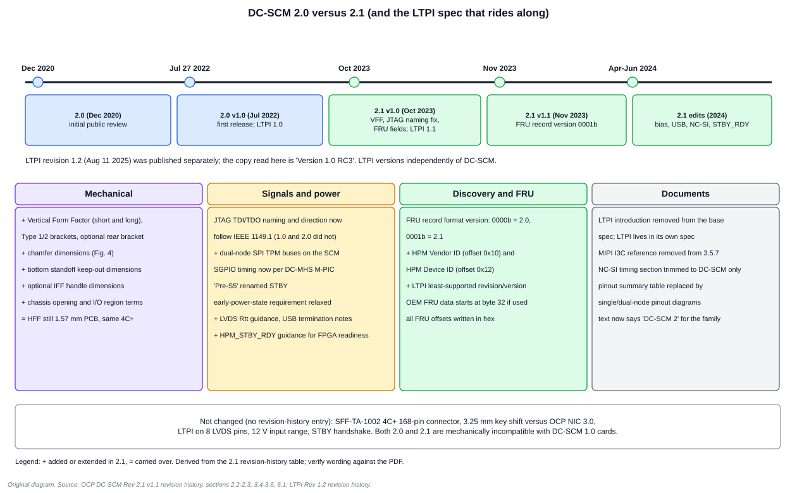

# 6. DC-SCM 2.0 versus 2.1

## 6.1 The short answer

**DC-SCM 2.1 is an evolutionary update of 2.0, not a new connector or a new link.** The card edge, connector, horizontal board, power input and LTPI wiring are carried forward. Revision 2.1 adds a vertical form factor, fixes the JTAG TDI/TDO naming, adds dual-node TPM SPI buses, tightens the HPM FRU record (new record version, vendor and device IDs, LTPI least-supported revision), relaxes an early-power-state rule, adopts the DC-MHS M-PIC timing for SGPIO, and clarifies several electrical details.

## 6.2 How this comparison was built, and its limits

- **Evidence.** The DC-SCM 2.1 document (Revision 2.1, Version 1.1) contains a revision-history table that lists what changed after the 2.0 release (2.0 v1.0, 27 July 2022). I used that table and checked each row against the 2.1 body text.
- **Not read.** I could not retrieve the 2.0 document itself. Anything that did **not** change would not appear in the table, so "unchanged" below means **no revision-history entry**, not a line-by-line comparison.
- **Naming.** OCP documents use a **Revision** (for example 2.1) and a **Version** within it (for example 1.1). The 2.1 text says "DC-SCM 2" for the family. "2.1" in conversation normally means Revision 2.1.
- **Dates.** 2.0 v1.0: July 27, 2022. 2.1 v1.0: October 2023. 2.1 v1.1: November 2023, with further edits in April, May and June 2024.

## 6.3 What changed from 2.0 to 2.1

### Mechanical

| Change | Revision-history entry | Notes |
| --- | --- | --- |
| **Vertical Form Factor added** | "Section 2.3 - added Vertical Form Factor information section" (v1.0) | In 2.0 drafts it was only a placeholder note that VFF would be defined later. 2.1 defines short and long VFF, Type 1/2 brackets, optional rear bracket, chassis opening, EMI components, and a vertical connector |
| Chamfer dimensions | "Figure 4 - add chamfer dimensions" | HFF top-view drawing |
| Bottom standoff keep-outs | "Figure 5 - added dims for bottom standoff translational KOZs" | HFF bottom-view drawing |
| Optional handle, IFF wording, chassis opening and I/O region | v1.1 (Nov 2023) | references to optional handle dimensions, clearer IFF definition, new definitions |

### Electrical and signals

| Change | Entry | Why it matters |
| --- | --- | --- |
| **JTAG TDI/TDO naming and direction** now follow IEEE 1149.1 (relative to the target) | "Added note on DC-SCI 2.1 change related to JTAG"; "3.5.14 added reference to IEEE 1149.1" | The spec says 1.0 and 2.0 "did not follow" the IEEE definition; 2.1 fixed it. A **naming and direction trap** when mixing revisions |
| **Dual-node TPM SPI** | "3.5.3 update dual node SPI TPM description"; "Figure 2 add 2 × TPM in dual node diagram" | 2.1 adds two SPI interfaces as the primary function for TPMs placed on the SCM; QSPI with a dedicated TPM chip select remains an alternative |
| **SGPIO timing per DC-MHS M-PIC** | "3.5.15.1 added SGPIO Timing Requirements as specified in M-PIC" | 5-25 MHz, 45-55% duty, etc. |
| **Early power-state requirement relaxed** | "3.5.15 - relaxing early power state requirement" | If discovery shows hardware compatibility and complete circuit awareness, a signal's earliest permitted power state may be relaxed |
| **"Pre-S5" renamed STBY** | "Remove Pre-S5 terminology, replaced with STBY" | matches the pinout spreadsheet |
| LVDS termination guidance | April 2024: "Table 4 - added LVDS Rtt recommendations"; "3.5.6 LTPI voltage bias clarification" | Fig. 59 became an example implementation |
| USB termination notes | May 2024: "3.5.9.2 added notes for USB termination recommendations" | |
| `HPM_STBY_RDY` guidance | June 2024: "Table 12 - HPM_STBY_RDY signal clarification" | treat HPM FPGA start-up as part of the standby sequence if using the pin for FPGA readiness |
| NC-SI timing section | May 2024: "Section 5.1 - remove duplicate information from the OCP NIC specification" | now DC-SCM-only timing |

### Discovery and the HPM FRU

| Change | Entry | Why it matters |
| --- | --- | --- |
| **Record Format version** | "Update Record Format Version to 0001 for DC-SCM 2.1" | `0000b` = 2.0, `0001b` = 2.1 |
| **HPM Vendor ID and HPM Device ID** | "6.1 - Table 19, add offset 16 HPM Vendor ID, add offset 18 HPM Device ID" | the record is longer; vendor ID is a PCI Vendor ID |
| **LTPI least-supported revision and version** | "LTPI Rev: add Least supported Revision; LTPI Ver: add Least supported Version" | lets the SCM judge LTPI compatibility before bringing the link up |
| OEM FRU data position | "removed 32 bytes for OEM, OEM FRU begins at byte 32 if used" | |
| FRU offsets in hex | "change all offsets to hex format" | |

### Documentation

| Change | Entry |
| --- | --- |
| LTPI introduction removed from the base spec | "2.1 - removed LTPI introduction" (LTPI is its own specification) |
| MIPI reference removed from I3C text | "3.5.7 - removed I3C reference to MIPI spec" |
| Pinout summary table replaced by diagrams | "3.4 - replaced the DC-SCI Pinout summary table with the pinout diagrams for Single and Dual Node" |
| "DC-SCM 2.0" wording replaced by "DC-SCM 2" | "Update DC-SCM 2.0 reference to 2" |

## 6.4 What did not change (no revision-history entry)

These are inferred from the *absence* of entries and from the 2.1 text restating them:

- The **SFF-TA-1002 4C+, 168-pin** connector and the **3.25 mm key shift** relative to OCP NIC 3.0.
- The 1.57 mm board thickness and the HFF's external/internal variants.
- **LTPI on 8 LVDS pins**, four unidirectional links, with the same electrical limits (VOD/VID 100-800 mV, 0.22 µF coupling).
- The 12 V input range (10.8-13.2 V) and the `VCC_SCM_HPM_FRU` rail.
- The three mandatory HPM items (FRU on I2C0 at 0xA0, STBY handshake, presence pins).
- The Plug-N-Detect-Else-Halt behaviour.

## 6.5 Context: 1.0 to 2.0

A reader meeting "2.x" for the first time often wonders how it relates to the original. The 2.1 text records these 1.0-to-2 points (it does not give a full 1.0 comparison, so this list is deliberately short):

| Topic | What the 2.1 text records |
| --- | --- |
| Compatibility | DC-SCM 2 cards are **not backwards compatible** with 1.0 cards; the card-edge key slot is shifted 3.25 mm |
| New link | LTPI was introduced so the spec could drop some legacy requirements and allow multi-node support and high-speed interfaces |
| Node count | single-node and dual-node pin definitions |
| Host bus | eSPI only: "There is no LPC bus support for either mode" |
| NC-SI | `RXERR` was removed in 2.0 (optional; pin reused for alternate functions) |
| Power and reset | `Virtual_Reseat` was removed from 2 (alternate methods exist); `VCC_SCM_HPM_FRU` is new in DC-SCI 2 |
| Discovery | PRoT was added to the discovery sequence in the 2.0 v1.0 release; the HPM FRU on I2C0 at 0xA0 is required |

## 6.6 LTPI revisions are separate from DC-SCM revisions

LTPI is its own specification with its own revision history, and it moved on after DC-SCM 2.1.

| LTPI revision | Date | Headline changes |
| --- | --- | --- |
| 1.0 | 27 Jul 2022 | first release alongside DC-SCM 2.0 |
| 1.1 v1.0 | 13 Oct 2023 | UART CRC-check clarification; echo messages always enabled; CRC "no inversion/reflection"; NL-GPIO total-count clarification; Advertise alignment timeout to 100 ms |
| 1.1 v1.1 | 27 May 2024 | optimisation: I2C Start after Stop-received; Data Echo and Data Received Echo sent at least 3 times and received at least once; Link Lost after 3 consecutive IO-frame CRC errors |
| 1.2 v1.0 | 11 Aug 2025 | standard UART baud rates in Table 7; complete error-handling chapter; "Version" renamed "Revision"; link-speed timeout and Link Lost refinements; recommended clock-compensation method |

The 2.1 text points to "LTPI Specification 1.0" in one place (section 3.5.6) while its FRU table already carries LTPI revision and version fields. Treat the **LTPI specification revision your silicon implements** as a separate selection from the DC-SCM revision. The copy of LTPI read for this volume is **Revision 1.2, Version 1.0 RC3**, a release candidate.

## 6.7 Compatibility checklist when mixing 2.0 and 2.1 hardware

*The specifications read do not state a general forward/backward compatibility rule between 2.0 and 2.1. The list is engineering guidance derived from the changes above; validate it against the full specifications and your vendors.*

| Check | Why |
| --- | --- |
| **JTAG TDI/TDO pins** | 2.0-era documents used pre-IEEE naming and direction; the 2.1 note says it was corrected. Compare the pinouts for the exact revisions on each side, not just the signal names |
| **HPM FRU parser** | a 2.0-era SCM expecting record format `0000b` may reject `0001b`; the new HPM Vendor/Device ID fields lengthen the record. Parse by the record length field |
| **LTPI revision fields** | read least-supported revision/version from the FRU and confirm both ends can train at a common LTPI revision |
| **Early power-state assumptions** | 2.1 relaxed the early-bias rule for discovered-compatible pairs. A 2.0-assuming SCM should not bias signals the HPM expects unpowered |
| **Dual-node TPM wiring** | 2.1 defines SPI TPM buses on the SCM; a 2.0-era dual-node HPM may route TPMs differently |
| **SGPIO timing** | 2.1 points at M-PIC timing; confirm the HPM's SGPIO targets meet 5-25 MHz and the edge-rate limits |
| **`HPM_STBY_RDY`** | confirm whether the HPM treats FPGA start-up as part of the standby sequence |
| **Mechanical** | HFF boards are unchanged by revision history. Check the 2.1 chamfer and keep-out drawings against your PCB and chassis. VFF exists only in 2.1 |

**Starting a new design today?** Build to the latest revision published (2.1 as of this text) and read the revision history for the items above. Start with a quick check of the FRU record format version your HPM reports.

## Worked exercises

**1. An HPM FRU reports record format `0001b` and DC-SCI revision `02h`. Which spec revision does it claim?** DC-SCM 2.1 within the DC-SCI 2.* family.

**2. A team wants a DC-SCM in a 2U server mounted like a PCIe add-in card. Which spec revision defines that?** 2.1, where the vertical form factor (short and long) is defined.

**3. Is the card-edge connector different between 2.0 and 2.1?** The revision history lists no connector change; both use the SFF-TA-1002 4C+ 168-pin connector with the 3.25 mm key shift.

**4. A 2.0-era SCM design uses the pre-IEEE JTAG naming and a 2.1-era HPM uses the corrected names. What is the risk?** The specification says 1.0 and 2.0 "did not follow" IEEE 1149.1 for the TDI/TDO direction and that 2.1 fixed it. Whether a wire moved is a question for the two pinouts. The risk is matching TDI and TDO *by name* across revisions, which can cross-wire the scan chain or leave two outputs facing each other. Compare pin positions and directions in both pinouts before connecting any debug or FPGA-programming path.

**5. Where does a designer find which LTPI revision the HPM needs at least?** In the HPM FRU record's "LTPI Revision (least supported)" and "LTPI Version" fields (populated 00h if LTPI is not implemented).

**6. Which document defines the LTPI frame format: DC-SCM 2.1 or the LTPI specification?** The LTPI specification. DC-SCM 2.1 removed its LTPI introduction and defers to it.

## Review

- Name three items added in 2.1. **Answer:** the vertical form factor, dual-node SPI TPM buses and the HPM Vendor/Device ID fields (also: IEEE-style JTAG naming, FRU record version `0001b`).
- Did 2.1 change the connector? **Answer:** not according to the revision history.
- Why does the FRU record carry a format version? **Answer:** so an SCM can tell which layout and rules the HPM follows before enabling its standby power.

Next: [Chapter 7: ASPEED BMCs on DC-SCM](07_ASPEED_on_DC_SCM_and_Review.md)
