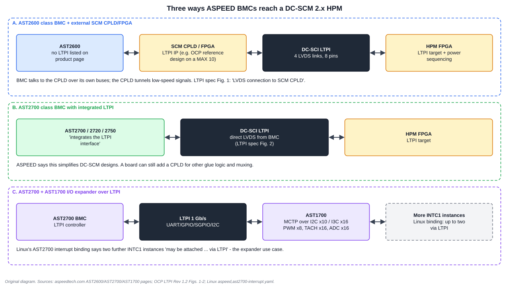

# 7. ASPEED BMCs on a DC-SCM, Review Checklist and Glossary

This chapter ties the two volumes together: which BMC blocks serve which DC-SCI interfaces, three ways to connect an ASPEED BMC to an HPM, and a checklist to review a design with.

## 7.1 Three architectures



| Architecture | Link logic | Evidence |
| --- | --- | --- |
| **A. AST2600-class BMC + SCM CPLD/FPGA** | LTPI lives in the CPLD/FPGA. The BMC controls it over ordinary buses | AST2600 product page lists no LTPI. The LTPI spec's Fig. 1 shows the LVDS connection to the SCM CPLD. The OCP reference IP is controlled via an I2C-target-to-memory-mapped bridge |
| **B. AST2700-class BMC, LTPI integrated** | the BMC drives the LVDS pairs directly | ASPEED: AST2700 "integrates the LTPI interface to help customers simplify DC-SCM designs". LTPI spec Fig. 2: "Direct connection of LVDS interface to the BMC" |
| **C. AST2700 + AST1700 expander over LTPI** | an LTPI link to a remote I/O expander | AST1700 page: LTPI 1 Gb/s for UART/GPIO/SGPIO/I2C plus MCTP over I2C/I3C, PWM, TACH, ADC. Linux binding: two further INTC1 instances may attach "via LTPI" |

How the BMC and an SCM CPLD talk to each other in architecture A is a **board design choice**. The DC-SCM spec does not fix it. Expect I2C/I3C, SPI and GPIO between them.

## 7.2 Which BMC block serves which DC-SCI interface

The mapping uses the blocks described in the Linux device trees (see the SoC volume). "Not in DT" means mainline Linux does not describe that block, not that the silicon lacks it.

| DC-SCI interface | AST2600 | AST27x0 |
| --- | --- | --- |
| BIOS/BMC flash (QSPI/SPI) | FMC (3 CS), SPI1, SPI2 | FMC (3 CS), SPI0-SPI2 |
| TPM (SPI) | SPI controllers | SPI controllers |
| NC-SI RBT | four Ethernet MACs (RMII/NC-SI is a board choice) | MDIO ×3 in DT; Ethernet MACs not in DT and not on the product pages read |
| I2C | 16 controllers | not on the product pages; not in DT (AST1700 lists MCTP over I2C ×10) |
| I3C | 6 controllers + global | AST1700 exposes MCTP over I3C ×16; BMC I3C not in DT |
| PECI | PECI controller | not in DT |
| SGPIO | SGPIOM ×2 | SGPIOM ×2 |
| FSI | FSI master ×2 | FSI master ×2 |
| UART | UART1-9 and four VUARTs | UART0-14 |
| eSPI | exists in silicon, not in `aspeed-g6.dtsi` [verify] | not in DT [verify] |
| LPC | KCS ×4, iBT, snoop (not used on DC-SCM 2, which has no LPC) | not in DT |
| PCIe endpoint, VGA, MCTP VDM | PCIe endpoint with 2D VGA | PCIe Gen4, VGA (2700, 2750) |
| USB | vHub, UDC, EHCI ×2, UHCI | vHub, EHCI, UHCI; xHCI binding |
| JTAG (BMC initiator) | exists in silicon [verify] | [verify] |
| LTPI | not listed | listed (1 Gb/s) |
| Platform RoT | SBC + OTP | Caliptra |

**A subtle point about host interfaces.** DC-SCM 2 provides eSPI and **no LPC**. An AST2600 device tree describes LPC-named blocks (KCS, iBT, snoop), so a DC-SCM-based board relies on the host-to-BMC transport being eSPI, with the same IPMI KCS/iBT functions carried over it. Confirm eSPI support and the mapping of those functions in your SoC datasheet and kernel.

## 7.3 Design review checklist

**Mechanical**
- [ ] Form factor chosen (EFF, IFF or VFF) and chassis opening, bracket and EMI choice match.
- [ ] HPM PCB thickness matches a straddle-mount option; the offset for 0.076 in (-0.3 mm) is accounted for.
- [ ] Chamfer and keep-out zones checked against the 2.1 drawings.

**Power and discovery**
- [ ] HPM provides an eFuse and presence pull-up; AUX is disabled when presence is absent.
- [ ] 12 V within 10.8-13.2 V, inrush within 5-200 ms, STBY draw within 15 W (or the HPM is known to support more).
- [ ] FRU on I2C0 at 0xA0 with 2-byte addressing and 256 B-64 KB capacity, write-protected by default.
- [ ] FRU MultiRecord fills record format version, DC-SCI revision, LTPI least-supported revision, HPM Vendor/Device ID.
- [ ] The SCM implements Plug-N-Detect-Else-Halt.

**Signals**
- [ ] PCIe clocks and PERST routing match the endpoint plan (first x1 for the BMC endpoint).
- [ ] Unused interfaces terminated per the interoperability table (eSPI, I2C, I3C, PECI_VREF).
- [ ] I2C pull-ups and level translation on the HPM; I3C bus below 25 pF on the SCM.
- [ ] NC-SI route fits the 3000 ps budget; HPM and NIC board get the remaining 2210 ps.
- [ ] JTAG TDI/TDO checked against the pinout of the exact revision.
- [ ] SGPIO within 5-25 MHz, 45-55% duty, 6 ns edges.

**LTPI**
- [ ] AC-coupling capacitors (0.22 µF) on the SCM, a bias network and 100 Ω termination near each RX.
- [ ] All four links have bias circuits; differential impedance near 85 Ω.
- [ ] Training runs at 25 MHz SDR first; common speed and DDR chosen as capabilities permit.
- [ ] NL GPIO count agrees on both ends; a CSR path exists for the BMC to read link status and request retraining.
- [ ] LTPI revision on both ends is compatible (FRU least-supported revision).

**Firmware**
- [ ] BMC firmware reads the FRU before enabling any HPM-dependent feature.
- [ ] Firmware images for BMC, SCM CPLD and HPM FPGA are versioned together (Plug-and-Code).
- [ ] Secure-boot keys, RoT policy and rollback counters are documented for each platform.

## 7.4 Read-only lab: look at an HPM FRU from a BMC

Run on a lab BMC you are authorised to inspect, with Linux I2C tools available. This **reads only**. Do not scan buses on production systems, and never write.

```sh
# Find the bus number mapped to DC-SCI I2C0 on your platform (board-specific).
ls /sys/bus/i2c/devices/ | head

# The FRU answers at 8-bit address 0xA0, which is 7-bit 0x50.
# It uses 2-byte offsets, so send offset 0x00 0x00, then read 16 bytes.
# Replace 4 with your bus number.
i2ctransfer -y 4 w2@0x50 0x00 0x00 r16@0x50
```

What to look for:

1. The read succeeds at 0x50 on I2C0. If it does not, check the FRU's pull-ups, the rail `VCC_SCM_HPM_FRU` and whether the bus is behind a mux (it must not be).
2. The first byte of a valid IPMI FRU common header is the format version `0x01`. Parse the MultiRecord area for record type `0xC1` and manufacturer ID bytes `7F A6 00` (LSB first).
3. Read the **Record Format version** nibble: `0` means DC-SCM 2.0, `1` means 2.1.

If the platform uses a different I2C addressing scheme or exposes the FRU through a kernel `at24` driver, read it from sysfs instead. `i2ctransfer` options differ between versions.

## 7.5 Exercises with answers

**1. Which architecture removes the need for an external LTPI CPLD on the SCM?** B, where the BMC integrates LTPI, per ASPEED's AST2700 page. A board may still keep a CPLD for other logic.

**2. A DC-SCM 2 board relies on KCS to the host. Which host bus carries it?** eSPI; DC-SCM 2 has no LPC.

**3. Where would you look for a missing AST2700 I2C bus in Linux?** In the vendor SDK kernel's device tree. The mainline AST2700 `.dtsi` files read contain no I2C nodes.

**4. The SCM reads FRU record format `0001b` but its LTPI hardware is revision 1.0. What is the right check?** Read the FRU's least-supported LTPI revision/version and compare it with the SCM's implemented revision. Proceed only if compatible; otherwise halt (Plug-N-Detect-Else-Halt).

**5. A board fits an AST2720 where an AST2700 was designed. What can break?** Features the AST2720 page does not list (2D VGA over PCIe, iKVM, DisplayPort). Hardware pin compatibility is stated; feature equality is not.

**6. Compute the LTPI frame time at 200 MHz DDR.** 160 ÷ (200 MHz × 2) = 0.40 µs.

**7. A designer routes NC-SI with 700 ps SCM trace delay.** The spec's `TBMC_DATA` assumption is 680 ps. With 110 ps in the connector, 700 + 110 = 810 ps, leaving 3000 − 810 = 2190 ps for HPM and NIC board routing; the 20 ps over the assumption reduces the downstream budget.

## 7.6 Glossary

| Term | Meaning |
| --- | --- |
| AUX | always-on supply domain powered while the host is off |
| BMC | baseboard management controller |
| CDC | LTPI DC-blocking capacitor, 0.22 µF |
| DC-MHS | Datacenter Modular Hardware System, OCP's sibling specification family |
| DC-SCI | the connector interface between SCM and HPM |
| DC-SCM | Datacenter Secure Control Module |
| EFF / IFF / VFF | external, internal and vertical form factors |
| FoF | Fabric-over-Foam EMI gasket |
| FRU | field-replaceable unit information (an EEPROM record) |
| HFF | horizontal form factor |
| HPM | Host Processor Module |
| LL / NL GPIO | low-latency and normal-latency LTPI GPIOs |
| LTPI | LVDS Tunneling Protocol and Interface |
| LVDS | low-voltage differential signalling |
| M-PIC | a DC-MHS specification whose SGPIO timing the DC-SCM adopts |
| NC-SI | Network Controller Sideband Interface |
| OCP | Open Compute Project |
| PRoT | platform root of trust |
| RBT | RMII-based transport (NC-SI) |
| RoT | root of trust |
| SCM CPLD | programmable logic on the DC-SCM |
| SDR / DDR | single and dual data rate |
| SFF-TA-1002 | the connector family used (4C+) |
| STBY | standby power state |

## 7.7 Where to go next

- [ASPEED SoC textbook](../ASPEED_BMC_SoC_Textbook/00_README.md): the BMC chips themselves.
- [MCTP](../MCTP_Textbook/00_README.md) and [PLDM](../PLDM_Textbook/00_README.md): management protocols that ride on I2C, I3C and PCIe VDM.
- [PCIe](../PCIe_Textbook/00_README.md): link training and VDM, behind the first x1.
- Primary sources: the [OCP DC-SCM project page](https://www.opencompute.org/) for the current specification and pinout spreadsheet; the [LTPI reference IP](https://github.com/opencomputeproject/HWMgmt-Module-DCSCM-LTPI) for the link logic.

Return to [contents](00_README.md)
