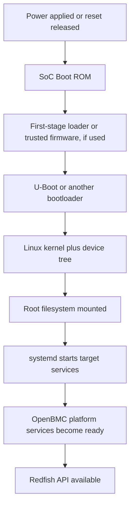
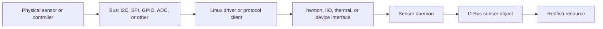
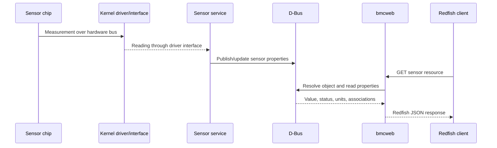

# OpenBMC: From Reset to Redfish

> **Scope and assumptions:** This material describes a typical OpenBMC-based BMC using Linux, systemd, D-Bus, `entity-manager`/`dbus-sensors`, and `bmcweb`. It is an architectural guide, not a statement that every board uses the same boot firmware, sensor source, service name, or configuration. Confirm details against the target board's device tree, image, service units, and source tree.

## Session Guide

### Audience

Firmware, Linux, platform-management, validation, and service engineers who need to trace how a BMC starts, discovers hardware, publishes sensor data, and exposes it through Redfish.

### Learning objectives

By the end of the session, participants should be able to:

- Sketch the normal BMC boot path from reset through userspace.
- Explain how systemd services and D-Bus interfaces divide responsibility.
- Trace a physical or virtual sensor into a Redfish resource.
- Identify the first useful logs and commands when one link in that path fails.
- Distinguish common OpenBMC patterns from board-specific implementation choices.

### Suggested 90-minute agenda

| Time | Topic | Activity / checkpoint |
| --- | --- | --- |
| 0-5 min | Goals and system boundary | Identify the BMC, managed host, network client, and the boundary between them. |
| 5-15 min | Boot sequence overview | Draw reset, boot firmware, kernel, root filesystem, and service startup. |
| 15-25 min | Reset, Boot ROM, and U-Boot | Trace one boot image and discuss handoff points and failure evidence. |
| 25-35 min | Linux kernel and systemd | Separate device initialization from service orchestration. |
| 35-45 min | D-Bus architecture | Read a service name, object path, interface, property, and signal. |
| 45-55 min | Platform discovery | Follow board configuration and hardware inventory into D-Bus. |
| 55-65 min | Sensor stack | Trace a sensor from hardware/driver to a D-Bus property. |
| 65-75 min | Redfish interface | Map a Redfish GET to the corresponding service and D-Bus data. |
| 75-85 min | End-to-end trace | Work through a sensor reading from acquisition to HTTP response. |
| 85-90 min | Debugging recap | Pick the first command for three failure symptoms. |

For a hands-on 2-hour version, add a 25-minute lab after the end-to-end trace: select one sensor on the target, find its D-Bus object and owning service, query it locally, then query its Redfish resource. Reserve five minutes for wrap-up.

### Preparation

- Use a lab BMC or representative OpenBMC image with shell access and a reachable Redfish endpoint.
- Know the target's board name, image build, network address, and whether the managed host is powered on.
- Have authorized credentials available through the normal lab process; do not put passwords or tokens in notes or shell history.
- Verify command availability in the image. Minimal production images may omit diagnostic utilities.
- Select one known sensor and record its Redfish URI or the method used to discover it.

### Suggested opening

“Today we will follow one piece of information across the BMC: a sensor value. We will start at reset, find how Linux and services bring up the platform, follow the value through D-Bus, and finish at the Redfish API. The exact components vary by board, but the boundaries and debugging method are reusable.”

---

## 1. Boot Sequence Overview

A BMC boot is a chain of firmware and software stages that initialize enough hardware to load the next stage. A simplified path is:



The actual chain may include SPL, TF-A, OP-TEE, a vendor-specific loader, verified-boot logic, an initramfs, or an alternate bootloader. Some platforms use U-Boot directly after Boot ROM; others do not. Firmware images may also contain multiple signed components.

“Boot complete” is not one event. Useful milestones include:

1. The SoC has executed trusted boot code.
2. The bootloader has selected a valid image and loaded the kernel and device tree.
3. The kernel has initialized storage, buses, and essential drivers.
4. The root filesystem is mounted and PID 1 is running.
5. Required platform services have acquired their D-Bus names and initialized hardware.
6. Network configuration and the Redfish service are ready to accept requests.

A console login can be available before all platform services are ready. Conversely, an HTTP listener may start before every sensor has been discovered. Readiness should be judged against the service or function under investigation.

## 2. Reset → Boot ROM → U-Boot

### Reset and Boot ROM

Reset may be caused by initial power-on, a watchdog, a software-requested reboot, a brownout, or a platform reset signal. The SoC's Boot ROM is immutable code that samples boot configuration and loads or authenticates the next stage from a supported boot source. The boot source and recovery behavior are SoC- and board-specific.

If the Boot ROM cannot find a usable next stage, Linux logs will not exist because Linux has not started. The best evidence may be UART output, boot-mode strap settings, boot-status registers, watchdog/reset-cause registers, or a recovery interface described by the SoC documentation.

### Early firmware and U-Boot

Depending on the design, early firmware configures clocks, DRAM, security state, and storage before handing off to U-Boot. U-Boot typically selects a boot target, loads the kernel and device tree (and sometimes an initramfs), applies boot arguments, and transfers control to the kernel. The image format can be FIT, raw partitions, or a vendor-specific layout.

Common investigation points:

- Serial console output and the last completed boot message.
- Boot command, environment, and selected boot slot, when available and permitted.
- Image validity, rollback counter, signature verification, and slot metadata.
- Kernel command line and the device tree actually passed to Linux.
- Storage read errors, DRAM training failures, and boot-count/recovery policy.

Do not assume U-Boot environment variables are persistent, writable, or the source of truth on a locked-down product. Secure-boot policy may deliberately prevent interactive changes.

## 3. Linux Kernel → systemd

The kernel decompresses, initializes architecture and memory management, parses the device tree and command line, probes drivers, and mounts the root filesystem. Hardware such as I2C controllers, GPIOs, SPI flash, fan tach inputs, ADCs, and watchdogs becomes available through kernel drivers and subsystem interfaces. Sensor-facing interfaces may include hwmon, IIO, thermal zones, regulator interfaces, or protocol-specific devices.

The kernel starts the first userspace process, normally systemd in OpenBMC. systemd brings up targets and units according to dependencies. Units can be services, sockets, timers, mounts, devices, and other resource definitions. Services may start in parallel; ordering does not imply that every device is fully usable when a process first runs.

A typical userspace progression is:

- Mount and initialize required filesystems and runtime directories.
- Start D-Bus and foundational services.
- Start board/platform services, inventory and sensor services, and networking.
- Start web/API services such as `bmcweb`.
- Reach a target-specific operational state.

Use unit dependencies and readiness checks rather than assuming a fixed global startup order. A service being `active` only indicates its systemd state; it does not prove that the service has found every device or published all expected objects.

## 4. D-Bus Architecture

D-Bus is the local inter-process communication fabric used by many OpenBMC services. A client sends a method call to a service; the service owns one or more object paths and exposes interfaces and properties. Signals notify interested clients about changes.

The usual system-bus address is local to the BMC. For example:

- **Bus name:** `xyz.openbmc_project.EntityManager`
- **Object path:** `/xyz/openbmc_project/inventory/system/chassis`
- **Interface:** `xyz.openbmc_project.Inventory.Item`
- **Property:** `Present`

These names are illustrative. The owning process can be found through the bus, and object paths/interfaces must be checked on the target image.

Important concepts:

- **Bus name:** A well-known name identifies a service; unique names identify a specific connection.
- **Object path:** A hierarchical identifier for an object exported by a service.
- **Interface:** A contract containing methods, properties, and signals.
- **Property:** A typed value read or written through D-Bus property methods; changes may be signaled.
- **ObjectManager:** A standard interface for enumerating objects and interfaces below a path.
- **Mapper:** OpenBMC's Object Mapper helps clients discover which services provide objects and interfaces, avoiding hard-coded ownership assumptions in many clients.

D-Bus is not a database. An object can appear late, disappear on service restart, or expose a property whose value is unavailable. Clients should handle service restarts, object lifecycle changes, and missing properties. D-Bus policy controls who may own names and call methods.

## 5. Platform Discovery

OpenBMC needs to determine which hardware is present and how it is wired. A common OpenBMC pattern uses `entity-manager` configuration to probe or describe components and publish configuration/inventory information on D-Bus. Sensor applications such as `dbus-sensors` consume relevant configuration and create sensor objects. Board-specific alternatives and legacy configuration paths exist, so inspect the target image rather than treating this pattern as universal.

Discovery inputs can include:

- Board identity and compatible strings from the device tree.
- EEPROM/FRU contents and product or board identifiers.
- Configuration files embedded in the image.
- Probe results from I2C devices, GPIOs, or other platform interfaces.
- Runtime presence signals for replaceable components.

A typical flow is:

1. The kernel exposes buses and devices described by firmware and device tree.
2. Platform discovery services evaluate board configuration and probes.
3. Matching components and their configuration are published on D-Bus.
4. Inventory and sensor services create or update the corresponding objects.
5. Clients such as `bmcweb` query the resulting objects and properties.

Discovery configuration commonly describes a device's bus/address or match conditions, sensor type, scaling, units, thresholds, and associations. Incorrect addresses, probe matches, compatible strings, or configuration names can cause a device to be absent even when its kernel driver is healthy.

Inventory and sensor state are related but distinct. Inventory answers what component is present and how it is associated with the system. Sensor objects represent measurements or status values. Associations connect objects such as a sensor, chassis, and inventory item; Redfish uses these relationships to construct resource links.

## 6. Sensor Stack

A sensor value can originate from a physical chip or from a calculated, protocol-derived, or platform-provided value. A common hardware path is:



The sensor daemon may be `dbus-sensors` or another platform-specific service. Some readings arrive through PLDM, MCTP, IPMI, a host interface, or a calculated expression rather than a direct hwmon file.

A D-Bus sensor object often exposes a value interface and additional interfaces for units, availability, functional state, thresholds, warning/critical alarms, or associations. Exact interface names and property availability depend on sensor type and implementation. A value can be numerically valid while marked unavailable or nonfunctional; consumers should consider status and quality properties as well as the number.

Common causes of bad readings include:

- Device not powered, absent, or held in reset.
- Bus contention, an incorrect bus/address, or failed I2C transactions.
- Driver not bound, wrong channel mapping, or missing device-tree node.
- Wrong sensor configuration, scale, offset, unit, or threshold.
- Service startup race, stale configuration, or object not yet published.
- Sensor timeout, out-of-range raw data, or a reported unavailable state.

When comparing layers, account for scaling and units. A raw register value, a hwmon value, a D-Bus value, and a Redfish value need not have the same representation.

## 7. Redfish Interface

Redfish is a resource-oriented management API, commonly served by OpenBMC's `bmcweb`. A client starts at the Redfish service root, follows links to resources such as Systems, Chassis, Managers, and Sensors, and receives JSON representations over HTTPS. The exact resource model depends on software version, configuration, and supported platform features.

For a sensor request, the broad path is:

1. The client authenticates and sends an HTTP request to a Redfish URI.
2. `bmcweb` routes the request to the relevant handler and validates permissions and request semantics.
3. The handler obtains required properties and associations from D-Bus, often using Object Mapper for discovery.
4. `bmcweb` translates service data into the Redfish schema, status, units, and links.
5. The HTTP response returns a JSON resource, or a Redfish error with extended information.

Redfish is not necessarily a one-to-one mirror of D-Bus. `bmcweb` may combine data from multiple services, omit unsupported properties, synthesize links, or map internal state into Redfish status. Debug both the API response and the underlying D-Bus state.

Useful client-side checks (use the correct address, TLS settings, and authorized credentials):

```text
GET https://<bmc-address>/redfish/v1
GET https://<bmc-address>/redfish/v1/Chassis
GET https://<bmc-address>/redfish/v1/Chassis/<chassis-id>/Sensors
```

Discover links from the responses instead of assuming every system uses identical IDs or routes. Avoid disabling TLS verification outside a controlled lab, and never paste credentials into shared logs.

## 8. End-to-End Data Flow

For a temperature sensor, a normal read path could be:



The HTTP GET may read a recently updated D-Bus value rather than trigger a fresh hardware conversion. Sampling cadence and cache behavior are implementation-dependent. A practical trace therefore checks each boundary independently:

1. **Hardware/kernel:** Is the device present and producing a plausible driver-level reading?
2. **Sensor service:** Is the expected process running, and does it report probe/read errors?
3. **D-Bus:** Does the expected object exist, who owns it, and are value/status/unit properties sensible?
4. **Associations/discovery:** Can the object be related to the correct chassis or inventory item?
5. **Redfish:** Does the resource link exist, and does its payload correspond to the D-Bus state?
6. **Client/network:** Is the request reaching the BMC with valid TLS, authentication, and authorization?

This layered approach narrows the fault domain: the first boundary where expected state disappears is usually the best place to investigate.

## 9. Debugging Tips

### Start with a precise symptom

Record the BMC image/build, board revision, reset cause if known, time of failure, exact sensor or URI, and whether the issue is absent data, stale data, an incorrect value, or an HTTP error. Check whether the managed host state changes the symptom.

### Boot and service health

```sh
cat /proc/cmdline
systemctl --failed
systemctl status <unit>
journalctl -b -u <unit> --no-pager
journalctl -b -p warning..alert --no-pager
```

Use `journalctl -b` for the current boot and `journalctl -b -1` only if the previous boot's journal was retained. Early Boot ROM/U-Boot failures require the serial console or SoC-specific diagnostics, not `journalctl`.

### D-Bus and discovery

```sh
busctl --system list
busctl --system tree <service-name>
busctl --system introspect <service-name> <object-path>
busctl --system get-property <service-name> <object-path> <interface> <property>
busctl --system monitor
```

On images that include OpenBMC's Object Mapper, a query can locate providers for a path or interface:

```sh
busctl --system call xyz.openbmc_project.ObjectMapper \
  /xyz/openbmc_project/object_mapper \
  xyz.openbmc_project.ObjectMapper GetObject \
  sas /xyz/openbmc_project/sensors/temperature <interface-name>
```

Check command syntax and installed tools on the target release. `busctl monitor` can produce substantial output; constrain the time and scope of a capture where possible. Treat D-Bus values and logs as potentially sensitive operational data.

### Kernel and hardware-facing checks

```sh
dmesg -T | tail -n 200
find /sys/class/hwmon -maxdepth 2 -type f
```

The exact sysfs paths vary. Prefer identifying a device through its driver and labels rather than assuming that `hwmon0` always represents the same component. For I2C or GPIO diagnosis, use approved board procedures; indiscriminate bus scans or register writes can disrupt hardware.

### Redfish checks

- Start at `/redfish/v1` and follow links returned by the service.
- Distinguish HTTP transport/authentication failures from Redfish error payloads.
- Check the resource's `Status`, value, units, and links, not only whether the URI returns 200.
- Compare the response against D-Bus at the same time to account for sampling and cache intervals.
- Inspect `bmcweb` logs and service health when the D-Bus object is correct but the API is missing or wrong.

### Symptom-to-first-check guide

| Symptom | First checks |
| --- | --- |
| No console or no kernel messages | Power/reset cause, UART routing, Boot ROM and bootloader output, image/boot slot. |
| Linux boots but a service is absent | `systemctl status`, unit dependencies, and that service's journal. |
| Sensor object is absent | Kernel device/driver, discovery configuration and probes, sensor-service logs, Object Mapper. |
| Sensor exists but is unavailable | Driver errors, bus/device state, timeout behavior, and availability/functional properties. |
| D-Bus value is wrong | Raw/driver value, scale/offset/unit configuration, sampling and conversion logic. |
| D-Bus is correct but Redfish is wrong | Resource links/associations, `bmcweb` logs, schema mapping, cache/update behavior. |
| Redfish is unreachable | Network/interface state, listener/service health, TLS, authentication, and firewall policy. |

### Debugging discipline

- Change one layer at a time and capture before/after evidence.
- Prefer read-only inspection before restarting services or modifying hardware state.
- A service restart can erase transient evidence or briefly remove its D-Bus objects; capture logs and state first.
- Do not expose credentials, private keys, unredacted FRU data, or production network details in a shared session.
- Record the exact image and configuration. OpenBMC service names, interfaces, and available tools evolve across releases and product images.

## Quick Reference: One Sensor, Five Questions

1. **What is the Redfish URI?** Follow links from the service root.
2. **What D-Bus object backs it?** Inspect links/associations and query Object Mapper.
3. **Which service owns that object?** Resolve the provider and inspect its systemd unit/logs.
4. **Where does the service read the value?** Check its configuration and kernel/protocol input.
5. **At which boundary does the expected state stop?** Compare hardware/kernel, service, D-Bus, and Redfish in order.

## Glossary

- **BMC:** Baseboard Management Controller, an embedded controller that manages and monitors a system.
- **D-Bus:** Local message bus for communication among userspace services.
- **Entity Manager:** An OpenBMC service/pattern for discovering and describing platform entities through configuration and runtime probes.
- **FRU:** Field Replaceable Unit data describing a component or assembly.
- **hwmon:** Linux hardware-monitoring subsystem and its userspace interfaces.
- **Redfish:** DMTF standard API for server and infrastructure management.
- **systemd:** Linux system and service manager, commonly PID 1 in OpenBMC images.
- **U-Boot:** A widely used bootloader; exact use and configuration are platform-specific.
