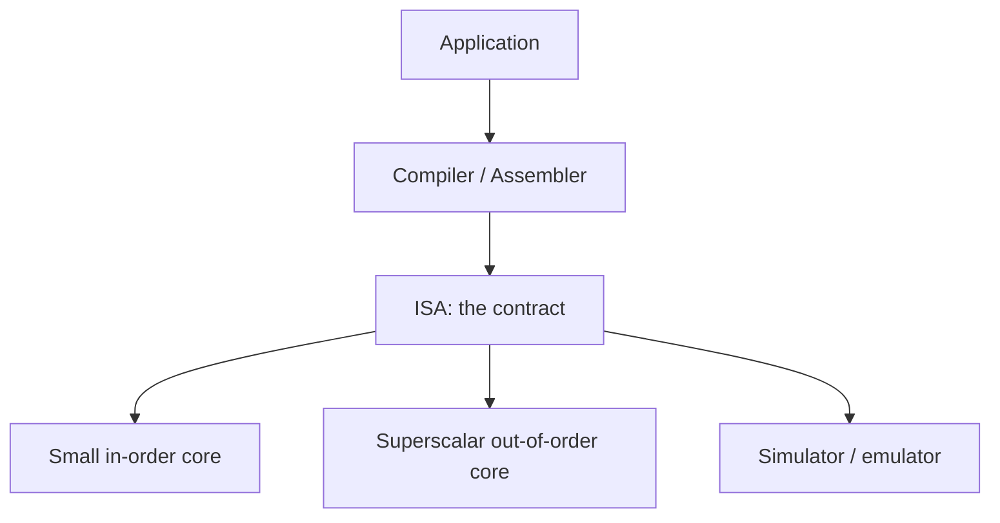
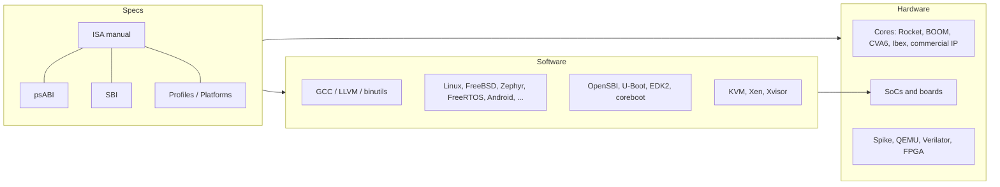

# Chapter 1 - Foundations

[Index](00_README.md) | Next: [Chapter 2 - Base ISA](02_Base_ISA.md)

**Goals:** Understand what RISC-V is and is not, where it came from, how the standard is governed and versioned, the vocabulary every other chapter uses, and how the ecosystem fits together.

---

## 1.1 What is an ISA?

An **instruction set architecture (ISA)** is the contract between software and hardware. It defines:

- the **instructions** (what operations exist and how they are encoded),
- the **architectural state** (registers, memory model, status/control registers),
- the **behavior** of every instruction including exceptions,
- the **privilege model** and how traps work.

It does *not* define **microarchitecture**: pipeline depth, cache sizes, branch predictors, or how many instructions issue per cycle. Many different microarchitectures can implement one ISA. That separation is why a 3-stage microcontroller and a wide out-of-order server core can run the same binary.



## 1.2 What is RISC-V?

RISC-V (pronounced "risk-five") is an **open standard ISA** based on reduced-instruction-set-computer (RISC) principles. The ISA manual states its goals as:

- A completely open ISA, freely available to academia and industry.
- A *real* ISA suitable for direct native hardware implementation, not just simulation.
- An ISA that avoids over-architecting for one microarchitecture style (microcoded, in-order, out-of-order) or technology (full-custom, ASIC, FPGA).
- A small **base integer ISA** usable by itself, with **optional standard extensions** for general-purpose software.
- Support for IEEE-754 floating point, both 32-bit and 64-bit address spaces, multicore/manycore, optional variable-length instructions, and a fully virtualizable ISA.

"Open" means **the specification is free to use**. It does *not* mean every implementation is open source. A company can sell a closed, proprietary RISC-V core; it simply does not pay per-chip royalties to an ISA owner.

### The "V" in RISC-V

The name denotes the **fifth** major RISC design from UC Berkeley (RISC-I, RISC-II, SOAR, SPUR came before). The Roman numeral also puns on **"variations"** and **"vectors"**, since supporting a range of architecture research (including data-parallel accelerators) was an explicit goal.

## 1.3 Short history

| Year | Event |
|------|-------|
| 2010 | Berkeley research project begins (Krste Asanovic, Andrew Waterman, Yunsup Lee, later David Patterson). Motivation: a clean, free ISA for research and teaching instead of licensing x86/ARM or using legacy MIPS/SPARC. |
| 2011 | First user-level ISA technical report (UCB/EECS-2011-62). |
| 2014 | User-level ISA v2.0 frozen as the base. |
| 2015 | RISC-V Foundation formed to steward the ISA. |
| 2016-2019 | Unprivileged ISA 2.1/2.2 and Privileged 1.9 -> 1.10 -> 1.11 evolve; Linux, GCC, binutils, LLVM, glibc get support. |
| 2019 | Unprivileged 20191213 and Privileged 20190608 ratified (`I M A F D C Zicsr Zifencei`, the "G + C" base). |
| 2020 | Governance moves to **RISC-V International**, a Swiss non-profit, to avoid geopolitical risk. |
| 2021 | Large ratification wave: **Vector 1.0**, **Bit-manipulation (B)**, **Scalar crypto**, **Hypervisor 1.0**, cache-block ops, `Zfh`, and others. |
| 2022-2023 | Profiles RVA22/RVB22 ratified; **AIA**, **IOMMU**, **CFI**, **vector crypto**, **Zicond**, **Zacas/Zabha**, **Pointer masking**, debug and trace work progresses. |
| 2024 | **RVA23** profile ratified (Vector and Hypervisor become mandatory). CFI (shadow stack, landing pads) ratified. |
| 2025 | **SBI 3.0** ratified (2025-07-16). Further extensions (see Ch. 14). |
| 2026 | Unified ISA manual release **v20260120** (January 2026) published at docs.riscv.org. |

Dates before 2026 are from memory of the public record and are accurate to the year **[verify]** for exact ratification months.

## 1.4 Design principles and consequences

Understanding the reasoning makes the rules easier to remember.

| Principle | Concrete consequence |
|-----------|----------------------|
| Small fixed base, modular extensions | Every system has a stable `I` core; features are opt-in. Extensions never change once ratified. |
| Load/store architecture | Only loads and stores touch memory (except atomics); everything else is register-to-register. |
| Regular encoding | `rd`, `rs1`, `rs2` sit at the same bit positions in every format, simplifying decode. |
| No condition codes | Compare-and-branch instructions instead of flag registers (no carry/zero flags to rename or serialize). |
| No branch delay slots | Cleaner for both simple and aggressive pipelines. |
| Sign-extended immediates, sign bit always at instruction bit 31 | Sign extension can start before the rest of decode finishes. |
| `x0` hardwired to zero | Provides a free zero source and a discard destination; many pseudoinstructions use it. |
| Load/store immediates are small (12-bit) | Large constants/addresses use `lui`/`auipc` pairs. |
| Separate privileged architecture | The unprivileged ISA does not assume paging, interrupts, or a specific OS. |
| Custom space reserved | Vendors can add instructions without colliding with future standard ones. |
| Variable length by design | Encoding scheme supports 16, 32, 48, 64+ bit instructions. |

## 1.5 A family of ISAs, not one ISA

RISC-V defines **four base integer ISAs**:

| Base | Register width | Registers | Address space | Typical use |
|------|---------------|-----------|---------------|-------------|
| `RV32I` | 32 bits | 32 | 2^32 bytes | Embedded, microcontrollers, education |
| `RV64I` | 64 bits | 32 | 2^64 bytes (virtual memory limits real use) | Application processors, servers |
| `RV32E` | 32 bits | 16 | 2^32 | Very small microcontrollers |
| `RV64E` | 64 bits | 16 | 2^64 | Small 64-bit controllers |
| `RV128I` | 128 bits | 32 | 2^128 | Reserved; not defined for use |

Design note: `RV32I` is **not** a strict subset of `RV64I`. Each base is optimized for its own width (for example, `RV64I` has `addw`, `ld`, `sd` and omits some RV32-only tricks). Emulating RV32 on RV64 hardware is therefore not free.

`XLEN` denotes the integer register width: 32 or 64.

### Extension categories

Every encoding space is divided into three disjoint categories:

1. **Standard** - defined by RISC-V International.
2. **Reserved** - held for future standard use.
3. **Custom** - guaranteed never to be used by standard extensions; free for vendors.

An extension is:

- **Standard** (RISC-V International defined),
- **Custom** (uses only custom encodings), or
- **Non-conforming** (uses standard/reserved encodings; breaks compatibility).

## 1.6 Terminology you must know

| Term | Meaning |
|------|---------|
| **Hart** | HARdware Thread. An independent resource that autonomously fetches and executes instructions within an execution environment. A core with SMT has several harts. |
| **Core** | A component with an independent instruction fetch unit. May contain multiple harts. |
| **EEI** | Execution Environment Interface. Defines initial state, number/type of harts, memory/IO accessibility, instruction behavior, trap handling. Examples: Linux user ABI, SBI, bare-metal hardware. |
| **Coprocessor** | Attached unit mostly sequenced by the RISC-V instruction stream but with its own state and extensions. |
| **Accelerator** | Fixed-function unit, or a core that runs autonomously for specific tasks. |
| **XLEN / FLEN / VLEN** | Integer / floating-point / vector register widths. |
| **Word** | 32 bits. **Halfword** = 16, **doubleword** = 64, **quadword** = 128. |
| **IALIGN** | Instruction-address alignment in bits: 32 in the base ISA, 16 when `C` (or similar) is present. Only 16 or 32 allowed. |
| **ILEN** | Maximum instruction length in bits supported. 32 for base-only implementations. |
| **Exception** | Unusual condition tied to an instruction on the current hart (e.g., illegal instruction, page fault). |
| **Interrupt** | External asynchronous event. |
| **Trap** | Transfer of control to a trap handler caused by an exception *or* an interrupt. |
| **UNSPECIFIED** | Behavior intentionally left unconstrained by the spec. May be defined by extensions, platforms, or implementations. |
| **CSR** | Control and Status Register: a 12-bit-addressed special register space accessed with `Zicsr` instructions. |
| **PMA** | Physical Memory Attributes (cacheability, atomicity support, ordering, etc.). |
| **PMP** | Physical Memory Protection. |
| **Profile** | A named, versioned set of mandatory and optional extensions that a software ecosystem can target (e.g., RVA23). |
| **Platform** | A profile plus hardware/firmware/boot/interrupt requirements (e.g., the OS-A platform). |
| **ABI** | Application Binary Interface: calling conventions, data layouts, object formats. |
| **psABI** | The processor-specific ABI for RISC-V (ELF psABI document). |

### Harts vs software threads

A hart is *not* an OS thread. The OS multiplexes software threads onto harts. From the point of view of software inside an execution environment, harts behave like independent hardware threads even if the environment time-multiplexes them onto fewer physical harts. The environment must guarantee **forward progress** of each hart: retirement of an instruction, taking a trap, or other extension-defined events count as forward progress.

### Traps: four flavors

The ISA manual classifies traps by how the execution environment treats them:

| Kind | Visible to software? | Execution resumes? | Example |
|------|----------------------|--------------------|---------|
| **Contained** | Yes, handled inside the environment | Usually | User `ecall` handled by supervisor-mode OS |
| **Requested** | Explicit call to the outer environment | Maybe | System call/SBI call; may terminate |
| **Invisible** | No (handled transparently) | Yes | Emulating a missing instruction, demand paging by a hypervisor |
| **Fatal** | Terminates | No | Failed memory protection, watchdog expiry |

## 1.7 Memory basics

- A hart has a single **byte-addressable** address space of 2^XLEN bytes. Addresses **wrap modulo 2^XLEN**.
- The execution environment decides what is main memory vs I/O. I/O reads/writes may have side effects; main memory accesses may not.
- Each instruction causes an implicit instruction fetch; loads/stores are explicit accesses. Page-table walks and similar are implicit accesses defined by the environment.
- **Endianness:** The base ISAs are little-endian, with big-endian and bi-endian variants defined by the privileged architecture. Instructions are always stored as a sequence of 16-bit **little-endian parcels**, regardless of data endianness.
- **Speculation:** Implicit reads without side effects may happen arbitrarily early. Software must use `FENCE.I` (or newer cache-control instructions) to make instruction fetches observe stores.
- **Ordering:** Default model is **RVWMO** (weak). Optional **Ztso** gives Total Store Ordering. See Chapter 8.

## 1.8 Instruction length encoding

The low bits of the first 16-bit parcel give the instruction length:

| Low bits `[1:0]` | Length |
|------------------|--------|
| `00`, `01`, `10` | 16-bit compressed instruction |
| `11` and bits `[4:2] != 111` | 32-bit instruction |
| `011111` | 48-bit |
| `0111111` | 64-bit |
| longer prefixes | reserved for >64-bit |

Special encodings:

- All-zero 16-bit parcel at the start of an instruction is **illegal** (traps jumps into zeroed memory). Software may rely on a naturally aligned 32-bit zero word being illegal on all implementations.
- All-ones is also illegal (catches unprogrammed flash, dead buses).

## 1.9 Standards bodies and how specs are made

**RISC-V International** is a non-profit with member companies and individuals. Specifications are developed openly, mostly on GitHub, but only members can contribute.

Key groups:

- **Board of Directors** - ratifies specifications.
- **Technical Steering Committee (TSC)** - technical oversight.
- **Architecture Review Committee (ARC)** - reviews specs for architectural consistency and quality.
- **Special Interest Groups (SIGs)** - discuss areas of interest.
- **Task Groups (TGs)** - write specific specifications (e.g., Vector, Hypervisor, CFI, Debug).

Lifecycle (simplified): Inception -> Planning -> Development -> Review -> Freeze -> Public review -> Ratification.

After **ratification, nothing is changed**; improvements arrive as new extensions (e.g., `Ss1p13` supersedes `Ss1p12`).

### Two kinds of spec families

- **ISA specs** (`riscv/...` GitHub org): unprivileged, privileged, Vector, Hypervisor, Zc*, AIA, CFI, debug, trace, etc.
- **Non-ISA specs** (`riscv-non-isa/...`): psABI, SBI, platform specs, UEFI/ACPI integration, assembly manual, toolchain conventions.

## 1.10 Profiles and platforms

**Problem:** with dozens of optional extensions, any binary could be compiled for thousands of combinations. **Solution:** profiles.

A profile names a set of mandatory extensions plus optional ones, so software vendors compile one binary for "RVA23U64" instead of a matrix.

Profile naming: `RV` + family + year + privilege + XLEN, e.g. **RVA23U64** and **RVA23S64**.

| Family letter | Target |
|---------------|--------|
| **A** | Application processors (rich OS such as Linux) |
| **B** | Base/Embedded-class application processors (subset of A without strict OS-A needs) **[verify wording]** |
| **I** | Integer-only baseline (`RVI20U32`, `RVI20U64`) |
| **M** | Microcontroller class **[verify; defined in newer profile work]** |

| Suffix | Meaning |
|--------|---------|
| `U` | User-mode (unprivileged) profile |
| `S` | Supervisor-mode profile (includes privileged requirements) |
| `32`/`64` | XLEN |

Generations commonly referenced: **RVA20** (basically `RV64GC`), **RVA22** (adds bit-manip, cache block ops, `Zihintpause`, etc.), **RVA23** (adds Vector, Hypervisor, many more). Chapter 3 and Chapter 14 list the RVA23 mandatory set in detail.

Profile **option categories** (from the profile documents):

| Category | Meaning |
|----------|---------|
| **Localized** | Local to an extension family; choose one option (e.g., which vector crypto suite) |
| **Development** | Intended to become mandatory in a future profile |
| **Expansion** | Optional extras that may or may not become mandatory |
| **Transitory** | Temporarily optional while the ecosystem catches up |

**Platforms** go beyond profiles: they define boot flow, interrupt controllers, firmware interface, memory map conventions, device discovery. The main one for Linux-class systems is the **OS-A Platform** with **server SoC** extensions **[verify current versions]**.

## 1.11 Extension naming

Naming is a precise grammar; compilers and device trees use it.

- **Base:** `RV32I`, `RV32E`, `RV64I`, `RV64E`.
- **Single-letter standard extensions:** `M`, `A`, `F`, `D`, `Q`, `C`, `B`, `P`, `V`, `H`.
- **`G`** is shorthand for `IMAFD_Zicsr_Zifencei`.
- **Multi-letter standard unprivileged extensions** start with `Z`; the second letter hints at the category (e.g., `Zfa` is FP-related, `Zicbom` is part of the `I` area, `Zvbb` is vector).
- **Supervisor-level:** `Ss...`, with virtual-memory ones as `Sv...` (e.g., `Svpbmt`).
- **Hypervisor-level:** `Sh...` (e.g., `Shcounterenw`).
- **Machine-level:** `Sm...` (e.g., `Smepmp`, `Smaia`).
- **Non-standard (vendor):** `X...` (e.g., `Xhwacha`, `Xtheadba`).
- **Versions:** `p` separates major and minor: `rv32i2p1`. `p0` can be omitted. Major version change = incompatible; minor = backward compatible.
- **Separators:** multi-letter extensions are separated by `_`.
- **Canonical order:** base, then `M A F D Q C B P V H` (this order), then Z-extensions grouped by category and alphabetized, then `Ss`, `Sh`, `Sm`, then `X`.

Examples:

```
rv64imafdc_zicsr_zifencei             # old-style GC
rv64gcv_zba_zbb_zbs_zicond            # GC + vector + selected extras
rv64imafdcv_zicsr_zifencei_zba_zbb_sstc_svnapot_svpbmt
```

Implications are implicit: `D` implies `F`, `F` implies `Zicsr`, `RV32IF` equals `RV32IFZicsr`.

## 1.12 The ecosystem map



### Who builds RISC-V? (illustrative, **[verify]** for current status)

- **Open cores/projects:** Rocket Chip, BOOM, CVA6 (Ariane), Ibex, CV32E40P/X, VexRiscv, NaxRiscv, PicoRV32, SERV, XiangShan, OpenTitan (secure silicon RoT).
- **IP vendors:** SiFive, Andes, T-Head (XuanTie), Codasip, Imagination, Ventana, Tenstorrent, MIPS (RISC-V products), Akeana, and others.
- **Silicon/boards:** StarFive (VisionFive 2), SpacemiT (K1/K3 class), Sophgo (SG2042), Kendryte (K230), Espressif (ESP32-C/H/P series), WCH (CH32V), Raspberry Pi (RP2350 includes RISC-V Hazard3 cores), and many MCU vendors.
- **OS support:** Linux (mainline), Debian (official riscv64 port), Fedora, Ubuntu, openSUSE, Arch/Alpine community ports, FreeBSD, NetBSD, OpenBSD, Zephyr, FreeRTOS, RT-Thread, seL4, Android (RISC-V work by Google), Windows (not generally available) **[verify each]**.

## 1.13 Why choose RISC-V? Honest trade-offs

**Advantages**

- No ISA license fee; freedom to customize (`X` extensions, custom instructions).
- Clean, modular design; easy to teach and verify.
- Rapidly growing software ecosystem and standardization via profiles.
- Supply-chain diversity and geopolitical flexibility.
- Strong fit for domain-specific accelerators and security roots-of-trust.

**Challenges**

- Fragmentation risk if vendors ship incompatible custom extensions (profiles exist to reduce this).
- Younger software and hardware ecosystem than Arm/x86; performance leaders are newer.
- Weak memory ordering (RVWMO) requires careful software.
- Fast-moving specs; version tracking is a real task.
- Open ISA does not mean open implementation, open firmware, or open drivers.

## 1.14 Common misconceptions

| Misconception | Reality |
|---------------|---------|
| "RISC-V is a CPU." | It is a specification. CPUs implement it. |
| "RISC-V means open-source hardware." | The ISA is open; individual cores may be closed. |
| "RISC-V is only for microcontrollers." | It spans MCUs to server-class and AI accelerators. |
| "`RV64GC` is the standard Linux ISA forever." | Linux-class profiles have moved to RVA22/RVA23. |
| "There is a CPUID instruction." | Discovery is via CSRs (`misa`, `marchid` ...), device tree/ACPI, SBI, OS interfaces (`hwprobe`). |
| "Vendors cannot add instructions." | They can, in the **custom** encoding space, but profile-conforming software should not depend on them. |

## 1.15 Chapter summary

- RISC-V is an open, modular ISA family with four base ISAs (`RV32I/E`, `RV64I/E`) and ratified extensions.
- A hart is the hardware execution thread; EEIs layer on each other (hardware -> SBI -> OS -> app).
- Specs are governed by RISC-V International; ratified specs never change; **profiles** and **platforms** give software a stable target.
- Naming strings like `rv64gcv_zba_zbb` are a defined grammar with canonical ordering and version rules.

### Check yourself

1. What is the difference between an exception, an interrupt, and a trap?
2. Why is `RV32I` not a subset of `RV64I`?
3. What does `IALIGN` become when the `C` extension is present?
4. Write the canonical ISA string for a 64-bit core with I, M, A, F, D, C, V and Zba/Zbb.
5. What category of trap is a user-mode `ecall` that the OS handles?

<details><summary>Answers</summary>

1. Exception: tied to an instruction on this hart. Interrupt: external asynchronous event. Trap: the control transfer caused by either.
2. Each base is optimized for its own width; RV64I removes/changes encodings that only make sense with 32-bit registers, and adds word/doubleword instructions.
3. 16 bits.
4. `rv64imafdcv_zba_zbb` (with `_zicsr_zifencei` implied by `G`-style naming; many tools write `rv64gcv_zba_zbb`).
5. A contained trap.
</details>

Next: [Chapter 2 - Base ISA](02_Base_ISA.md)
