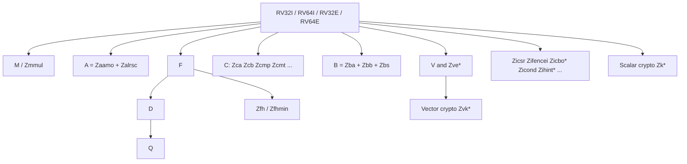

# Chapter 3 - Standard Extensions

[Index](00_README.md) | Prev: [Ch 2](02_Base_ISA.md) | Next: [Ch 4 - Vector](04_Vector_Extension.md)

**Goals:** Know every ratified general-purpose extension: what it adds, how it is encoded or used, and which are mandated by the main application-processor profiles.

> Status: all extensions in this chapter are **Ratified** unless stated otherwise. Version numbers and the exact list are in the ISA manual (v20260120 at the time of writing).

---

## 3.1 Map of the extension universe



| Group | Extensions |
|-------|-----------|
| Integer arithmetic | `M`, `Zmmul`, `Zba`, `Zbb`, `Zbc`, `Zbs`, `Zicond` |
| Atomics | `A`, `Zaamo`, `Zalrsc`, `Zacas`, `Zabha`, `Zawrs`, `Zalasr` **[verify]** |
| Floating point | `F`, `D`, `Q`, `Zfh`, `Zfhmin`, `Zfbfmin`, `Zfa`, `Zfinx`/`Zdinx`/`Zhinx`/`Zhinxmin` |
| Compressed | `C`, `Zca`, `Zcf`, `Zcd`, `Zcb`, `Zcmp`, `Zcmt`, `Zcmop`, `Zclsd` **[verify]** |
| System-support (unprivileged) | `Zicsr`, `Zifencei`, `Zicntr`, `Zihpm`, `Zicbom`, `Zicbop`, `Zicboz`, `Zihintpause`, `Zihintntl`, `Zimop` |
| Memory model | `Ztso` |
| Crypto (scalar) | `Zk`, `Zkn`, `Zks`, `Zkr`, `Zkt`, `Zbkb`, `Zbkc`, `Zbkx`, `Zkne`, `Zknd`, `Zknh`, `Zksed`, `Zksh` |
| Vector | `V`, `Zve*`, `Zvl*b`, `Zvfh`, `Zvbb`, `Zvbc`, vector crypto (Chapter 4) |

## 3.2 `misa` and extension letters (preview)

The machine CSR `misa` reports base XLEN (`MXL` in top 2 bits: 1=32, 2=64, 3=128) and single-letter extensions in bits 25:0 (A=bit 0, B=1, C=2, D=3, E=4, F=5, G=6, H=7, I=8, M=12, Q=16, S=18, U=20, V=21, X=23). Multi-letter extensions are **not** in `misa`; they are discovered via device tree, ACPI, or OS interfaces (Chapter 10).

---

## 3.3 `M` - Integer multiplication and division

Subset `Zmmul` provides multiplication only (no divide).

| Instruction | Operation |
|-------------|-----------|
| `mul` | low XLEN bits of `rs1 * rs2` |
| `mulh` | high XLEN bits, signed x signed |
| `mulhu` | high bits, unsigned x unsigned |
| `mulhsu` | high bits, signed `rs1` x unsigned `rs2` |
| `div` / `divu` | signed / unsigned quotient (round toward zero) |
| `rem` / `remu` | signed / unsigned remainder (sign follows dividend) |
| RV64: `mulw divw divuw remw remuw` | 32-bit operations, result sign-extended |

Encoding: OP/OP-32 opcodes with `funct7 = 0000001`; `funct3`: mul 000, mulh 001, mulhsu 010, mulhu 011, div 100, divu 101, rem 110, remu 111.

**Fusion recommendation:** to get a full 2*XLEN product, issue `mulh[[s]u] rdh, rs1, rs2` followed by `mul rdl, rs1, rs2` (same source operands, back to back), so hardware can fuse them.

**No traps on divide:**

| Case | `div`/`divu` quotient | `rem`/`remu` remainder |
|------|-----------------------|------------------------|
| Divide by zero | all ones (`-1` / `2^XLEN-1`) | dividend |
| Signed overflow (`-2^(XLEN-1) / -1`) | `-2^(XLEN-1)` (dividend) | `0` |

Software that needs to detect divide-by-zero must test explicitly.

---

## 3.4 `A` - Atomic instructions

`A` = `Zaamo` (atomic memory operations) + `Zalrsc` (load-reserved/store-conditional).

### AMOs (`Zaamo`)

```
amo<op>.{w|d}[.aq][.rl]  rd, rs2, (rs1)
```

Atomically: `rd = mem[rs1]; mem[rs1] = rd <op> rs2`. Operations: `swap`, `add`, `and`, `or`, `xor`, `max`, `maxu`, `min`, `minu`.

Encoding (opcode `0101111`, `funct3` = 010 for `.w`, 011 for `.d`):

| funct5 | Op |
|--------|----|
| 00000 | amoadd |
| 00001 | amoswap |
| 00010 | lr |
| 00011 | sc |
| 00100 | amoxor |
| 01000 | amoor |
| 01100 | amoand |
| 10000 | amomin |
| 10100 | amomax |
| 11000 | amominu |
| 11100 | amomaxu |

Bits `[26]` = `aq` (acquire) and `[25]` = `rl` (release). Address must be naturally aligned (misaligned atomics are environment-dependent; see `Zama16b` in 3.20).

### LR/SC (`Zalrsc`)

```
lr.{w|d}[.aq][.rl]   rd, (rs1)
sc.{w|d}[.aq][.rl]   rd, rs2, (rs1)    # rd = 0 on success, nonzero on failure
```

- `lr` loads and registers a **reservation** on the address.
- `sc` stores only if the reservation is still valid; `rd = 0` means success.
- Any other `sc` or context switch may invalidate the reservation.
- **Eventual success guarantee:** only for a "constrained LR/SC loop" - at most 16 instructions in the loop, base-ISA integer instructions only (no other loads/stores, no taken backward branches except the retry, no `fence`/system), in memory with the `RsrvEventual` PMA (profiles require this via `Ziccrse`).

```asm
# atomic fetch-and-increment using LR/SC
1:  lr.w   t0, (a0)
    addi   t1, t0, 1
    sc.w   t2, t1, (a0)
    bnez   t2, 1b
```

### Spinlock

```asm
lock:
    li       t0, 1
1:  amoswap.w.aq t1, t0, (a0)   # try to acquire
    bnez     t1, 1b
    ret
unlock:
    amoswap.w.rl x0, x0, (a0)   # release
    ret
```

### Newer atomics

| Extension | Adds |
|-----------|------|
| `Zacas` | `amocas.w`, `amocas.d`, `amocas.q` (compare-and-swap; `.q` and RV32 `.d` use even-odd register pairs) |
| `Zabha` | Byte/halfword AMOs: `amoadd.b/.h`, `amoswap`, `amoand/or/xor`, `amomin/max(u)` and (with `Zacas`) `amocas.b/.h` |
| `Zawrs` | `wrs.nto`, `wrs.sto`: wait-on-reservation-set; efficient spin-waiting paired with `lr` |
| `Zalasr` | Load-acquire and store-release instructions (`lb.aq`, `sw.rl`, ...) **[verify status]** |

Spin-wait with `Zawrs`:

```asm
1:  lr.w     t0, (a0)
    beqz     t0, 2f        # condition met
    wrs.nto                # wait until reservation invalidated (or short timeout)
    j        1b
2:
```

The memory-ordering meaning of `aq`/`rl` is in Chapter 8.

---

## 3.5 Floating point: `F`, `D`, `Q`, `Zfh`

### State

| State | Description |
|-------|-------------|
| `f0`-`f31` | FP registers, `FLEN` bits (32 for F only, 64 for D, 128 for Q) |
| `fcsr` (CSR 0x003) | `frm` in bits 7:5 (rounding mode), `fflags` in bits 4:0 |
| `fflags` (0x001) | accrued exceptions: `NX`(0) inexact, `UF`(1) underflow, `OF`(2) overflow, `DZ`(3) divide-by-zero, `NV`(4) invalid |
| `frm` (0x002) | dynamic rounding mode |
| `mstatus.FS` | FP unit state: Off / Initial / Clean / Dirty (lazy save/restore for the OS) |

FP ABI register names: `ft0-ft11` temporaries, `fs0-fs11` saved, `fa0-fa7` arguments/returns (Chapter 9).

### Rounding modes (`rm` field, 3 bits)

| Code | Mnemonic | Meaning |
|------|----------|---------|
| 000 | `rne` | round to nearest, ties to even |
| 001 | `rtz` | toward zero |
| 010 | `rdn` | down (toward -inf) |
| 011 | `rup` | up (toward +inf) |
| 100 | `rmm` | nearest, ties to max magnitude |
| 101-110 | - | reserved |
| 111 | `dyn` | use `frm` (in an instruction `rm` field) |

### Instruction groups (S = single, D = double, Q = quad, H = half)

| Group | Instructions |
|-------|--------------|
| Load/store | `flw fsw`, `fld fsd`, `flq fsq`, `flh fsh` |
| Arithmetic | `fadd.s fsub.s fmul.s fdiv.s fsqrt.s` (and `.d/.q/.h`) |
| Fused multiply-add | `fmadd` (`rs1*rs2+rs3`), `fmsub` (`rs1*rs2-rs3`), `fnmsub` (`-(rs1*rs2)+rs3`), `fnmadd` (`-(rs1*rs2)-rs3`) |
| Sign injection | `fsgnj`, `fsgnjn`, `fsgnjx` -> pseudos `fmv.s`, `fneg.s`, `fabs.s` |
| Min/max | `fmin`, `fmax` |
| Compare (result in integer reg) | `feq`, `flt`, `fle` |
| Classify | `fclass` -> 10-bit one-hot mask in integer reg |
| Convert FP<->int | `fcvt.w.s fcvt.wu.s fcvt.l.s fcvt.lu.s` and reverse `fcvt.s.w ...`; FP<->FP `fcvt.s.d`, `fcvt.d.s` |
| Move bits | `fmv.x.w`, `fmv.w.x`; RV64 `fmv.x.d`, `fmv.d.x` |

`fclass` result bits: 0 = -inf, 1 = negative normal, 2 = negative subnormal, 3 = -0, 4 = +0, 5 = positive subnormal, 6 = positive normal, 7 = +inf, 8 = signaling NaN, 9 = quiet NaN.

### Important semantics

- **No FP trap.** Exceptions only set `fflags`. Software checks flags.
- **Canonical NaN** is the only NaN generated by arithmetic (e.g., `0x7fc00000` for single). NaN payloads are not propagated.
- **NaN-boxing:** a narrower value stored in a wider register has all upper bits set to 1. If an operand is not properly NaN-boxed, it is treated as the canonical NaN. This allows `F` values in `D` registers safely.
- `fmin`/`fmax` return the non-NaN operand if exactly one is NaN (IEEE 754-2019 `minimumNumber/maximumNumber` behavior); `-0 < +0`. (`Zfa` adds `fminm/fmaxm` with propagating NaN semantics.)
- Out-of-range FP->integer conversions **saturate** and raise `NV`; NaN converts to the max positive value.
- Fused multiply-add is a single rounding; `fmul`+`fadd` is two.
- Single-precision ops on a D-capable register file operate on the lower 32 bits.

### FP-in-integer-registers (`Zfinx`, `Zdinx`, `Zhinx`, `Zhinxmin`)

For small cores: no separate `f` register file; FP instructions use `x` registers. Saves area and context-switch cost. Not compatible with `F/D` binaries at the ISA level.

### Half precision and BF16

| Extension | Provides |
|-----------|----------|
| `Zfh` | Full IEEE binary16 arithmetic |
| `Zfhmin` | Conversions and moves only (`fcvt.s.h`, `fcvt.h.s`, `flh`, `fsh`, `fmv.x.h`, `fmv.h.x`) |
| `Zfbfmin` | bfloat16 conversions (`fcvt.bf16.s`, `fcvt.s.bf16`) plus loads/stores |
| `Zvfh/Zvfhmin`, `Zvfbfmin`, `Zvfbfwma` | Vector half/BF16 support (Chapter 4) |

### `Zfa` - additional FP instructions

- `fli.{h,s,d,q}`: load one of 32 predefined constants (-1.0, min normal, 1.0, 2.0, 255, inf, canonical NaN...).
- `fminm`, `fmaxm`: min/max that return NaN if either operand is NaN.
- `fround`, `froundnx`: round to integral value (the `nx` form raises Inexact).
- `fcvtmod.w.d`: convert double to a modular 32-bit int (JavaScript-style).
- `fleq`, `fltq`: quiet comparisons (do not raise on quiet NaN).
- RV32 only: `fmvh.x.d`, `fmvp.d.x` for moving 64-bit halves.

### Example: dot product (single precision)

```asm
# float dot(const float *a, const float *b, long n)
dot:
    fmv.w.x ft0, x0              # acc = 0.0f
    beqz    a2, 2f
1:  flw     ft1, 0(a0)
    flw     ft2, 0(a1)
    fmadd.s ft0, ft1, ft2, ft0
    addi    a0, a0, 4
    addi    a1, a1, 4
    addi    a2, a2, -1
    bnez    a2, 1b
2:  fmv.s   fa0, ft0
    ret
```

---

## 3.6 `C` - Compressed instructions

16-bit encodings of common 32-bit instructions. Typical code-size reduction is roughly 25-30% in embedded code; performance impact is small to positive. 32- and 16-bit instructions mix freely, and 32-bit ones may start on any 16-bit boundary.

### Why it works

- Common operations are encoded with **fewer register bits**: many forms use a 3-bit field for `x8`-`x15`.
- **Destination equals first source** (2-address form).
- **Small immediates**.
- The decoder expands each 16-bit instruction to its 32-bit equivalent, so there is no new architectural state.

### Three quadrants (bits `[1:0]`)

| `[1:0]` | Quadrant | Content |
|---------|----------|---------|
| `00` | 0 | Stack-pointer-based address generation and register-based loads/stores |
| `01` | 1 | Control transfer, integer constants, ALU on compressed registers |
| `10` | 2 | SP-relative loads/stores, register moves/adds, jumps |
| `11` | - | 32-bit (or longer) instruction |

### Instruction list

| Mnemonic | Expands to |
|----------|-----------|
| `c.addi4spn rd', nzuimm` | `addi rd', sp, nzuimm` |
| `c.lw`, `c.ld` (RV64), `c.flw`/`c.fld` | register-relative loads |
| `c.sw`, `c.sd`, `c.fsw`/`c.fsd` | register-relative stores |
| `c.lwsp`, `c.ldsp`, `c.flwsp`, `c.fldsp` | `lw rd, off(sp)` etc. |
| `c.swsp`, `c.sdsp`, `c.fswsp`, `c.fsdsp` | `sw rs2, off(sp)` etc. |
| `c.nop`, `c.addi`, `c.li`, `c.lui`, `c.addi16sp` | `addi`/`lui` variants |
| `c.addiw` (RV64), `c.addw`, `c.subw` | word ops |
| `c.jal` (**RV32 only**) | `jal ra, off` |
| `c.j`, `c.jr`, `c.jalr` | jumps |
| `c.beqz`, `c.bnez` | branches vs zero (compressed regs) |
| `c.srli`, `c.srai`, `c.andi`, `c.slli` | shifts/mask |
| `c.and`, `c.or`, `c.xor`, `c.sub` | compressed-reg ALU |
| `c.mv`, `c.add` | register move/add |
| `c.ebreak` | breakpoint |

(`c.jal` on RV32 and `c.addiw` on RV64 share an encoding.)

### Component extensions

| Extension | Purpose |
|-----------|---------|
| `Zca` | The integer part of `C` (no FP). `C` = `Zca` plus `Zcf` (if RV32 + F) plus `Zcd` (if D). |
| `Zcf` | RV32-only compressed single-precision FP loads/stores |
| `Zcd` | Compressed double-precision FP loads/stores |
| `Zcb` | More compressed ops: `c.lbu c.lhu c.lh c.sb c.sh c.zext.b c.sext.b c.zext.h c.sext.h c.zext.w c.not c.mul` |
| `Zcmp` | Prologue/epilogue macros: `cm.push`, `cm.pop`, `cm.popret`, `cm.popretz`, `cm.mva01s`, `cm.mvsa01` (save/restore `ra`, `s0..s11` with one 16-bit instruction) |
| `Zcmt` | Table-jump: `cm.jt`, `cm.jalt` through the `jvt` CSR (0x017), reducing code size of call-heavy code |
| `Zcmop` | Compressed may-be-operations `c.mop.n` (`n` = 1,3,...,15) |
| `Zclsd` / `Zilsd` | RV32 load/store of 64-bit values through register pairs **[verify status]** |

`cm.push {ra, s0-s2}, -32` pushes the listed registers and adjusts `sp` in one instruction; `cm.popret` pops and returns. Compilers use these with `-Os` to shrink code.

Beware: `Zcmp`/`Zcmt` are **not** compatible with `Zcd` (encoding overlap), so a hart with both choices must pick one set.

### Alignment effects

With `C`, `IALIGN = 16`: jump/branch targets need only 2-byte alignment, and a 32-bit instruction may cross a cache line or even a page boundary. Hardware must handle instruction fetch across those boundaries (`Ziccif` guarantees atomic fetch for naturally aligned sizes in profile-conforming memory).

---

## 3.7 `B` - Bit manipulation

`B` = **`Zba` + `Zbb` + `Zbs`**. `Zbc` (carry-less multiply) is separate.

### `Zba` - address generation

| Instruction | Operation |
|-------------|-----------|
| `sh1add rd, rs1, rs2` | `rd = rs2 + (rs1 << 1)` |
| `sh2add` | `rs2 + (rs1 << 2)` |
| `sh3add` | `rs2 + (rs1 << 3)` |
| RV64: `add.uw rd, rs1, rs2` | `rs2 + zext32(rs1)` |
| RV64: `sh1add.uw/sh2add.uw/sh3add.uw` | zero-extend then shift-add |
| RV64: `slli.uw rd, rs1, shamt` | `zext32(rs1) << shamt` |

Typical use: `a[i]` with 8-byte elements becomes one `sh3add t0, i, base` plus a load.

### `Zbb` - basic bit manipulation

| Instruction | Operation |
|-------------|-----------|
| `andn`, `orn`, `xnor` | AND/OR/XOR with inverted `rs2` |
| `clz`, `ctz`, `cpop` | count leading zeros, trailing zeros, population count |
| RV64: `clzw`, `ctzw`, `cpopw` | 32-bit versions |
| `max`, `maxu`, `min`, `minu` | integer min/max |
| `sext.b`, `sext.h`, `zext.h` | sign/zero extend |
| `rol`, `ror`, `rori` (RV64: `rolw`, `rorw`, `roriw`) | rotates |
| `orc.b` | each byte becomes `0xFF` if nonzero else `0x00` (fast `strlen`/`memchr` scans) |
| `rev8` | byte-reverse (endianness swap) |

### `Zbs` - single-bit

`bclr`, `bclri`, `bext`, `bexti`, `binv`, `binvi`, `bset`, `bseti`.

### `Zbc` - carry-less multiply

`clmul`, `clmulh`, `clmulr`. Used in CRC and GCM/GHASH. (RVA23 lists `Zbc` as an **expansion option**; vector `Zvbc` is a **development option**.)

Example: `popcount` and bit test:

```asm
    cpop a0, a0          # popcount
    bexti t0, a1, 5      # t0 = bit 5 of a1
```

---

## 3.8 Conditional operations - `Zicond`

| Instruction | Operation |
|-------------|-----------|
| `czero.eqz rd, rs1, rs2` | `rd = (rs2 == 0) ? 0 : rs1` |
| `czero.nez rd, rs1, rs2` | `rd = (rs2 != 0) ? 0 : rs1` |

Branchless select `r = c ? a : b`:

```asm
    czero.nez t0, b, c       # t0 = c ? 0 : b
    czero.eqz t1, a, c       # t1 = c ? a : 0
    or        r,  t0, t1
```

---

## 3.9 System-support extensions

### `Zicsr`, `Zifencei`
Covered in Chapter 2.

### `Zicntr`, `Zihpm` - counters

| CSR | Meaning |
|-----|---------|
| `cycle` (0xC00) | cycle counter (read-only shadow of `mcycle`) |
| `time` (0xC01) | real-time counter (shadow of memory-mapped `mtime`) |
| `instret` (0xC02) | instructions retired |
| `hpmcounter3`-`hpmcounter31` (0xC03...) | event counters (events chosen via `mhpmevent*`) |
| `mcounteren`/`scounteren` | permission bits for lower modes to read these |

Details in Chapters 5 and 13.

### Cache-block operations

| Extension | Instructions | Purpose |
|-----------|--------------|---------|
| `Zicbom` | `cbo.clean`, `cbo.flush`, `cbo.inval` | Clean (write back), flush (write back and invalidate), invalidate a cache block. Needed for non-coherent DMA. |
| `Zicbop` | `prefetch.i`, `prefetch.r`, `prefetch.w` | Prefetch hints for instruction/read/write. Encoded as `ori x0, rs1, imm` with low 5 bits of imm zero. |
| `Zicboz` | `cbo.zero` | Zero a whole cache block without reading memory |

- Block size is implementation-defined; **`Zic64b`** (a profile-defined extension) mandates 64 bytes in RVA23. Discovered through the device tree (`riscv,cbom-block-size`, `riscv,cboz-block-size`).
- Which modes may use them is controlled by `menvcfg`/`senvcfg`/`henvcfg` fields (`CBIE`, `CBCFE`, `CBZE`).

### Hints

| Extension | Instruction | Meaning |
|-----------|-------------|---------|
| `Zihintpause` | `pause` | Temporarily reduce a hart's retired-instruction rate (spin-loop hint). Encoded as `fence w,0`. |
| `Zihintntl` | `ntl.p1`, `ntl.pall`, `ntl.s1`, `ntl.all` | Non-temporal locality hint for the *next* load/store: cache levels not to allocate in. Encoded as `add x0, x0, x2/x3/x4/x5`. |

Hints never change architectural results; implementations may ignore them.

### `Zimop` / `Zcmop` - may-be-operations

- 32 `mop.r.N` and 8 `mop.rr.N` encodings that by default **write 0 to `rd`** (behave as a `li rd,0`-like nop that reads the sources).
- Purpose: future extensions can redefine them; software emitting them still runs on old hardware. Used heavily by **CFI** (Chapter 12).
- Compressed: `c.mop.1`, `c.mop.3`, ..., `c.mop.15`.

### `Ztso` - total store ordering

Optional stronger memory model, useful for ported x86 code. Chapter 8.

---

## 3.10 Scalar cryptography (`Zk`)

Ratified. Provides small, **constant-time** primitives for AES, SHA-2, SM3, SM4.

| Extension | Content |
|-----------|---------|
| `Zbkb` | Bit-manip for crypto: `rol`, `ror`, `rev8`, `brev8`, `pack`, `packh`, `packw`, `andn/orn/xnor`, RV32 `zip`/`unzip` |
| `Zbkc` | Carry-less multiply (`clmul`, `clmulh`) |
| `Zbkx` | Crossbar permutations (`xperm4`, `xperm8`) |
| `Zknd` | AES decryption (RV32: `aes32dsi`, `aes32dsmi`; RV64: `aes64ds`, `aes64dsm`, `aes64im`, `aes64ks1i`, `aes64ks2`) |
| `Zkne` | AES encryption (RV32: `aes32esi`, `aes32esmi`; RV64: `aes64es`, `aes64esm`, key-schedule shared) |
| `Zknh` | SHA-256: `sha256sig0/sig1/sum0/sum1`; SHA-512: `sha512sig0/sig1/sum0/sum1` (RV64) or `*l/*h` pairs (RV32) |
| `Zksed` | SM4: `sm4ed`, `sm4ks` |
| `Zksh` | SM3: `sm3p0`, `sm3p1` |
| `Zkr` | Entropy source: read through CSR `seed` (0x015) using `csrrw`; supplies raw entropy bits for a seeding DRBG |
| `Zkt` | **Data-independent execution latency** for a defined list of instructions (a constant-time guarantee against timing side channels) |

Bundles: **`Zkn`** = Zbkb + Zbkc + Zbkx + Zkne + Zknd + Zknh. **`Zks`** = Zbkb + Zbkc + Zbkx + Zksed + Zksh. **`Zk`** = Zkn + Zkr + Zkt.

> Profile note: RVA23 **does not** make scalar `Zkn`/`Zks` options. It mandates `Zkt` and pushes toward **vector crypto** (Chapter 4). RVA22 had scalar crypto options.

---

## 3.11 Profile-defined "behavior" extensions (PMA-style names)

Some names in profiles do not add instructions. They state **guarantees about main memory** or privileged behavior, so software can rely on them.

| Name | Guarantee |
|------|-----------|
| `Ziccif` | Instruction fetch support (and atomic fetch of naturally aligned sizes up to min(ILEN,XLEN)) in cacheable/coherent main memory |
| `Ziccrse` | `RsrvEventual` - LR/SC loops eventually succeed |
| `Ziccamoa` | All `Zaamo` atomics supported in main memory |
| `Ziccamoc` | `amocas` supported in main memory (needed with `Zacas`) |
| `Zicclsm` | Misaligned loads/stores to main memory are supported (may be slow) |
| `Za64rs` / `Za128rs` | Reservation set is contiguous, naturally aligned, at most 64 / 128 bytes |
| `Zic64b` | Cache blocks are exactly 64 bytes, naturally aligned |
| `Zama16b` | Misaligned loads/stores/AMOs inside a 16-byte naturally aligned granule are atomic |
| `Ssccptr` | Main memory supports hardware page-table reads |
| `Svade` | Page fault if A/D bit would need setting |
| `Sstvecd`, `Sstvala`, `Sscounterenw`, `Shvstvala`, `Shtvala`, ... | Specify behavior of `stvec`, `stval`, `scounteren`, hypervisor CSRs |
| `Ssstrict` | Unimplemented standard/reserved opcodes and CSRs raise illegal-instruction (no non-conforming extensions) |

---

## 3.12 Profiles in detail (what is mandatory)

> Source: RVA23 profile document (fetched 2026-10-22). The profiles repository was seen archived on 2026-07-24; the text now lives in the unified specification library at docs.riscv.org **[verify location]**.

### RVA20U64 (basis; ~`RV64GC`)

`RV64I` + `M A F D C` + `Zicsr` + `Zicntr` + `Ziccif`/`Ziccrse`/`Ziccamoa`/`Zicclsm` + `Za128rs` (and basic privileged parts in RVA20S64 such as Sv39).

### RVA22U64 (adds)

`B` (`Zba Zbb Zbs`), `Zihintpause`, `Zihpm`, `Zic64b`, `Zicbom`, `Zicbop`, `Zicboz`, `Zfhmin`, `Zkt`, `Za64rs`. Vector (`V`) optional.

### RVA23U64 - mandatory

Everything in RVA22U64 (including `M A F D C B Zicsr Zicntr Zihpm Ziccif Ziccrse Ziccamoa Zicclsm Za64rs Zihintpause Zic64b Zicbom Zicbop Zicboz Zfhmin Zkt`) **plus**:

| Added mandatory | Meaning |
|------------------|---------|
| `V` (+ `Zvfhmin`, `Zvbb`, `Zvkt`) | Vector extension and minimal vector support (V was optional in RVA22) |
| `Zihintntl` | Non-temporal hints |
| `Zicond` | Conditional zero |
| `Zimop`, `Zcmop` | May-be-operations |
| `Zcb` | Extra compressed instructions |
| `Zfa` | Additional FP |
| `Zawrs` | Wait on reservation set |
| `Supm` | Pointer masking (PMLEN=0 and 7 available at minimum) |

### RVA23U64 - options

| Category | Items |
|----------|-------|
| Localized | `Zvkng`, `Zvksg` (vector crypto with GCM) |
| Development (intended to become mandatory) | `Zabha`, `Zacas`, `Ziccamoc`, `Zvbc`, `Zama16b` |
| Expansion | `Zfh`, `Zbc`, `Zicfilp` (landing pads), `Zicfiss` (shadow stack), `Zvfh`, `Zfbfmin`, `Zvfbfmin`, `Zvfbfwma` |
| Transitory | none |

### RVA23S64 - mandatory (in addition to all RVA23U64)

`Zifencei`; `Ss1p13` (supervisor architecture v1.13); `Svbare`, `Sv39`, `Svade`, `Ssccptr`, `Sstvecd`, `Sstvala`, `Sscounterenw`, `Svpbmt`, `Svinval`, `Svnapot`, `Sstc`, `Sscofpmf`, `Ssnpm` (pointer masking), `Ssu64xl`, and **`Sha`** (the augmented hypervisor extension: `H`, `Ssstateen`, `Shcounterenw`, `Shvstvala`, `Shtvala`, `Shvstvecd`, `Shvsatpa`, `Shgatpa`). Details in Chapters 5-7.

### RVA23S64 - options

Expansion: `Sv48`, `Sv57`, `Zkr`, `Svadu`, `Sdtrig`, `Ssstrict`, `Svvptc`, `Sspm`. No localized/development/transitory privileged options.

**Consequence:** RVA23 software can assume vectors and a hypervisor-capable core, but must discover options (`Zicfiss`, `Zacas`, `Zvbc`, ...) at runtime.

### Compiler flags (check your toolchain version **[verify]**)

```
gcc -march=rv64gcv_zba_zbb_zbs_zicond_zfa_zawrs ...   # explicit list
clang -march=rva23u64 ...                              # profile names in recent LLVM
gcc -march=rva23u64 ...                                # profile names in recent GCC
```

---

## 3.13 Choosing and discovering extensions

| Need | Prefer |
|------|--------|
| Smallest code on an MCU | `C` + `Zcb` + `Zcmp` (and maybe `Zcmt`) |
| Fast array indexing | `Zba` |
| Fast string/bit ops | `Zbb` (`orc.b`, `cpop`, `clz`) |
| Branchless select | `Zicond` |
| Lock-free queues, 128-bit CAS | `Zacas` |
| Spin-wait efficiency | `Zihintpause`, `Zawrs` |
| Constant-time crypto | `Zkt`, `Zbkb`, `Zkn`/`Zvk*` |
| Non-coherent DMA | `Zicbom` |
| x86-ported lock-free code | `Ztso` |

How software discovers what is present: Chapter 10 (device tree `riscv,isa-extensions`, ACPI RHCT, Linux `riscv_hwprobe`).

---

## 3.14 Chapter summary

- The base is tiny; extensions add multiply, atomics, FP, compression, bit ops, crypto, hints, and cache control.
- Division never traps; FP never traps; atomics are `Zaamo` + `Zalrsc` with newer CAS/byte atomics.
- `C` is a decode-time expansion, not a separate architecture; `Zcb/Zcmp/Zcmt` improve density further.
- Profiles (RVA22, RVA23) pin down which extensions software may assume; RVA23 mandates Vector and the hypervisor.
- Many extension names (`Ziccamoa`, `Za64rs`, `Zic64b`...) describe **guarantees**, not instructions.

### Check yourself

1. What does `div` return for `x / 0` and for `INT_MIN / -1`?
2. Why does RISC-V not set an FP exception trap?
3. Which extension gives `sh3add`, and what one-line sequence indexes `long a[i]`?
4. What is NaN-boxing?
5. Name three RVA23U64 mandatory extensions that were *not* mandatory in RVA22U64.

<details><summary>Answers</summary>

1. `-1` (all ones) for `x/0`; `INT_MIN` for overflow (remainder 0).
2. Design choice: exceptions set flags; software polls them (simplifies pipelines).
3. `Zba`; `sh3add t0, i, base` then `ld`.
4. A narrower FP value in a wider FP register has its upper bits all 1s; improperly boxed values are read as canonical NaN.
5. For example `V`, `Zicond`, `Zfa` (also `Zawrs`, `Zcb`, `Zihintntl`, `Zimop`, `Zcmop`, `Supm`).
</details>

Next: [Chapter 4 - Vector Extension](04_Vector_Extension.md)
