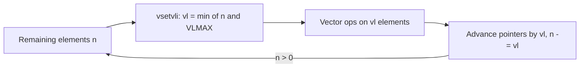

# Chapter 4 - The Vector Extension (RVV 1.0)

[Index](00_README.md) | Prev: [Ch 3](03_Standard_Extensions.md) | Next: [Ch 5 - Privileged](05_Privileged_Architecture.md)

**Goals:** Understand the vector programming model (vector-length agnostic), master `vsetvli`, LMUL, masking, memory access forms, and write correct strip-mined loops.

> Status: **Ratified** (v1.0, 2021). Mandatory in **RVA23** (as `V` with `Zvfhmin`, `Zvbb`, `Zvkt`). Vector crypto extensions are also ratified. Exact ratification dates **[verify]**.

---

## 4.1 Idea: vector-length agnostic (VLA) SIMD

Fixed-width SIMD (SSE/AVX/NEON) bakes the register width into the code. RISC-V vectors instead let the program ask for N elements; hardware answers how many it will process this iteration. The same binary runs on 128-bit and 1024-bit hardware.



Contrast with packed-SIMD (`P`, Chapter 14): `P` reuses integer registers; `V` has its own register file and a length-agnostic model.

## 4.2 Architectural state

| State | Meaning |
|-------|---------|
| `v0`-`v31` | 32 vector registers, each `VLEN` bits. `v0` doubles as the **mask register**. |
| `vlenb` (CSR 0xC22) | `VLEN/8` (read-only) |
| `vl` (0xC20) | Number of elements to process (read-only; written by `vset{i}vl{i}`) |
| `vtype` (0xC21) | Current element configuration (read-only; written by `vset{i}vl{i}`) |
| `vstart` (0x008) | First element to process; used to resume after a trap. Normally 0. |
| `vxrm` (0x00A) | Fixed-point rounding mode (2 bits) |
| `vxsat` (0x009) | Fixed-point saturation flag |
| `vcsr` (0x00F) | `vxsat` (bit 0) and `vxrm` (bits 2:1) combined |
| `mstatus.VS` | Vector unit state: Off/Initial/Clean/Dirty (OS lazy context switch) |

Implementation parameters:

| Parameter | Meaning |
|-----------|---------|
| `VLEN` | Bits per vector register. Power of two. `V` requires >= 128. |
| `ELEN` | Maximum element width in bits. `V` requires 64. |
| `SEW` | Selected element width: 8, 16, 32, 64 (bits). |
| `LMUL` | Register-group multiplier: 1/8, 1/4, 1/2, 1, 2, 4, 8. |
| `VLMAX` | `LMUL * VLEN / SEW`, the maximum elements per operation. |

### `vtype` layout

```
 XLEN-1  XLEN-2        8   7    6    5    3  2    0
+------+-------------+-----+----+---------+---------+
| vill |  reserved   | vma | vta |  vsew   |  vlmul  |
+------+-------------+-----+----+---------+---------+
```

| Field | Encoding |
|-------|----------|
| `vsew` | 000=8, 001=16, 010=32, 011=64 |
| `vlmul` | 101=1/8, 110=1/4, 111=1/2, 000=1, 001=2, 010=4, 011=8 |
| `vta` | 1 = tail agnostic, 0 = tail undisturbed |
| `vma` | 1 = mask agnostic, 0 = mask undisturbed |
| `vill` | 1 = the requested configuration is illegal (all other fields then zero; vector ops trap) |

Fractional LMUL requires `SEW/LMUL <= ELEN`.

## 4.3 Configuring the unit: `vsetvli`, `vsetivli`, `vsetvl`

```
vsetvli  rd, rs1, e<sew>, m<lmul>, t<a|u>, m<a|u>   # AVL in rs1
vsetivli rd, uimm, e<sew>, m<lmul>, t<a|u>, m<a|u>  # AVL = 5-bit immediate
vsetvl   rd, rs1, rs2                               # vtype from register rs2
```

`rd` receives the new `vl`. The **application vector length (AVL)** is the requested count:

| `rs1` | `rd` | Meaning |
|-------|------|---------|
| not `x0` | any | AVL = value in `rs1` |
| `x0` | not `x0` | AVL = infinity -> `vl = VLMAX` |
| `x0` | `x0` | Keep current `vl`, change only `vtype` (new `VLMAX` ratio must stay the same, else `vill` may be set) |

Rule for `vl`: if AVL <= VLMAX, `vl = AVL`. If AVL >= 2*VLMAX, `vl = VLMAX`. In between, the implementation picks (subject to rules), e.g. may balance the last two iterations. Never assume `vl == min(AVL, VLMAX)` in all cases; always use the returned `vl`.

Example: `vsetvli t0, a0, e32, m2, ta, ma` -> 32-bit elements, registers grouped by 2, tail/mask agnostic.

## 4.4 Register grouping (LMUL)

- `LMUL > 1` joins registers into **groups**: with `LMUL=4`, an operand names `v0`, `v4`, `v8`... (register number must be a multiple of LMUL; otherwise illegal instruction).
- `LMUL < 1` uses only part of one register; saves registers when mixing widths.
- Widening instructions produce a result group of `2*LMUL` (`EMUL`); narrowing consume `2*LMUL` and produce `LMUL`.
- Use large LMUL to unroll for throughput; use small LMUL when you need many registers.

```
LMUL=1 : v0 v1 v2 ... v31 (32 usable operands)
LMUL=2 : v0 v2 v4 ... v30 (16 operands)
LMUL=4 : v0 v4 v8 ... v28 (8 operands)
LMUL=8 : v0 v8 v16 v24    (4 operands)
```

## 4.5 Masking and tail/mask policy

- A masked instruction ends in `, v0.t`. Element `i` is **active** if bit `i` of `v0` is 1 and `vstart <= i < vl`.
- **Mask layout:** bit `i` of a mask register corresponds to element `i`, regardless of SEW (mask registers are always packed, one bit per element, one register).
- **Prestart** elements (`i < vstart`) are never changed.
- **Body** elements `vstart <= i < vl`: active ones get computed; inactive ones follow the **mask policy** (`ma` / `mu`).
- **Tail** elements `i >= vl`: follow the **tail policy** (`ta` / `tu`).
- *Agnostic* means each element is either left undisturbed **or** overwritten with all 1s (implementation choice; the program must not depend on which).
- Use `tu` when you need to preserve the remaining values (e.g., accumulating into a register across loop iterations, see 4.12).

## 4.6 Memory access instructions

Encoding: they reuse **LOAD-FP / STORE-FP** opcodes with the `width` field (`funct3`) = 000 (8-bit), 101 (16), 110 (32), 111 (64); the `mop` field (bits 27:26) selects addressing mode (00 unit-stride, 01 unordered-indexed, 10 strided, 11 ordered-indexed).

| Kind | Loads | Stores |
|------|-------|--------|
| Unit-stride | `vle8.v vle16.v vle32.v vle64.v` | `vse8.v ... vse64.v` |
| Mask | `vlm.v` | `vsm.v` |
| Strided (byte stride in a scalar reg) | `vlse{8..64}.v vd, (rs1), rs2` | `vsse{8..64}.v` |
| Indexed unordered | `vluxei{8..64}.v vd, (rs1), vs2` | `vsuxei*` |
| Indexed ordered | `vloxei*` | `vsoxei*` |
| Fault-only-first | `vle{8..64}ff.v` | - |
| Segment (structure-of-arrays) | `vlseg<nf>e<w>.v` etc. (2..8 fields) | `vsseg<nf>e<w>.v` |
| Whole register | `vl1re8.v`, `vl2re8.v`, `vl4re8.v`, `vl8re8.v` (and 16/32/64) | `vs1r.v`, `vs2r.v`, `vs4r.v`, `vs8r.v` |

Notes:

- The effective element width (EEW) of a memory op is in the mnemonic; it can differ from SEW (EMUL = EEW/SEW * LMUL adjusts the register group size).
- **Fault-only-first** (`vle*ff`) takes a trap only if element 0 faults; later faults truncate `vl` instead. Essential for `strlen`/`memchr`-style loops that may run off a page.
- **Segment** loads de-interleave: e.g., `vlseg3e8.v v8, (a0)` loads RGB pixels into `v8` (R), `v9` (G), `v10` (B).
- **Whole-register** ops ignore `vl` and `vtype` (used for spills/context switch, kernel `memcpy`).
- Unordered indexed ops may access elements in any order; ordered ones preserve element order (required for I/O).
- Vector accesses to misaligned addresses follow the same environment rules as scalar; alignment support is implementation-defined (`Zicclsm`/`Zvbb`-profile statements apply **[verify]**).

## 4.7 Arithmetic instruction families

Operand forms (suffix):

| Suffix | Operands |
|--------|----------|
| `.vv` | vector, vector |
| `.vx` | vector, scalar integer register |
| `.vi` | vector, 5-bit immediate |
| `.vf` | vector, scalar FP register |
| `.vs` | reduction: vector in, scalar (element 0) in/out |
| `.wv`/`.wx`/`.wi` | wide (2*SEW) first operand |
| `.mm` | mask-register operands |

Encoding: opcode `1010111` (OP-V); `funct3`: OPIVV 000, OPFVV 001, OPMVV 010, OPIVI 011, OPIVX 100, OPFVF 101, OPMVX 110, OPCFG 111 (the `vset*` family).

### Integer

| Category | Instructions |
|----------|--------------|
| Add/sub | `vadd vsub vrsub` (reverse-subtract), `vneg` pseudo |
| Widening add/sub | `vwadd vwaddu vwsub vwsubu` (+ `.wv/.wx` forms) |
| Extension | `vzext.vf2/4/8`, `vsext.vf2/4/8` |
| Carry/borrow | `vadc vmadc vsbc vmsbc` |
| Logic | `vand vor vxor vnot` |
| Shifts | `vsll vsrl vsra`; narrowing `vnsrl vnsra` |
| Compare -> mask | `vmseq vmsne vmsltu vmslt vmsleu vmsle vmsgtu vmsgt` |
| Min/max | `vminu vmin vmaxu vmax` |
| Multiply | `vmul vmulh vmulhu vmulhsu`; widening `vwmul vwmulu vwmulsu` |
| Divide | `vdivu vdiv vremu vrem` |
| Multiply-add | `vmacc vnmsac vmadd vnmsub`; widening `vwmacc vwmaccu vwmaccsu vwmaccus` |
| Merge/move | `vmerge`, `vmv.v.v/x/i`, `vmv.x.s`, `vmv.s.x` |
| Fixed-point | `vsaddu vsadd vssubu vssub vaaddu vaadd vasubu vasub vsmul vssrl vssra vnclipu vnclip` |

### Floating point

`vfadd vfsub vfrsub vfmul vfdiv vfrdiv vfsqrt vfrec7 vfrsqrt7 vfmin vfmax vfsgnj vfsgnjn vfsgnjx vfclass`, fused `vfmacc vfnmacc vfmsac vfnmsac vfmadd ...`, widening `vfwadd vfwmul vfwmacc ...`, conversions `vfcvt.*`, `vfwcvt.*`, `vfncvt.*`, compare `vmfeq vmfne vmflt vmfle vmfgt vmfge`, merge/move `vfmerge vfmv.v.f vfmv.f.s vfmv.s.f`. Same exception model as scalar FP (flags only; `frm` rounding).

### Reductions

`vredsum vredmax(u) vredmin(u) vredand vredor vredxor`, FP `vfredusum` (unordered), `vfredosum` (ordered, reproducible), `vfredmax/min`; widening `vwredsum(u)`, `vfwredusum/osum`. Result goes in **element 0** of `vd`; the initial value comes from element 0 of `vs1`.

### Mask operations

`vmand vmnand vmandn vmor vmnor vmorn vmxor vmxnor`, `vcpop.m` (count set bits), `vfirst.m` (index of first set bit or -1), `vmsbf.m` (set-before-first), `vmsif.m` (set-including-first), `vmsof.m` (set-only-first), `viota.m` (prefix count), `vid.v` (element indices).

### Permutation

`vslideup vslidedown vslide1up vslide1down vrgather vrgatherei16 vcompress vmv<nr>r.v` (whole-register copy of 1,2,4,8 registers).

## 4.8 Subsets for embedded cores

| Extension | Contents |
|-----------|----------|
| `Zve32x` | ELEN=32, integer only |
| `Zve32f` | + single-precision FP |
| `Zve64x` | ELEN=64, integer |
| `Zve64f` | + single FP |
| `Zve64d` | + double FP |
| `Zvl32b` ... `Zvl65536b` | Guaranteed minimum `VLEN` |
| **`V`** | `Zve64d` + `Zvl128b` (the application-processor vector extension) |
| `Zvfh`, `Zvfhmin` | Vector half precision (full / conversions only) |
| `Zvfbfmin`, `Zvfbfwma` | bfloat16 conversions / widening multiply-add |

`Zve*` cores (e.g., small MCUs with AI kernels) omit vector division, FP types, and sometimes 64-bit elements; code compiled for them uses a restricted set.

## 4.9 Vector crypto (`Zvk*`)

**Ratified.** Optional in RVA23 except `Zvbb`/`Zvkt` (mandatory) and the `Zvkng`/`Zvksg` options.

| Extension | Content |
|-----------|---------|
| `Zvbb` | Vector basic bit-manip: `vandn vbrev vbrev8 vrev8 vclz vctz vcpop vrol vror vwsll` |
| `Zvbc` | Vector carry-less multiply: `vclmul vclmulh` |
| `Zvkb` | Vector crypto bit-manip (subset of `Zvbb`) |
| `Zvkg` | GCM/GMAC: `vghsh vgmul` |
| `Zvkned` | AES (NIST): `vaesef vaesem vaesdf vaesdm vaesz vaeskf1 vaeskf2` |
| `Zvknha` / `Zvknhb` | SHA-256 (`a`) / SHA-256 and SHA-512 (`b`): `vsha2ms vsha2ch vsha2cl` |
| `Zvksed` | SM4: `vsm4k vsm4r` |
| `Zvksh` | SM3: `vsm3me vsm3c` |
| `Zvkt` | Data-independent execution latency for vector crypto instructions |

Bundles: `Zvkn` = `Zvkned`+`Zvknhb`+`Zvkb`+`Zvkt`; `Zvknc` = `Zvkn`+`Zvbc`; `Zvkng` = `Zvkn`+`Zvkg`; `Zvks` = `Zvksed`+`Zvksh`+`Zvkb`+`Zvkt`; `Zvksc` = `Zvks`+`Zvbc`; `Zvksg` = `Zvks`+`Zvkg`.

Vector crypto operates on **element groups** (e.g., four 32-bit elements for AES = 128 bits), requiring `vl` and `vstart` to be multiples of the group size.

## 4.10 Exceptions, traps, and `vstart`

- Vector instructions trap precisely. A trap during a vector instruction sets `vstart` to the element index at which to resume; the handler returns and the instruction restarts at `vstart`.
- Writing `vstart` to nonzero is software-visible only in handlers; all vector instructions (except `vset*`) reset `vstart` to 0 on completion.
- Illegal-instruction exceptions occur if `mstatus.VS == Off`, if `vill` is set, if register-group alignment is wrong, or if source/destination groups overlap illegally.
- Overlap rule of thumb: a destination group may overlap a source group only in specified cases (e.g., same EEW, or highest-numbered part of a widening source).
- The OS lazily saves vector state: first vector use after a context switch traps when `VS = Off`.

## 4.11 Context-switch cost

State = 32 * VLEN bits + CSRs. For `VLEN=512`, that is 2 KiB; for 2048, 8 KiB. Operating systems use `VS` Initial/Clean/Dirty to avoid unnecessary saves. Whole-register `vs8r.v` instructions copy state efficiently.

## 4.12 Worked examples

### `memcpy` (bytes)

```asm
# void *memcpy(void *dst, const void *src, size_t n)
memcpy:
    mv      a3, a0
1:  vsetvli t0, a2, e8, m8, ta, ma
    vle8.v  v0, (a1)
    add     a1, a1, t0
    sub     a2, a2, t0
    vse8.v  v0, (a3)
    add     a3, a3, t0
    bnez    a2, 1b
    ret
```

### `saxpy`: `y[i] += a * x[i]` (float)

```asm
# a0 = n, fa0 = a, a1 = x, a2 = y
saxpy:
1:  vsetvli   t0, a0, e32, m4, ta, ma
    vle32.v   v0, (a1)
    vle32.v   v4, (a2)
    vfmacc.vf v4, fa0, v0          # v4 += fa0 * v0
    vse32.v   v4, (a2)
    sub       a0, a0, t0
    slli      t1, t0, 2            # bytes processed
    add       a1, a1, t1
    add       a2, a2, t1
    bnez      a0, 1b
    ret
```

### `sum` of int32 array using `tu` accumulation and one reduction

```asm
# int sum(const int *a, size_t n): a0 = a, a1 = n
sum:
    vsetvli  t0, x0, e32, m8, ta, ma
    vmv.v.i  v8, 0                    # accumulator = 0 for all VLMAX lanes
1:  vsetvli  t0, a1, e32, m8, tu, ma  # tu keeps accumulator lanes beyond vl
    vle32.v  v16, (a0)
    vadd.vv  v8, v8, v16
    sub      a1, a1, t0
    slli     t1, t0, 2
    add      a0, a0, t1
    bnez     a1, 1b
    vsetvli  t0, x0, e32, m8, ta, ma
    vmv.s.x  v0, x0                   # initial scalar 0 in element 0
    vredsum.vs v0, v8, v0
    vmv.x.s  a0, v0
    ret
```

### `strlen` with fault-only-first

```asm
strlen:
    mv      a3, a0
1:  vsetvli t0, x0, e8, m8, ta, ma
    vle8ff.v v8, (a3)               # may shorten vl instead of faulting
    csrr    t1, vl                  # elements actually loaded
    vmseq.vi v0, v8, 0              # find NUL
    vfirst.m a2, v0                 # -1 if none
    bgez    a2, 2f
    add     a3, a3, t1
    j       1b
2:  add     a3, a3, a2
    sub     a0, a3, a0
    ret
```

### Masked conditional: `if (a[i] > 0) b[i] = a[i]`

```asm
    vsetvli   t0, a2, e32, m1, ta, mu
    vle32.v   v1, (a0)
    vmsgt.vx  v0, v1, x0            # mask = (a > 0)
    vse32.v   v1, (a1), v0.t        # store only active elements
```

### Intrinsics in C

```c
#include <riscv_vector.h>
void vadd(size_t n, const int32_t *a, const int32_t *b, int32_t *c) {
  for (size_t vl; n > 0; n -= vl, a += vl, b += vl, c += vl) {
    vl = __riscv_vsetvl_e32m1(n);
    vint32m1_t va = __riscv_vle32_v_i32m1(a, vl);
    vint32m1_t vb = __riscv_vle32_v_i32m1(b, vl);
    __riscv_vse32_v_i32m1(c, __riscv_vadd_vv_i32m1(va, vb, vl), vl);
  }
}
```

The C intrinsics API is a separate spec (`riscv-non-isa/rvv-intrinsic-doc`). Compilers also auto-vectorize with `-O3 -march=rv64gcv` (or an RVA23 profile name). Use `-mrvv-vector-bits=zvl` to tell the compiler a fixed VLEN **[verify flag names per compiler version]**.

## 4.13 Performance considerations

| Topic | Guidance |
|-------|----------|
| LMUL | Larger LMUL reduces loop overhead and may improve throughput, but uses more registers and may spill. LMUL=2 or 4 is a common sweet spot. |
| Register-group chaining | Hardware may overlap dependent vector ops (implementation-defined). |
| `vsetvli` overhead | Keep config stable; use `vsetvli x0, x0, ...` form to change SEW/LMUL without changing `vl` when ratio is same. |
| Masks | Masked elements still occupy lanes; heavy masking wastes throughput. |
| Strided/indexed | Typically much slower than unit-stride. |
| Segment loads | Efficient on hardware that supports them; otherwise slow. |
| Tail policy | Prefer `ta, ma` unless you need undisturbed values; it gives hardware freedom. |
| Alignment | Align to the natural element size; cache-line alignment helps. |

## 4.14 Chapter summary

- `V` is length-agnostic: ask with `vsetvli`, process `vl` elements, loop.
- `vtype` = {SEW, LMUL, tail policy, mask policy}; `VLMAX = LMUL*VLEN/SEW`.
- Registers group via LMUL; masks use `v0` and are packed bitmaps.
- Memory forms: unit-stride, strided, indexed, segment, fault-only-first, whole-register.
- Subsets `Zve*` for embedded; vector crypto `Zvk*` and bit-manip `Zvbb` for security and performance.

### Check yourself

1. Compute `VLMAX` for `VLEN=256, SEW=16, LMUL=4`.
2. What is the difference between `ta` and `tu`?
3. Why must you use the `vl` returned by `vsetvli` rather than `min(n, VLMAX)`?
4. Which instruction is used for a `strlen` loop that may cross into unmapped memory?
5. Where do reduction results end up?

<details><summary>Answers</summary>

1. `4 * 256 / 16 = 64`.
2. `ta` allows tail elements to become undisturbed or all ones; `tu` forces them to keep their old values.
3. The architecture lets the implementation choose `vl` between `ceil(AVL/2)` and `VLMAX` in some ranges.
4. Fault-only-first load, `vle8ff.v`.
5. Element 0 of the destination register.
</details>

Next: [Chapter 5 - Privileged Architecture](05_Privileged_Architecture.md)
