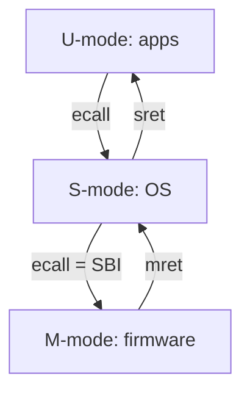

# Chapter 5 - The Privileged Architecture

[Index](00_README.md) | Prev: [Ch 4](04_Vector_Extension.md) | Next: [Ch 6 - Virtual Memory](06_Virtual_Memory.md)

**Goals:** Understand privilege modes, the CSR space, traps and interrupts, delegation, timers and counters, and physical memory protection, well enough to write a minimal kernel or firmware trap handler.

> Source anchor: Privileged ISA manual **v20260120** (Jan 2026). RVA23S64 requires supervisor architecture version **Ss1p13**. CSR numbers below are from the long-standing privileged architecture; confirm newer ones in the manual **[verify]**.

---

## 5.1 Privilege modes

| Level | Encoding | Name | Abbrev | Required? | Purpose |
|-------|----------|------|--------|-----------|---------|
| 0 | `00` | User/Application | U | Optional | Applications |
| 1 | `01` | Supervisor | S | Optional | Operating system |
| 2 | `10` | (reserved) | - | - | Used for hypervisor concept (see below) |
| 3 | `11` | Machine | M | **Mandatory** | Firmware, always trusted, full access |

Allowed combinations: **M only**; **M + U**; **M + S + U**. (A hart with only M is a simple embedded core; M+U supports basic protection with PMP; M+S+U runs Unix-like OSes.)

With the **Hypervisor extension (`H`)**, S-mode becomes **HS** (hypervisor-extended supervisor), and a hidden **V bit** creates **VS** and **VU** guest modes (Chapter 7). Effective modes: M, HS, U (when V=0), VS, VU (when V=1).

### Why more privilege means more power

- Higher privilege can access all CSRs of lower levels.
- Trap delegation lets M give S (and S give VS) responsibility for chosen traps.
- Instructions like `mret`, `sret`, `wfi`, `sfence.vma` are privileged.



## 5.2 CSR address space

12-bit address, 4096 CSRs. Address bit fields:

| Bits | Meaning |
|------|---------|
| `[11:10]` | `00`, `01`, `10` = read/write; `11` = read-only |
| `[9:8]` | Lowest privilege that can access: `00` U, `01` S/HS, `10` VS (hypervisor-related), `11` M |
| `[7:4]` | Further grouping and standard/custom designation |

Writing a read-only CSR, or accessing one above your privilege, raises an **illegal-instruction** exception (or **virtual-instruction** if executed in V=1 mode and the access would have been legal in HS).

### Field types

| Type | Meaning |
|------|---------|
| **WPRI** | Reserved Writes Preserve values, Reads Ignore values: software must preserve on write and ignore on read |
| **WLRL** | Write/Read Only Legal Values: software should only write legal values |
| **WARL** | Write Any, Read Legal: any write is allowed; reads return a legal value (the way software discovers capabilities) |

**Discovery trick:** write all ones to a WARL field and read back to see what is supported.

## 5.3 Machine-level CSRs

### Identification (read-only)

| CSR | Addr | Meaning |
|-----|------|---------|
| `mvendorid` | 0xF11 | JEDEC manufacturer ID (0 if non-commercial) |
| `marchid` | 0xF12 | Microarchitecture ID (open-source projects have registered IDs) |
| `mimpid` | 0xF13 | Implementation/version ID |
| `mhartid` | 0xF14 | This hart's ID (one hart must have ID 0) |
| `mconfigptr` | 0xF15 | Pointer to a platform configuration structure (0 if none) |

### Trap setup and handling

| CSR | Addr | Meaning |
|-----|------|---------|
| `mstatus` | 0x300 | Status (below) |
| `misa` | 0x301 | ISA and extensions (WARL; may be read-only) |
| `medeleg` | 0x302 | Exception delegation to S |
| `mideleg` | 0x303 | Interrupt delegation to S |
| `mie` | 0x304 | Interrupt enable bits |
| `mtvec` | 0x305 | Trap vector base and mode |
| `mcounteren` | 0x306 | Counter access for lower modes |
| `mstatush` | 0x310 | RV32 upper half of `mstatus` |
| `mscratch` | 0x340 | Scratch register for trap handlers |
| `mepc` | 0x341 | Exception PC |
| `mcause` | 0x342 | Trap cause |
| `mtval` | 0x343 | Trap value (faulting address / instruction) |
| `mip` | 0x344 | Interrupt pending bits |
| `mtinst` | 0x34A | Trap instruction (hypervisor) |
| `mtval2` | 0x34B | Second trap value (guest physical address) |
| `menvcfg` | 0x30A | Environment config for lower modes (e.g., `CBIE`, `CBZE`, `PBMTE`, `STCE`, `FIOM`, `SSE`, `LPE`) |
| `mseccfg` | 0x747 | Machine security config (Smepmp, `USEED`, `SSEED`) |

### Counters and events

| CSR | Addr | Meaning |
|-----|------|---------|
| `mcycle` | 0xB00 | Cycle counter |
| `minstret` | 0xB02 | Instructions retired |
| `mhpmcounter3`...`31` | 0xB03... | Event counters |
| `mhpmevent3`...`31` | 0x323... | Event selectors |
| `mcountinhibit` | 0x320 | Stop counters: bit 0 CY, bit 2 IR, bits 3+ HPM |

On RV32, `mcycleh`, `minstreth`, etc. (offset 0x80 higher) provide the upper 32 bits.

### `misa`

```
 XLEN-1  XLEN-2   26 25                         0
+--------+--------+--+---------------------------+
|  MXL   |   0    |    Extensions (A..Z bits)    |
+--------+--------+--+---------------------------+
```

`MXL`: 1 = 32, 2 = 64, 3 = 128. Bit `n` = letter `n` (A=0, C=2, D=3, F=5, H=7, I=8, M=12, S=18, U=20, V=21, X=23). A hart may allow software to *clear* some bits (e.g., turn off `C`), which changes `IALIGN`. Writes that would leave the hart in an illegal state are ignored.

### `mstatus` (RV64 layout)

| Bits | Field | Meaning |
|------|-------|---------|
| 1 | `SIE` | S-mode global interrupt enable |
| 3 | `MIE` | M-mode global interrupt enable |
| 5 | `SPIE` | Previous `SIE` before trap |
| 6 | `UBE` | U-mode data endianness (1 = big) |
| 7 | `MPIE` | Previous `MIE` |
| 8 | `SPP` | Previous privilege for traps taken to S (0 = U, 1 = S) |
| 10:9 | `VS` | Vector state (00 Off, 01 Initial, 10 Clean, 11 Dirty) |
| 12:11 | `MPP` | Previous privilege for traps taken to M |
| 14:13 | `FS` | FP state |
| 16:15 | `XS` | Other extension state |
| 17 | `MPRV` | Modify PRiVilege: data loads/stores use `MPP` privilege |
| 18 | `SUM` | S may access U pages (permit Supervisor User Memory access) |
| 19 | `MXR` | Make eXecutable Readable |
| 20 | `TVM` | Trap Virtual Memory: S-mode `satp`/`sfence.vma` traps |
| 21 | `TW` | Timeout Wait: `wfi` in lower modes may trap |
| 22 | `TSR` | Trap SRET: `sret` in S traps |
| 23 | `SPELP` | Previous expected landing pad (CFI, `Zicfilp`) |
| 24 | `SDT` | S-mode double trap disable (`Ssdbltrp`) |
| 33:32 | `UXL` | U-mode XLEN (1 = 32, 2 = 64) |
| 35:34 | `SXL` | S-mode XLEN |
| 36 | `SBE` | S-mode endianness |
| 37 | `MBE` | M-mode endianness |
| 38 | `GVA` | Guest virtual address flag (hypervisor) |
| 39 | `MPV` | Previous virtualization mode (hypervisor) |
| 41 | `MPELP` | Previous M-mode expected landing pad |
| 42 | `MDT` | M-mode double trap |
| 63 | `SD` | Summary: `FS`, `VS`, or `XS` is Dirty |

Bit positions for `SPELP`, `SDT`, `MPELP`, `MDT` come from newer extensions **[verify]**; the first group (`SIE` .. `SXL`) is long-standing.

`sstatus` (0x100) is a **restricted view** of `mstatus` (only fields S-mode may see: `SIE`, `SPIE`, `SPP`, `VS`, `FS`, `XS`, `SUM`, `MXR`, `UXL`, `SD`, ...).

### `mtvec`

```
 XLEN-1                              2 1   0
+-----------------------------------+-----+
|              BASE                 |MODE |
+-----------------------------------+-----+
```

| MODE | Behavior |
|------|----------|
| 0 Direct | All traps set `pc = BASE` |
| 1 Vectored | Synchronous exceptions go to `BASE`; interrupts go to `BASE + 4 * cause` |
| >= 2 | Reserved |

`BASE` is 4-byte aligned. In Vectored mode, `BASE` must be aligned to a larger boundary determined by the number of vectors implemented (commonly 64 or 256 bytes **[verify]**). Each vector slot is one instruction (typically a `j` to the real handler).

### `mcause`

MSB (`Interrupt` bit) = 1 for interrupts, 0 for exceptions. Remaining bits hold the code.

**Exception codes**

| Code | Cause |
|------|-------|
| 0 | Instruction address misaligned |
| 1 | Instruction access fault |
| 2 | Illegal instruction |
| 3 | Breakpoint |
| 4 | Load address misaligned |
| 5 | Load access fault |
| 6 | Store/AMO address misaligned |
| 7 | Store/AMO access fault |
| 8 | Environment call from U (or VU) |
| 9 | Environment call from HS-mode |
| 10 | Environment call from VS-mode |
| 11 | Environment call from M-mode |
| 12 | Instruction page fault |
| 13 | Load page fault |
| 15 | Store/AMO page fault |
| 16 | Double trap (`Smdbltrp`/`Ssdbltrp`) |
| 18 | Software check (CFI) |
| 19 | Hardware error (RAS) |
| 20 | Instruction guest-page fault |
| 21 | Load guest-page fault |
| 22 | Virtual instruction |
| 23 | Store/AMO guest-page fault |

**Interrupt codes**

| Code | Cause |
|------|-------|
| 1 | Supervisor software interrupt (SSI) |
| 2 | Virtual supervisor software interrupt |
| 3 | Machine software interrupt (MSI) |
| 5 | Supervisor timer interrupt (STI) |
| 6 | Virtual supervisor timer |
| 7 | Machine timer interrupt (MTI) |
| 9 | Supervisor external interrupt (SEI) |
| 10 | Virtual supervisor external |
| 11 | Machine external interrupt (MEI) |
| 12 | Supervisor guest external interrupt |
| 13 | Counter-overflow interrupt (`Sscofpmf`) |
| 16+ | Platform use |

Codes 24-31 and 48-63 are designated for custom use for exceptions; 16+ for platform use for interrupts.

### `mtval` and `mepc`

- `mepc` holds the PC of the instruction that trapped (exceptions) or the next instruction to run (interrupts). Bit 0 is always 0; bit 1 is 0 if `IALIGN=32`.
- `mtval` holds exception-specific data:
  - Address-related faults (misaligned, access, page): the **faulting virtual address**.
  - Illegal instruction: the instruction bits (may be 0 if not implemented).
  - Breakpoint: the address of the breakpoint or 0.
  - `ecall`: usually 0.
- `Sstvala` (RVA23) mandates `stval` is written on the cases above.

## 5.4 Supervisor-level CSRs

| CSR | Addr | Meaning |
|-----|------|---------|
| `sstatus` | 0x100 | View of `mstatus` |
| `sie` | 0x104 | Interrupt enable (delegated bits) |
| `stvec` | 0x105 | Trap vector |
| `scounteren` | 0x106 | Counter access for U |
| `senvcfg` | 0x10A | Environment config for U |
| `sscratch` | 0x140 | Scratch |
| `sepc` | 0x141 | Exception PC |
| `scause` | 0x142 | Cause |
| `stval` | 0x143 | Trap value |
| `sip` | 0x144 | Interrupt pending (delegated bits) |
| `stimecmp` | 0x14D | Supervisor timer compare (`Sstc`) |
| `satp` | 0x180 | Address translation and protection |
| `scountovf` | 0xDA0 | Counter overflow status (`Sscofpmf`) |

These have the same layout as machine versions but only expose what has been delegated.

## 5.5 Traps in detail

### Trap taken (to M-mode, similar for S)

1. If the trap is delegated to S and occurred in U/S, it goes to S-mode; otherwise M.
2. `xepc <- pc` (the trapping instruction for exceptions, next for interrupts).
3. `xcause <- cause`; `xtval <- value`.
4. `xPIE <- xIE`; `xIE <- 0` (interrupts disabled).
5. `xPP <- current privilege`.
6. Privilege `<- x`.
7. `pc <- xtvec` (Direct, or vectored for interrupts).

### Return (`mret`)

1. Privilege `<- MPP`.
2. `MIE <- MPIE`; `MPIE <- 1`.
3. `MPP <- least-privileged mode supported` (U if implemented, else M).
4. If the new privilege is not M, `MPRV <- 0`.
5. `pc <- mepc`.

`sret` is analogous with `SPP`, `SPIE`, `SIE`, `sepc`.

### Delegation

- `medeleg[i] = 1` sends exception code `i` to S (when taken from S or U). `ecall` from M (code 11) cannot be delegated.
- `mideleg[i] = 1` delegates interrupt `i` (for supervisor-level interrupts SSIP/STIP/SEIP; M-level ones are hardwired to M).
- With delegation, `sie`/`sip` show only delegated bits. Traps in M-mode are never delegated.
- Traps from a **higher** privilege than the delegated target cannot be delegated "downward": a trap taken in M-mode always goes to M.

### Which privilege can take which interrupt?

| Current mode | Interrupt to M | Interrupt to S |
|--------------|----------------|----------------|
| M | enabled if `mstatus.MIE`=1 and `mie` bit set | never taken |
| S | always enabled (higher privilege) | enabled if `sstatus.SIE`=1 |
| U | always enabled | always enabled |

An interrupt is *taken* when: pending (`mip`), enabled (`mie`), and global enable permits for that mode.

**Priority order** (highest first): MEI, MSI, MTI, SEI, SSI, STI (then platform/AIA-defined order). Synchronous exceptions have their own priority list in the manual.

## 5.6 Interrupt sources and timers

### Standard sources per hart

| Source | `mip` bit | Set by |
|--------|-----------|--------|
| Software (M) `MSIP` | 3 | Memory-mapped register write (CLINT/ACLINT/IMSIC) |
| Timer (M) `MTIP` | 7 | `mtime >= mtimecmp` |
| External (M) `MEIP` | 11 | Interrupt controller (PLIC/APLIC/IMSIC) |
| Software (S) `SSIP` | 1 | Software writes (or by SBI IPI, or hardware per-hart signals) |
| Timer (S) `STIP` | 5 | M-mode firmware sets it; or hardware via `Sstc` |
| External (S) `SEIP` | 9 | Interrupt controller |
| Counter overflow `LCOFIP` | 13 | `Sscofpmf` |

### Timers

- `mtime` (64-bit free-running, constant frequency) and `mtimecmp` (per hart) are **memory-mapped**, not CSRs, in the classic CLINT/ACLINT design. The `time` CSR is a read-only shadow; if hardware does not provide it, reading `time` traps and M-mode emulates it (this is common on older boards).
- `MTIP` is set while `mtime >= mtimecmp`; clear by writing a larger `mtimecmp`.
- **`Sstc`** (Ratified): `stimecmp` CSR (0x14D, `vstimecmp` for guests) lets S-mode program the timer directly, with `STIP` set by hardware: no SBI call per tick. Mandatory in RVA23S64. Enable with `menvcfg.STCE`.
- Timer frequency is **platform-defined** (device tree `timebase-frequency`).

### Software interrupts / IPIs

Memory-mapped `msip` registers per hart (CLINT) or **IMSIC** writes (AIA). S-mode software sends IPIs via **SBI `sbi_send_ipi`**, which firmware turns into M-level software interrupt and then sets `SSIP` on the target.

### Interrupt controllers

Classic: **CLINT** (timer + software) and **PLIC** (external). Modern: **ACLINT**, and the **AIA** (APLIC + IMSIC) with MSI support and virtualization. Details in Chapter 7.

## 5.7 `wfi`, reset, and NMI

- **`wfi`**: hint that the hart can pause until an interrupt could be taken. It may wake even if the interrupt is disabled globally, provided the interrupt is *enabled in `mie`/`sie` and pending*. It does **not** trap on its own unless `mstatus.TW` is set and a bounded time elapses in lower modes.
- **Reset**: hart starts in M-mode at an implementation-defined reset vector; `mstatus.MIE = 0`, `MPRV = 0`; `mcause` records the reset reason; `misa` has a defined value; PMP and virtual memory are typically off. Other CSR values are mostly UNSPECIFIED, so firmware must initialize what it needs.
- **NMI**: non-maskable interrupts are implementation-defined unless **`Smrnmi`** (Ratified) is present: it adds `mnscratch`, `mnepc`, `mncause`, `mnstatus`, and the `mnret` instruction.

## 5.8 Counters and performance basics

| CSR | Accessible from lower modes? |
|-----|------------------------------|
| `cycle`, `time`, `instret`, `hpmcounterN` | Controlled by `mcounteren` (for S/U), then `scounteren` (for U), `hcounteren` (guest) |

- Bits in `mcounteren`: bit 0 = CY, 1 = TM, 2 = IR, 3.. = HPMn. If the bit is 0, access from S/U raises illegal-instruction.
- **`Sscounterenw`** (RVA23): any counter that isn't hardwired to zero must have a writable enable bit.
- **`Sscofpmf`** (Ratified): per-event overflow interrupt and mode-based filtering; adds `scountovf`, `mhpmeventN` filter bits (`OF`, `MINH`, `SINH`, `UINH`, `VSINH`, `VUINH`).
- **`Smcntrpmf`/`Ssccfg`/`Smcdeleg`** extend filtering/delegation of counters to S-mode **[verify status]**.
- More in Chapter 13.

## 5.9 State-enable and indirect access

- **`Smstateen` / `Ssstateen`** (Ratified): `mstateen0-3`, `sstateen0-3`, `hstateen0-3` registers let higher privilege mode disable access to optional state (e.g., `Zcmt` `jvt`, AIA, `fcsr`, custom state) for lower modes, so state can be context-switched safely. Mandatory (`Ssstateen`) in RVA23S64 as part of `Sha`.
- **`Smcsrind` / `Sscsrind`** (Ratified): indirect CSR access through `miselect/mireg...`, `siselect/sireg...`, `vsiselect/vsireg...` windows. Used by AIA and counter delegation to avoid consuming many CSR addresses.

## 5.10 Physical Memory Protection (PMP)

PMP lets M-mode restrict which physical addresses S/U-mode (and optionally M) may read/write/execute, with a few registers.

### Registers

| CSR | Notes |
|-----|-------|
| `pmpcfg0`-`pmpcfg15` (0x3A0-0x3AF) | Configuration bytes. RV64: only even-numbered exist (8 entries each); RV32: 4 entries each |
| `pmpaddr0`-`pmpaddr63` (0x3B0-0x3EF) | Address registers; hold `physical address >> 2` (up to 54 bits on RV64) |

Standard base: 16 entries (`pmp0`-`pmp15`); the manual allows up to 64 entries.

### `pmpcfg` byte

```
  7    6:5     4:3     2   1   0
+---+--------+-------+---+---+---+
| L | (res.) |   A   | X | W | R |
+---+--------+-------+---+---+---+
```

| A | Mode | Region |
|---|------|--------|
| 00 | OFF | Disabled |
| 01 | TOR | Top Of Range: `[pmpaddr[i-1], pmpaddr[i])` (for entry 0 the lower bound is 0) |
| 10 | NA4 | Naturally aligned 4-byte region |
| 11 | NAPOT | Naturally aligned power-of-two region, size >= 8 bytes |

**NAPOT encoding:** a region of size `2^k` bytes (k >= 3) at aligned `base` is `pmpaddr = (base >> 2) | ((1 << (k - 3)) - 1)` (trailing ones encode the size).

Example: 4 KiB at `0x8000_0000` -> `pmpaddr = 0x2000_0000 | 0x1FF = 0x2000_01FF`, `A = 11`.

### Matching rules

- Entries are checked in numeric order; the **lowest-numbered matching entry** decides.
- A match must cover the **entire** access; partial overlap = failure.
- No match: M-mode **succeeds**; S/U **fail** (if any PMP entry is implemented).
- `L` (Lock): the rule also applies to **M-mode** and the entry (and `pmpaddr` for TOR neighbour) cannot be changed until reset.
- Violations raise **access-fault** exceptions (not page faults).
- Granularity may be coarser than 4 bytes (implementation-defined); `pmpaddr` low bits read as zero accordingly.

### Smepmp (Ratified)

Adds `mseccfg` bits that harden PMP:

| Bit | Name | Effect |
|-----|------|--------|
| 0 | `MML` (Machine Mode Lockdown) | Changes the meaning of `L/R/W/X`: locked rules can be M-only or shared; prevents M-mode executing U-mode memory and vice versa |
| 1 | `MMWP` (Machine Mode Whitelist Policy) | Default-deny for M-mode when no PMP entry matches |
| 2 | `RLB` (Rule Locking Bypass) | Temporarily allows editing locked rules (before booting the OS; clear and lock it) |

### Typical firmware setup

```asm
# Allow S/U full access to all physical memory (common early boot step)
    li   t0, -1
    csrw pmpaddr0, t0            # all-ones NAPOT = entire address space
    li   t0, 0x1F                # A=NAPOT(11), X=W=R=1
    csrw pmpcfg0, t0
```

OpenSBI uses PMP to protect its own memory from S-mode.

## 5.11 `Smepmp` successors and memory protection beyond PMP

- **`Smmtt`** (Memory Tracking Tables): table-based, scalable physical memory isolation for confidential computing **[verify status]**.
- **`Sdtrig`**: debug triggers can also act as watchpoints in M-mode.
- **IOPMP**: protects physical memory against DMA by devices (separate spec) **[verify status]**.
- See Chapter 12.

## 5.12 Endianness

- `mstatus.MBE`, `SBE`, `UBE` select big-endian data accesses at each level (implicit accesses such as page-table walks use `SBE`; instruction fetch is always little-endian).
- Most systems are little-endian only; the bits are then hardwired to 0.

## 5.13 Writing a trap handler

### M-mode skeleton (non-nested)

```asm
    .align 2
trap_entry:
    csrrw sp, mscratch, sp        # sp <-> mscratch: sp = trap stack, mscratch = interrupted sp
    addi  sp, sp, -256
    sd    ra,   0(sp)
    sd    t0,   8(sp)
    sd    t1,  16(sp)
    # ... save remaining caller-saved regs a0-a7, t2-t6 ...
    csrr  a0, mcause
    csrr  a1, mepc
    csrr  a2, mtval
    mv    a3, sp
    call  handle_trap             # C handler; may modify the saved mepc
    # ... restore registers ...
    ld    t1,  16(sp)
    ld    t0,   8(sp)
    ld    ra,   0(sp)
    addi  sp, sp, 256
    csrrw sp, mscratch, sp        # restore sp, put trap stack back in mscratch
    mret
```

### Handling `ecall` (advance past the instruction)

```c
if (cause == 8 /* ecall from U */) {
    mepc += 4;                    // return to the instruction after ecall
    syscall(...);
}
```

### Timer interrupt in M-mode

```c
uint64_t *mtimecmp = (uint64_t *)(CLINT_BASE + 0x4000 + 8 * hartid);
uint64_t *mtime    = (uint64_t *)(CLINT_BASE + 0xBFF8);
*mtimecmp = *mtime + TICKS;       // acknowledge and schedule the next tick
```

### Enabling interrupts

```asm
    la    t0, trap_entry
    csrw  mtvec, t0               # Direct mode
    li    t0, (1 << 7)            # MTIE
    csrs  mie, t0
    csrsi mstatus, (1 << 3)       # MIE
```

### Dropping to S-mode (firmware)

```asm
    li    t0, (1 << 11)           # MPP = 01 (S): clear bit 12, set bit 11
    li    t1, (3 << 11)
    csrc  mstatus, t1
    csrs  mstatus, t0
    la    t0, kernel_entry
    csrw  mepc, t0
    csrw  satp, x0                # MMU off
    # delegate traps/interrupts to S
    li    t0, 0xB1FF              # example exception delegation mask (all but ecall-M, etc.)
    csrw  medeleg, t0
    li    t0, 0x222               # SSIP, STIP, SEIP
    csrw  mideleg, t0
    mret
```

(The `medeleg` mask is an example; choose per platform. OpenSBI delegates most exceptions but keeps `ecall` from S-mode for itself.)

## 5.14 Chapter summary

- M-mode is mandatory and trusted; S and U are optional; `H` adds virtualization.
- CSR space is 12-bit with access rules in the address; WARL fields let software probe capabilities.
- Traps save state in `xepc/xcause/xtval/xstatus`, then jump to `xtvec`; `mret`/`sret` restore.
- Delegation (`medeleg/mideleg`) moves handling to S-mode; `Sstc` removes timer SBI calls.
- PMP/Smepmp enforce physical memory protection and produce **access faults**, distinct from **page faults**.

### Check yourself

1. Which privilege levels must every RISC-V hart implement, and which combinations are legal?
2. Where does a vectored interrupt with cause 7 jump, if `mtvec = 0x80000001`?
3. What changes in `mstatus` on an `mret` to U-mode?
4. Encode PMP NAPOT for a 64 KiB region at `0x4000_0000`.
5. Why can't `ecall` from M-mode be delegated?

<details><summary>Answers</summary>

1. M is mandatory; legal sets are M; M+U; M+S+U.
2. `BASE = 0x80000000`, MODE = 1, so `pc = 0x80000000 + 4*7 = 0x8000001C`.
3. `MIE <- MPIE`, `MPIE <- 1`, `MPP <- U` (least privilege), and `MPRV <- 0`.
4. `k = 16`; `pmpaddr = (0x40000000 >> 2) | ((1 << 13) - 1) = 0x10000000 | 0x1FFF = 0x10001FFF`, `A = 11`.
5. Delegation only moves traps to *lower-or-equal* privilege handlers of a lower mode; M is the top level, so traps from M have nowhere to be delegated.
</details>

Next: [Chapter 6 - Virtual Memory](06_Virtual_Memory.md)
