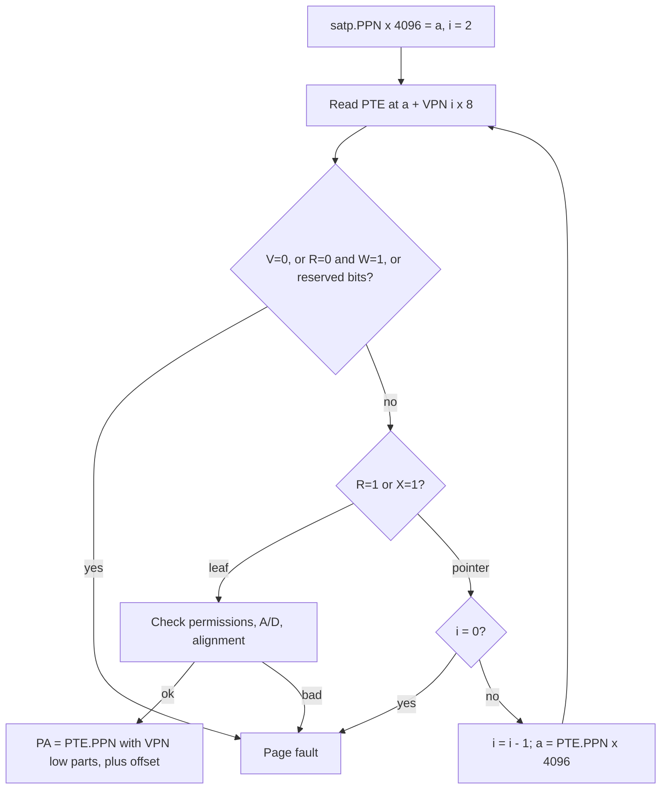

# Chapter 6 - Virtual Memory

[Index](00_README.md) | Prev: [Ch 5](05_Privileged_Architecture.md) | Next: [Ch 7 - Hypervisor, AIA, IOMMU](07_Hypervisor_AIA_IOMMU.md)

**Goals:** Understand how RISC-V translates virtual to physical addresses (Sv32, Sv39, Sv48, Sv57), the page-table entry format, the walk algorithm, TLB management, and the modern extensions (`Svpbmt`, `Svnapot`, `Svinval`, `Svade/Svadu`, `Svvptc`).

> Status: Sv32/Sv39/Sv48/Sv57 and the listed `Sv*` extensions are **Ratified**. **RVA23S64 mandates** `Svbare`, `Sv39`, `Svade`, `Svpbmt`, `Svinval`, `Svnapot`, `Ssccptr`; `Sv48`, `Sv57`, `Svadu`, `Svvptc` are options.

---

## 6.1 Why virtual memory

- **Isolation:** each process sees its own address space.
- **Protection:** per-page read/write/execute and user/supervisor control.
- **Flexibility:** demand paging, copy-on-write, memory-mapped files, sparse allocation.
- **Relocation:** physical memory fragmentation is hidden.

Translation is controlled by the **`satp`** CSR and applies to S-mode and U-mode accesses (and to M-mode loads/stores when `mstatus.MPRV=1` with `MPP != M`). M-mode instruction fetches are never translated.

## 6.2 `satp`

**RV64:**

```
 63    60 59                44 43                          0
+--------+--------------------+-----------------------------+
|  MODE  |        ASID        |            PPN              |
+--------+--------------------+-----------------------------+
```

| MODE | Name | Description |
|------|------|-------------|
| 0 | `Bare` | No translation or protection (VA = PA) |
| 8 | `Sv39` | 39-bit virtual, 3 levels |
| 9 | `Sv48` | 48-bit virtual, 4 levels |
| 10 | `Sv57` | 57-bit virtual, 5 levels |
| 11 | `Sv64` | Reserved for future |

**RV32:** `MODE` is bit 31 (0 = Bare, 1 = Sv32); `ASID` is bits 30:22 (9 bits); `PPN` is bits 21:0.

- `PPN` is the physical page number of the **root page table** (physical address >> 12).
- `ASID` (address-space ID) tags TLB entries, so switching processes need not flush the TLB. Up to 16 bits on RV64; hardware may implement fewer (`WARL`: write all ones and read back).
- **Probing supported modes:** write the candidate `MODE`, read `satp` back. If `MODE` did not stick, unsupported (Linux does this to pick Sv57 -> Sv48 -> Sv39).
- Setting an unsupported `MODE` leaves `satp` unchanged.

## 6.3 Address formats

| Scheme | Virtual bits | Levels | PTE size | Page sizes | Max PA bits |
|--------|--------------|--------|----------|------------|-------------|
| Sv32 | 32 | 2 | 4 B | 4 KiB, 4 MiB | 34 |
| Sv39 | 39 | 3 | 8 B | 4 KiB, 2 MiB, 1 GiB | 56 |
| Sv48 | 48 | 4 | 8 B | + 512 GiB | 56 |
| Sv57 | 57 | 5 | 8 B | + 256 TiB | 56 |

Each level has 512 entries (Sv39 and up; 1024 in Sv32), so each page table fills exactly one 4 KiB page.

### Virtual address splits

```
Sv32:  | VPN[1] 31:22 | VPN[0] 21:12 | offset 11:0 |
Sv39:  | VPN[2] 38:30 | VPN[1] 29:21 | VPN[0] 20:12 | offset 11:0 |
Sv48:  | VPN[3] 47:39 | VPN[2] 38:30 | VPN[1] 29:21 | VPN[0] 20:12 | offset |
Sv57:  | VPN[4] 56:48 | VPN[3] 47:39 | ... same ... |
```

### Canonical addresses

For `Sv39`, bits `63:39` of a virtual address must equal bit 38 (sign extension). Otherwise a **page-fault** exception (not an access fault) is raised. This divides the space into a **lower half** (user) and an **upper half** (kernel) of the canonical range. Same rule for Sv48 (bit 47) and Sv57 (bit 56).

Linux/Sv39 layout (typical): user `0x0` - `0x3F_FFFF_FFFF` (256 GiB); kernel `0xFFFF_FFC0_0000_0000` upward (256 GiB).

## 6.4 Page-table entry (PTE)

**RV64 (Sv39/48/57):**

```
 63  62 61 60      54 53                       10 9  8 7 6 5 4 3 2 1 0
+---+-----+----------+--------------------------+----+-+-+-+-+-+-+-+-+
| N |PBMT | reserved |           PPN            |RSW |D|A|G|U|X|W|R|V|
+---+-----+----------+--------------------------+----+-+-+-+-+-+-+-+-+
```

| Bit | Name | Meaning |
|-----|------|---------|
| 0 | `V` | Valid |
| 1 | `R` | Readable |
| 2 | `W` | Writable |
| 3 | `X` | Executable |
| 4 | `U` | User-accessible |
| 5 | `G` | Global (applies to all address spaces; ignores ASID) |
| 6 | `A` | Accessed |
| 7 | `D` | Dirty |
| 9:8 | `RSW` | Reserved for software (OS) |
| 53:10 | `PPN` | Physical page number (44 bits). `PPN[0]` 18:10, `PPN[1]` 27:19, `PPN[2]` 53:28 for Sv39 |
| 60:54 | reserved | Must be zero unless defined by an extension (e.g., `Svrsw60t59b`) |
| 62:61 | `PBMT` | `Svpbmt` memory type |
| 63 | `N` | `Svnapot` NAPOT flag |

**Sv32 PTE (32 bits):** `PPN[1]` 31:20, `PPN[0]` 19:10, same low 10 bits.

### `R/W/X` meaning

| X W R | Meaning |
|-------|---------|
| 0 0 0 | Pointer to the next level of page table |
| 0 0 1 | Read-only page |
| 0 1 0 | **Reserved** (page fault) |
| 0 1 1 | Read-write |
| 1 0 0 | Execute-only |
| 1 0 1 | Read-execute |
| 1 1 0 | **Reserved** |
| 1 1 1 | Read-write-execute |

A PTE is a **leaf** if `R=1` or `X=1` (or `W=1`, which is invalid alone). Leaf at level 0 = 4 KiB page; leaf at a higher level = **superpage** (megapage 2 MiB, gigapage 1 GiB in Sv39).

## 6.5 The page-table walk (Sv39 example)



Formal steps (from the spec):

1. `a = satp.PPN * PAGESIZE`; `i = LEVELS - 1`.
2. Read `pte = M[a + va.vpn[i] * PTESIZE]` (this access is checked by PMP/PMA; a failure is an **access fault**, not a page fault).
3. If `pte.V = 0`, or `pte.R = 0 and pte.W = 1`, or any reserved bit is set -> **page fault**.
4. If `pte.R = 1 or pte.X = 1`, it is a leaf; go to step 6. Otherwise `i = i - 1`; if `i < 0` -> page fault; else `a = pte.PPN * PAGESIZE`, goto step 2.
5. (Leaf handling continues:)
6. Check access permissions against the PTE (below). On violation -> page fault.
7. If `i > 0` and `pte.PPN[i-1:0] != 0` -> **misaligned superpage** page fault.
8. If `pte.A = 0`, or the access is a store and `pte.D = 0`: either raise a page fault (`Svade`) or update atomically in hardware (`Svadu`).
9. Result: `pa.PPN[LEVELS-1:i] = pte.PPN[LEVELS-1:i]`; `pa.PPN[i-1:0] = va.VPN[i-1:0]` (for superpages); `pa.offset = va.offset`.

### Permission checks

| Access type | Required |
|-------------|----------|
| Instruction fetch | `X=1` |
| Load | `R=1`, or `X=1` when `mstatus.MXR=1` |
| Store/AMO | `W=1` |
| U-mode | `U=1` |
| S-mode on `U=1` page (data) | Only if `sstatus.SUM=1` |
| S-mode instruction fetch from `U=1` page | **Never** |

Also: when `mstatus.MPRV=1` data accesses use `MPP` privilege/translation.

### Worked translation example (Sv39)

Virtual address `va = 0x0000_0000_8020_1ABC`:

| Field | Value |
|-------|-------|
| `VPN[2]` (38:30) | `2` |
| `VPN[1]` (29:21) | `1` |
| `VPN[0]` (20:12) | `1` |
| offset | `0xABC` |

Walk: root table `[2]` -> level-1 table `[1]` -> level-0 table `[1]` -> leaf PTE whose `PPN` gives the physical page; `PA = (PPN << 12) | 0xABC`.

If the level-1 entry were itself a leaf (2 MiB megapage), then `PA = (PPN[2:1] << 21) | va[20:0]`, and `PPN[0]` of the PTE must be zero.

## 6.6 Accessed and Dirty bits

| Extension | Behavior | Notes |
|-----------|----------|-------|
| **`Svade`** | Page fault when `A=0` (any access) or `D=0` (store); OS sets the bits and retries | Mandatory in RVA23S64; simple hardware; cost: extra faults |
| **`Svadu`** | Hardware sets `A`/`D` atomically in the PTE | Expansion option in RVA23S64; enabled via `menvcfg.ADUE` (and hypervisor `henvcfg.ADUE`) |

OS strategy to avoid faults with `Svade`: pre-set `A=1` (and `D=1` for writable pages) when the page is created, or use hardware A/D with `Svadu` and check dirty tracking differently (e.g., write-protect for dirty logging).

## 6.7 TLB and `sfence.vma`

The TLB caches translations. Hardware is **not** required to keep it coherent with memory writes to page tables, so software must synchronize.

```
sfence.vma rs1, rs2
```

| `rs1` | `rs2` | Effect |
|-------|-------|--------|
| `x0` | `x0` | Flush all translations (all ASIDs) |
| address | `x0` | Flush translations for that address, all ASIDs |
| `x0` | ASID | Flush all translations for that ASID (not global ones) |
| address | ASID | Flush that address in that ASID |

- Orders prior stores to page tables before later address translations on this hart.
- It only affects the **current hart**. For multi-hart shootdown, use IPIs (e.g., SBI `RFENCE` remote `sfence.vma` calls or direct IPI).
- Global (`G=1`) mappings are not removed by an ASID-specific fence.
- When `mstatus.TVM=1`, `sfence.vma` and `satp` writes in S-mode trap (used by hypervisors).

### `Svinval` - fine-grained invalidation

Splits the operation into batches for efficiency:

```
sfence.w.inval        # order prior stores before invalidations
sinval.vma rs1, rs2   # invalidate one translation (many times)
sfence.inval.ir       # order invalidations before later translations
```

### `Svvptc`

Transitions from **invalid to valid** PTEs become visible in bounded time **without** an explicit `sfence.vma` (optional in RVA23S64; helps avoid fences on new mappings).

### When must you execute `sfence.vma`?

| Situation | Needed? |
|-----------|---------|
| Changing `satp` to a new root with a **new ASID** | Usually not for correctness; stale entries belong to other ASIDs |
| Reusing an ASID | Yes (flush that ASID) |
| Modifying a valid PTE (permissions, PPN) | Yes |
| Making an invalid PTE valid | Not required if `Svvptc`; otherwise it may be required because hardware may cache invalid entries |
| Changing `satp` from Bare to a table-based mode | Execute `sfence.vma` after to be safe |

## 6.8 Page-based memory attributes and NAPOT

### `Svpbmt` (page-based memory types)

`PTE[62:61]`:

| Value | Name | Meaning |
|-------|------|---------|
| 00 | PMA | Use the platform's default physical memory attributes |
| 01 | NC | Non-cacheable, idempotent, weakly-ordered (like write-combining main memory) |
| 10 | IO | Non-cacheable, non-idempotent, strongly ordered (device registers) |
| 11 | Reserved | |

Requires `menvcfg.PBMTE=1` (and `henvcfg.PBMTE` for guests) in some configurations.

### `Svnapot` (NAPOT translation contiguity)

When `N=1` on a 4 KiB leaf PTE with `PPN[3:0] = 1000b`, the PTE is part of a **64 KiB naturally aligned region** of 16 identical-attribute pages. Hardware may cache the whole 64 KiB as one TLB entry (reduces TLB pressure). Other NAPOT sizes may be added by future extensions.

### `Svrsw60t59b`

Frees PTE bits 60:59 for software use **[verify status]**.

### Other possible extensions

`Svukte` (user-mode-address-based side-channel hardening) and related work are discussed in Chapter 14.

## 6.9 Faults: page fault vs access fault vs misaligned

| Exception | Cause |
|-----------|-------|
| **Page fault** (instruction 12 / load 13 / store 15) | Translation failure: invalid PTE, permission mismatch, non-canonical address, A/D handling, misaligned superpage |
| **Access fault** (1 / 5 / 7) | PMP/PMA violation on the physical address (including page-walk reads) or unsupported access type |
| **Address misaligned** (0 / 4 / 6) | Misaligned access that the platform does not support |
| **Guest-page fault** (20 / 21 / 23) | G-stage translation failure (Chapter 7) |

`stval`/`mtval` holds the faulting **virtual** address for page faults; `htval` holds guest-physical address bits for guest-page faults.

## 6.10 Setting up Sv39: example

### Identity map with 1 GiB gigapages (early boot)

```c
// root table: 512 PTEs of 8 bytes, 4 KiB aligned
uint64_t root[512] __attribute__((aligned(4096)));

#define PTE_V (1<<0)
#define PTE_R (1<<1)
#define PTE_W (1<<2)
#define PTE_X (1<<3)
#define PTE_A (1<<6)
#define PTE_D (1<<7)

// map 0x8000_0000..0xC000_0000 (1 GiB) identically
root[2] = ((0x80000000ULL >> 12) << 10) | PTE_V|PTE_R|PTE_W|PTE_X|PTE_A|PTE_D;

// enable Sv39
uint64_t satp = (8ULL << 60) | ((uintptr_t)root >> 12);
asm volatile("sfence.vma" ::: "memory");
asm volatile("csrw satp, %0" :: "r"(satp));
asm volatile("sfence.vma" ::: "memory");
```

- `A` and `D` are preset to 1 so `Svade` hardware does not fault.
- `root[2]` covers VPN[2] = 2, i.e., `0x8000_0000` - `0xBFFF_FFFF`.
- The code that writes `satp` must execute at an address mapped by the new table (identity mapping), or the next instruction fetch faults.

### Two-level mapping (4 KiB page)

```c
uint64_t l2[512], l1[512], l0[512]; // each page aligned
l2[vpn2] = ((uint64_t)l1 >> 12) << 10 | PTE_V;     // pointer (R=W=X=0)
l1[vpn1] = ((uint64_t)l0 >> 12) << 10 | PTE_V;
l0[vpn0] = (pa >> 12) << 10 | PTE_V|PTE_R|PTE_W|PTE_A|PTE_D|PTE_U; // leaf
```

## 6.11 Performance and design notes

- **TLB reach** = entries x page size; use superpages (2 MiB, 1 GiB) and `Svnapot` for big mappings (Linux uses hugepages/THP).
- **Page-walk cost:** Sv39 needs up to 3 dependent memory reads; caches for intermediate PTEs ("page-walk caches") are common microarchitecture features.
- **ASIDs** reduce flushing; OS typically implements ASID generations/allocators.
- **Larger address space:** Sv48/Sv57 increase walk depth; kernels choose at boot.
- **PMA/PMP interplay:** page walks use *supervisor* accesses; if a PTE lies in memory lacking `Ssccptr` support (hardware page-table reads), the walk fails with an access fault.

## 6.12 Chapter summary

- `satp` selects mode, ASID, root PPN; M-mode fetches aren't translated.
- Sv39 is the baseline for Linux-class RISC-V (mandatory in RVA23S64); Sv48/Sv57 expand the address space.
- A PTE with `R=W=X=0` points to the next level; any `R/X` makes it a leaf; superpages must be aligned.
- `Svade` vs `Svadu` decides who updates A/D; `sfence.vma` (or `Svinval`) manages the TLB per hart.
- `Svpbmt`, `Svnapot` add memory types and 64 KiB contiguous mappings.

### Check yourself

1. How many bits of virtual address are translated in Sv48, and how many levels are there?
2. What exception does a non-canonical Sv39 address cause?
3. Why can `sfence.vma` not be skipped after editing a valid PTE?
4. What does PTE `R=0, W=1` mean?
5. What is the meaning of `Svpbmt` PBMT=10?

<details><summary>Answers</summary>

1. 48 bits, 4 levels.
2. A page-fault exception (instruction, load, or store as appropriate).
3. The TLB may hold a stale copy; the architecture does not guarantee coherence with memory writes.
4. Reserved encoding; causes a page fault.
5. IO: non-cacheable, non-idempotent, strongly-ordered memory attribute.
</details>

Next: [Chapter 7 - Hypervisor, AIA, IOMMU](07_Hypervisor_AIA_IOMMU.md)
