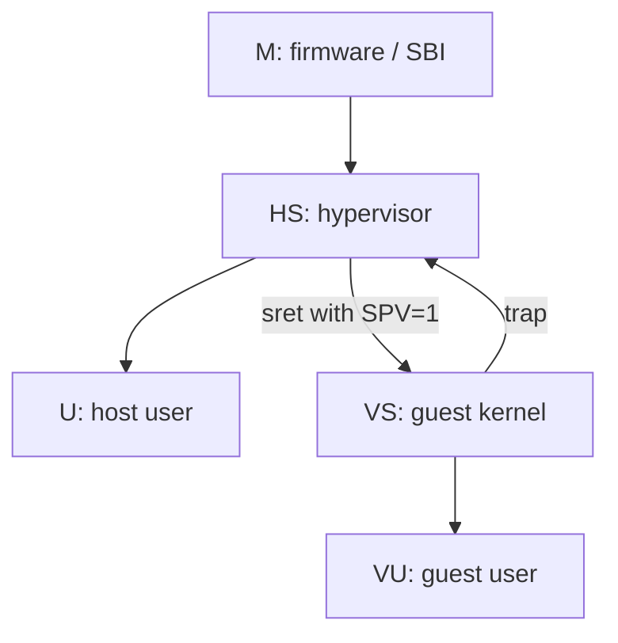
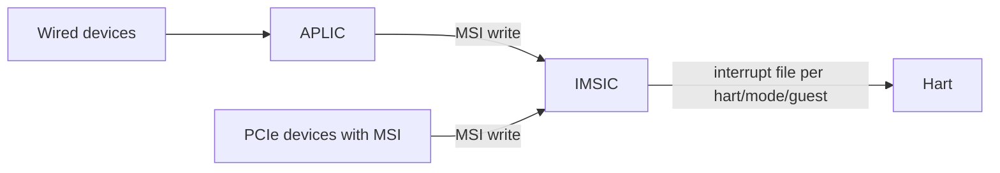
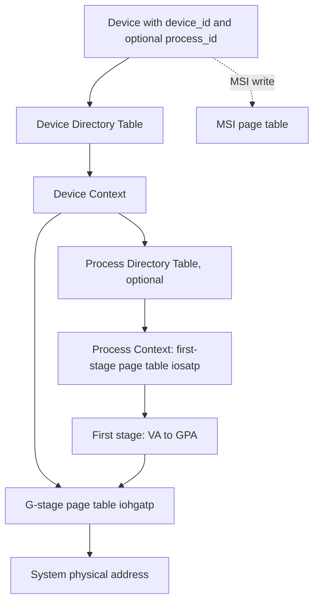

# Chapter 7 - Hypervisor, Interrupt Architecture (AIA), and IOMMU

[Index](00_README.md) | Prev: [Ch 6](06_Virtual_Memory.md) | Next: [Ch 8 - Memory Model](08_Memory_Model_Atomics.md)

**Goals:** Understand how RISC-V virtualizes CPUs (the `H` extension, two-stage translation), how modern interrupt delivery works (PLIC/CLINT vs AIA's APLIC+IMSIC), and how DMA is protected and translated (IOMMU).

> Status: Hypervisor extension **Ratified** (v1.0, 2021); **AIA** **Ratified** (v1.0, 2023 **[verify]**); **IOMMU** **Ratified** (v1.0, 2023 **[verify]**). RVA23S64 mandates `Sha` (augmented hypervisor extension).

---

## 7.1 The Hypervisor extension (`H`)

### Goals

- Run **guest operating systems** with near-native speed.
- Support **Type-1** (bare-metal, e.g., Xen, Xvisor) and **Type-2** (hosted, e.g., KVM) hypervisors.
- Fully virtualizable: sensitive operations trap (virtual-instruction exceptions) instead of silently misbehaving.

### Modes

With `H`, the **S-mode becomes HS** (hypervisor-extended supervisor). A new hidden state bit **V** (virtualization mode) selects whether the hart runs host or guest code:

| V | Privilege | Name | Who runs here |
|---|-----------|------|---------------|
| 0 | M | M | Firmware |
| 0 | S | **HS** | Hypervisor (or a normal OS if no virtualization is used) |
| 0 | U | U | Host user processes (e.g., QEMU/VMM) |
| 1 | S | **VS** | Guest kernel |
| 1 | U | **VU** | Guest user processes |



### Extra CSRs

| CSR group | Registers (examples) |
|-----------|----------------------|
| Hypervisor control | `hstatus` (0x600), `hedeleg` (0x602), `hideleg` (0x603), `hie` (0x604), `htimedelta` (0x605), `hcounteren` (0x606), `hgeie` (0x607), `henvcfg` (0x60A) |
| Guest traps | `htval` (0x643), `hip` (0x644), `hvip` (0x645), `htinst` (0x64A), `hgeip` (0xE12) |
| Guest translation | `hgatp` (0x680), `vsatp` (0x280) |
| VS-mode shadows | `vsstatus` (0x200), `vsie` (0x204), `vstvec` (0x205), `vsscratch` (0x240), `vsepc` (0x241), `vscause` (0x242), `vstval` (0x243), `vsip` (0x244) |
| Machine additions | `mtval2` (0x34B), `mtinst` (0x34A) |

When V=1, accesses to `sstatus`, `stvec`, `satp`, etc. are **redirected** to the `vs*` copies. Guest software is unaware.

### `hstatus` highlights

| Field | Meaning |
|-------|---------|
| `SPV` | Previous virtualization mode before trap to HS (so `sret` returns to guest if 1) |
| `SPVP` | Previous guest privilege (VS vs VU) |
| `GVA` | `stval` holds a guest virtual address |
| `VTSR`, `VTW`, `VTVM` | Trap `sret`, `wfi`, `satp`/`sfence.vma` from VS |
| `HU` | Allow `hlv/hsv` instructions from U-mode (host user, e.g., VMM) |
| `VGEIN` | Selects which guest external interrupt file maps to VS-level external interrupts |
| `VSBE`, `VSXL` | Guest endianness and XLEN |

### Hypervisor instructions

| Instruction | Purpose |
|-------------|---------|
| `hfence.vvma rs1, rs2` | Fence VS-stage translations (like guest `sfence.vma`) |
| `hfence.gvma rs1, rs2` | Fence G-stage translations (by guest physical address / VMID) |
| `hlv.b/bu/h/hu/w/wu/d`, `hlvx.hu/wu` | Hypervisor virtual-machine **load** (translate as the guest would) |
| `hsv.b/h/w/d` | Hypervisor virtual-machine **store** |
| `hinval.vvma`, `hinval.gvma` | `Svinval` forms |

`hlv`/`hsv` let the hypervisor read/write guest memory using the guest's address translation and permissions (e.g., to emulate an MMIO instruction or fetch the faulting instruction).

### Trap routing with `H`

1. Trap occurs in VS/VU.
2. `medeleg` decides M vs HS. If delegated to HS, `hedeleg` decides HS vs VS.
3. A trap handled in HS saves `htval/htinst` in addition to usual `s*` CSRs.

New exception codes:

| Code | Cause |
|------|-------|
| 10 | Ecall from VS-mode (a guest SBI call, handled by the hypervisor) |
| 20 | Instruction guest-page fault |
| 21 | Load guest-page fault |
| 22 | **Virtual instruction** (guest tried a privileged operation it may not do) |
| 23 | Store/AMO guest-page fault |

`ecall` from VS (code 10) is the guest's way to call SBI; the hypervisor emulates (or forwards) the SBI services.

## 7.2 Two-stage address translation


- **VS-stage** (guest controlled): guest page tables, same format as normal S-mode (`vsatp`). Page-table pointers inside are **guest physical** addresses.
- **G-stage** (hypervisor controlled): translates every guest-physical address, including those used by the guest page-table walker, to host-physical.
- Both stages must succeed; the worst-case walk is large (e.g., Sv39 x Sv39x4 -> up to 15 memory references without caching), so TLBs and walk caches matter.

### `hgatp`

```
 63   60 59      44 43                  0
+------+---------+--------------------+
| MODE |  VMID   |        PPN         |
+------+---------+--------------------+
```

| MODE | Scheme |
|------|--------|
| 0 | Bare |
| 8 | `Sv39x4` |
| 9 | `Sv48x4` |
| 10 | `Sv57x4` |
| (RV32) 1 | `Sv32x4` |

`SvNNx4`: same as `SvNN` but the guest-physical address is 2 bits wider (e.g., Sv39x4 = 41 bits), and the **root table is 16 KiB** (4x the size, 2048 entries). `VMID` (up to 14 bits on RV64) tags G-stage TLB entries.

G-stage PTEs follow the same layout as VS-stage PTEs, but with differences: **the `U` bit must be 1 for guest access**; all G-stage accesses are treated as user-mode accesses. `hgatp` G-stage mappings are checked for R/W/X per access type; failure raises a **guest-page fault** (instruction/load/store), with the faulting guest-physical address in `htval` (shifted right by 2) and `stval` holding the guest virtual address.

### Profile-defined hypervisor guarantees (`Sha`)

| Name | Guarantee |
|------|-----------|
| `H` | Hypervisor extension |
| `Ssstateen` | State-enable registers (`hstateen`, `sstateen`) |
| `Shcounterenw` | Writable bits in `hcounteren` for existing counters |
| `Shvstvala` | `vstval` written as `stval` is for all faults |
| `Shtvala` | `htval` written with the guest physical address for all guest-page faults |
| `Shvstvecd` | `vstvec` supports Direct mode with any 4-byte-aligned base |
| `Shvsatpa` | `vsatp` supports all translation modes `satp` supports |
| `Shgatpa` | `hgatp` supports `SvNNx4` for each supported `SvNN`, and Bare |

### Virtual-instruction exceptions

Executing a privileged instruction or accessing an inaccessible CSR in VS/VU raises a **virtual-instruction** exception (code 22) when it would have been legal in HS (`wfi` with `VTW`, `sfence.vma` with `VTVM`, access to HS CSRs, etc.). The hypervisor can emulate it. Illegal-instruction remains for what is illegal in all modes.

### Timers in guests

`htimedelta` offsets the `time` CSR seen by the guest. With `Sstc`, `vstimecmp` (CSR 0x24D) lets the guest program its timer directly (needs `henvcfg.STCE`).

### Nested virtualization

The ISA is designed so a hypervisor can itself run in VS (guest hypervisor). The **SBI NACL** (Nested Acceleration) extension helps by sharing state via shared memory to cut traps **[verify status]**.

## 7.3 Software stack for virtualization

| Component | Role |
|-----------|------|
| KVM (Linux) | Type-2; Linux in HS runs vCPUs; `/dev/kvm` |
| QEMU/KVM | VMM in user space |
| Xvisor | Type-1 lightweight hypervisor |
| Xen | RISC-V port in progress **[verify]** |
| OpenSBI | M-mode firmware; passes `H` info; provides guest-facing SBI via hypervisor |

KVM guests use SBI via `ecall` (VS-mode): timers, IPIs, HSM, debug console, etc., emulated by KVM. Guest interrupts are delivered by the **AIA IMSIC guest interrupt files** (below) or software injection via `hvip`.

---

## 7.4 Classic interrupt controllers

### CLINT (Core-Local Interruptor)

Memory-mapped **timer and software interrupts** for each hart (SiFive-style):

| Register | Offset | Size |
|----------|--------|------|
| `msip` (per hart) | `0x0000 + 4*hartid` | 32 bits (bit 0) |
| `mtimecmp` (per hart) | `0x4000 + 8*hartid` | 64 bits |
| `mtime` | `0xBFF8` | 64 bits |

QEMU `virt` machine places CLINT at `0x0200_0000`. The newer **ACLINT** spec splits MTIMER, MSWI, SSWI devices **[verify ratification]**.

### PLIC (Platform-Level Interrupt Controller)

Global external-interrupt controller (up to 1023 sources). Per-source priority, per-context enable and threshold; **claim/complete** protocol.

| Register | Address (base + offset) |
|----------|-------------------------|
| Source priority | `0x000000 + 4*id` |
| Pending bits | `0x001000` |
| Enable bits (per context) | `0x002000 + 0x80*context` |
| Priority threshold (per context) | `0x200000 + 0x1000*context` |
| Claim/complete (per context) | `0x200004 + 0x1000*context` |

A **context** is a (hart, privilege) pair (e.g., hart 0 M-mode = context 0, hart 0 S-mode = context 1 on QEMU `virt`).

Handler flow: read claim register (get highest-priority source ID, atomically clears pending) -> service the device -> write the ID back to the claim/complete register.

**Limitations:** wired interrupts only (no MSIs), no virtualization support, scaling issues with many harts.

---

## 7.5 AIA: Advanced Interrupt Architecture

> Ratified (v1.0). Core piece for modern servers/hypervisors. CSRs prefixed `Smaia` (machine-level) and `Ssaia` (supervisor-level).

### Components



| Block | Role |
|-------|------|
| **IMSIC** (Incoming MSI Controller) | Per-hart device with **interrupt files**: one for M-mode, one for S-mode, plus up to many **guest interrupt files** (one per virtual hart). A device sends an interrupt by writing the interrupt identity to the file's memory-mapped `seteipnum` register (an MSI). |
| **APLIC** (Advanced PLIC) | Converts wired interrupts into MSIs (MSI delivery mode) or delivers them directly (Direct mode, PLIC-like). Hierarchical domains (M-domain, S-domain) for isolation. |
| **Hart CSRs** | `miselect`/`mireg` (indirect access to `eidelivery`, `eithreshold`, `eip`, `eie` arrays), `mtopei`, `mtopi`, and S/VS equivalents `siselect/sireg`, `stopei`, `stopi`, `vsiselect/vsireg`, `vstopi` |

Key properties:

- **Up to 2047 interrupt identities** per file.
- **Priority by identity number** (lower number = higher priority).
- Fast claim: `csrrw rd, stopei, x0` returns the highest-priority pending identity and clears it atomically.
- **Virtualization:** guest interrupt files let a VM receive MSIs from passthrough devices without hypervisor interposition. `hstatus.VGEIN` maps one guest file to VS external interrupts; `hgeie/hgeip` enable and show guest external interrupts at HS.
- **Extra CSRs for virtual interrupts:** `mvien`/`mvip`, `hvien`/`hvip`, `hviprio` allow M or HS to inject virtual interrupts to S/VS without taking real traps.
- Supports more than 64 local interrupt sources via `mie`/`mip` extension: `miph/mieh` on RV32 and indirect CSR sources.

### AIA handler sketch (S-mode, IMSIC)

```asm
# Fast-path S-mode external interrupt handler
1:  csrrw  t0, stopei, x0        # claim highest-priority interrupt id
    beqz   t0, 2f                # none pending
    srli   t0, t0, 16            # identity is in bits 26:16
    # dispatch(t0)
    j      1b
2:  sret
```

### ACPI/device tree description

Device tree nodes: `riscv,imsics`, `riscv,aplic`; ACPI MADT structures: `IMSIC`, `APLIC`, `RINTC` (RISC-V hart interrupt controller), `PLIC`.

---

## 7.6 IOMMU

> Ratified (v1.0). Provides address translation, protection and interrupt remapping for **DMA-capable devices**.

### Why an IOMMU?

- Devices (PCIe, DMA engines) issue **physical** addresses by default; a buggy or malicious device can overwrite any memory.
- Virtualization needs passthrough: a guest driver programs guest-physical addresses; the IOMMU translates them for the device.
- Allows contiguous device views of scattered memory, and per-device isolation.

### Structure



| Concept | Meaning |
|---------|---------|
| `device_id` | Identifies the requester (PCIe BDF or platform ID) |
| **Device Directory Table (DDT)** | 1-3 level table indexed by `device_id`, yielding a **device context (DC)** |
| **Device context** | G-stage root (`iohgatp`), translation control (`tc`), MSI configuration, process-directory pointer (`fsc`) |
| `process_id` (PASID) | Optional second ID (e.g., PCIe PASID) selecting a **process context** with a first-stage root (`iosatp`) |
| **Two stages** | First stage (VA->GPA, same page-table formats as CPU `Sv39/48/57`) and G-stage (GPA->SPA, `Sv*x4`) mirror CPU two-stage translation |
| **MSI page tables** | Remap and translate incoming MSIs to IMSIC interrupt files (**interrupt remapping**) |
| **Command queue (CQ)** | Software writes commands: `IOTINVAL.VMA/GVMA` (TLB invalidate), `IODIR.INVAL_DDT/PDT`, `IOFENCE.C`, `ATS.INVAL`, `ATS.PRGR` |
| **Fault queue (FQ)** | IOMMU writes translation-fault records |
| **Page-request queue (PQ)** | For PCIe ATS/PRI (page requests from devices) |
| **Registers** | `capabilities`, `fctl`, `ddtp` (DDT pointer & mode), `cqb/cqh/cqt`, `fqb/fqh/fqt`, `pqb/pqh/pqt`, `cqcsr/fqcsr/pqcsr`, `ipsr`, `iocountovf`, `icvec`, etc. |
| **Hardware performance monitor** | Counters for IOATC hits/misses etc. |

Other features: **ATS** (Address Translation Services) integration, **PRI**, **MRIF** (memory-resident interrupt files, for more guests than hardware interrupt files), debug interface, **IOMMU PMU**, and big-/little-endian handling. See also **WorldGuard IOMMU**/ **IOPMP** alternatives **[verify]**.

### Passthrough scenario

1. Hypervisor assigns device to a VM, allocates G-stage tables mapping guest RAM.
2. Hypervisor creates the device context with `iohgatp` pointing to the G-stage tables.
3. Guest driver programs DMA with guest-physical addresses.
4. IOMMU translates GPA -> SPA on each DMA; unmapped access is blocked and reported via the fault queue.
5. MSIs from the device are remapped to the guest's IMSIC interrupt file.

### Linux support

Linux has a RISC-V IOMMU driver (platform and PCI bindings) and VFIO integration **[verify kernel version]**.

---

## 7.7 Chapter summary

- `H` adds HS/VS/VU, the V bit, two-stage translation (`vsatp` + `hgatp`), `hlv/hsv`, and virtual-instruction traps.
- Guest page faults report the GPA via `htval`; `hfence.*` manage TLBs per VMID/ASID.
- CLINT/PLIC are the classic controllers; **AIA (APLIC + IMSIC)** adds MSIs, hart-local fast claim, and guest interrupt files for efficient virtualization.
- **IOMMU** gives DMA protection, two-stage device translation, and MSI remapping.
- RVA23S64 requires `Sha`, so RVA23 Linux hosts can run KVM.

### Check yourself

1. Which CSR redirects when V=1 and a guest writes `satp`?
2. What do `Sv39x4` and `Sv39` differ in?
3. How does a guest-page fault report the faulting guest-physical address?
4. What is the difference between APLIC and IMSIC?
5. Why does a PCIe device need `device_id` in an IOMMU?

<details><summary>Answers</summary>

1. `vsatp`.
2. Sv39x4 uses a 41-bit guest-physical address and a 16 KiB root table (4x larger).
3. `htval` holds (GPA >> 2); `stval` holds the guest virtual address.
4. APLIC is the wired-interrupt aggregator producing MSIs; IMSIC is the per-hart controller receiving MSIs and delivering them via CSRs.
5. It identifies the requester so the IOMMU can select the right device context/address space.
</details>

Next: [Chapter 8 - Memory Model and Atomics](08_Memory_Model_Atomics.md)
