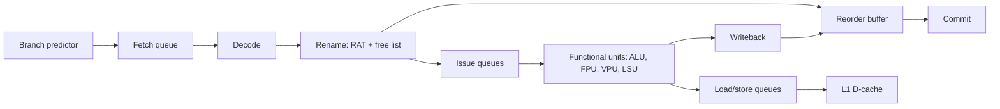
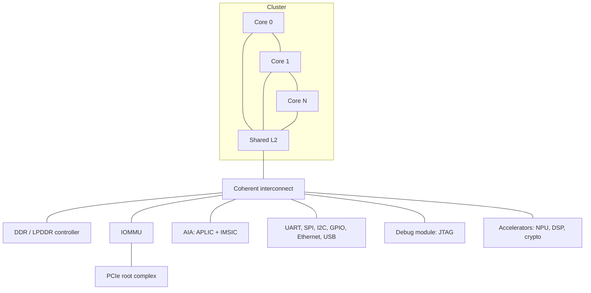

# Chapter 11 - Microarchitecture and Implementations

[Index](00_README.md) | Prev: [Ch 10](10_Boot_SBI_Firmware_Linux.md) | Next: [Ch 12 - Security, CFI, TEE](12_Security_CFI_TEE.md)

**Goals:** Understand how a RISC-V core is built (pipelines, out-of-order machinery, caches, TLBs, coherence, SoC fabric), what RISC-V makes easy or hard for implementers, and survey the open and commercial implementations.

> The ISA does not specify microarchitecture. Everything about specific products here is **Impl-specific** and changes quickly; verify against vendor documentation **[verify]**.

---

## 11.1 From ISA to hardware

The RISC-V encoding was designed to make decode and hardware cheap:

| ISA feature | Hardware benefit |
|-------------|------------------|
| Fixed register fields at fixed bits | Register file read can begin before decode finishes |
| Immediate sign bit always bit 31 | Early sign extension |
| No condition codes | No flag renaming; branch compares do not need a hidden register |
| No branch delay slot | Simple front end |
| `x0` zero register | Free constant/discard |
| 32/16-bit lengths decided by the first parcel | Simple length decode (with `C`) |
| Load/store with simple base+offset | Simple AGU |
| Weak memory model | More freedom for store buffers and speculation |
| Few instruction side effects | Easier precise exceptions |
| CSR instructions separate from the data path | Isolation of system state |

Challenges: instruction fusion needed for peak performance (`lui+addi`, `auipc+jalr`, `slli+add`), no scaled addressing modes (compensated by `Zba`), CSR serialization, and a large and growing extension set to verify.

## 11.2 Classic five-stage in-order pipeline

Stages: **IF** (fetch) -> **ID** (decode, register read) -> **EX** (ALU, branch resolve) -> **MEM** (load/store) -> **WB** (write register).

| Hazard | Cause | Solution |
|--------|-------|----------|
| Data (RAW) | Needs a result not yet written | **Forwarding** from EX/MEM/WB; stall for load-use |
| Control | Branch unresolved | Predict, flush on mispredict (2-3 bubbles) |
| Structural | Shared resource busy | Duplicate resources (separate I$/D$) |

Typical small cores: 2-3 stages (Ibex, PicoRV32), 5-6 stages (Rocket, CV32E40P, CVA6).

### Performance equation

$$\text{Time} = \text{Instruction count} \times \text{CPI} \times \text{Cycle time}$$

RISC-V keeps instruction counts competitive with `C` (code density) plus `Zba/Zbb/Zicond` and `V`; CPI and frequency depend on the implementation.

## 11.3 Superscalar and out-of-order cores

Out-of-order (OoO) execution hides latency by executing independent instructions as their operands become ready, then **committing in order** to preserve precise exceptions.

Components:

| Block | Role |
|-------|------|
| **Branch predictor** | Direction (TAGE/perceptron/gshare), target (BTB), returns (RAS), indirect (ITTAGE) |
| **Rename** | Map architectural registers to larger physical register file; removes WAR/WAW |
| **Reorder buffer (ROB)** | Tracks in-flight instructions for in-order commit and exception handling |
| **Issue queues / schedulers** | Wake up and select ready operations |
| **Load/store queue** | Memory dependence checking, store-to-load forwarding, ordering (RVWMO rules, LR/SC reservation) |
| **Functional units** | Integer ALUs, branch, multiplier, divider, FPU, vector, crypto |
| **Retire/commit** | Updates architectural state; handles traps |

Notes specific to RISC-V:

- **Instruction fusion (macro-op fusion):** adjacent pairs like `lui+addi`, `auipc+addi/ld/jalr`, `slli+srli` (zero-extension), `mulh+mul`, compare+branch are merged into one micro-op.
- **Compressed instructions:** the fetch unit must handle 16-bit alignment and instructions straddling fetch blocks or cache lines (and pages).
- **Vector extension:** register-group chaining, lane-based or decoupled vector units, `vsetvli` renaming (`vl`/`vtype` speculation), mask handling.
- **CSRs:** many are serializing; `fcsr`, `vl`, `vtype` need special renaming for performance.
- **LR/SC:** needs a reservation tracker that interacts with coherence.
- **Memory model:** RVWMO allows load-load reordering; OoO cores need only enforce per-address coherence plus dependencies, fences, and acquire/release semantics.

## 11.4 Caches, TLBs, and coherence

| Structure | Typical sizes | Notes |
|-----------|---------------|-------|
| L1 I-cache | 16-64 KiB, 4-8 way | VIPT common; must handle `fence.i` |
| L1 D-cache | 16-64 KiB, 4-8 way | Write-back, non-blocking |
| L2 | 256 KiB-2 MiB | Private or cluster-shared |
| L3 / LLC | MiBs | Shared, often non-inclusive |
| L1 TLBs | 16-64 entries, fully associative | Separate I/D |
| L2 TLB | 512-4096 entries | Unified |
| Page-walk cache | small | Caches upper-level PTEs |

- **Cache-block ops** (`Zicbom/Zicboz/Zicbop`) assume a defined block size (`Zic64b` mandates 64 bytes in RVA23).
- **Coherence protocols:** MESI/MOESI; buses and fabrics: **TileLink** (SiFive/Chipyard), **AMBA AXI/ACE/CHI**, **OpenPiton P-Mesh**, **Wishbone** (small cores).
- **Non-coherent DMA** devices require software cache maintenance (`cbo.clean/inval/flush`) or coherent IO ports.
- **PMA** (physical memory attributes) tables decide cacheability, atomic support, ordering; **PMP** in front of them for protection.
- **Instruction cache coherence:** hardware may not snoop stores into I$; `fence.i` flushes/synchronizes.

## 11.5 SoC structure

Typical components: boot ROM, SRAM, DRAM controller, interrupt controller, timers (`mtime`), watchdogs, PCIe, DMA, security (OTP, RoT, crypto), power management unit.

Tools to assemble SoCs: **Chipyard** (Berkeley), **LiteX** (FPGA), **OpenTitan** (secure), **ESP** (Columbia), **Rocket Chip generators** (Chisel).

## 11.6 Customization: how vendors extend RISC-V

| Mechanism | Description |
|-----------|-------------|
| **Custom opcodes** | custom-0..custom-3 encoding spaces; assembler support via `.insn` |
| **Custom CSRs** | Reserved CSR address ranges for vendor use |
| **RoCC / CV-X-IF / CORE-V eXtension Interface** | Standard-ish interfaces for attaching coprocessors |
| **Vendor extensions (`Xthead*`, `Xcv*`, `Xsf*`, `Xventana*`...)** | Defined by vendors; supported in some toolchains |
| **Memory-mapped accelerators** | Registers/DMA driven by software |

Cautions: custom extensions fragment the software ecosystem; profile-conforming software must not depend on them. The RVA23 optional **`Ssstrict`** extension specifies "no non-conforming extensions" behavior.

## 11.7 Open-source cores

| Core | Origin | Style | Notes |
|------|--------|-------|-------|
| **Rocket Chip / Rocket** | Berkeley / SiFive | In-order, RV64GC, Chisel | Generator ecosystem (Chipyard), reference implementation |
| **BOOM / SonicBOOM** | Berkeley | Out-of-order superscalar, RV64GC, Chisel | Academic OoO reference |
| **CVA6 (Ariane)** | ETH Zurich / OpenHW | 6-stage in-order, RV32/64 GC, SystemVerilog | Boots Linux; OpenHW verified |
| **CV32E40P / CV32E40X / CV32E40S** | OpenHW (from PULP RI5CY) | 4-stage MCU-class | Industrial-quality verification |
| **Ibex** | lowRISC | 2-3 stage RV32IMC(B), SystemVerilog | Used in OpenTitan |
| **PicoRV32 / SERV / VexRiscv / NEORV32** | Community | Tiny, FPGA-friendly | SERV is bit-serial (smallest) |
| **NaxRiscv** | SpinalHDL community | OoO RV32/64 | Linux-capable |
| **XiangShan** | ICT/CAS and others | High-performance OoO (Nanhu, Kunminghu...), Chisel | Open-source high-perf; **[verify generation names]** |
| **SweRV / VeeR (EH1, EL2, EH2)** | Western Digital -> CHIPS Alliance | MCU/embedded, SystemVerilog | Used in Caliptra |
| **XuanTie C906/C908/C910** | T-Head (Alibaba) | Application cores, open-sourced RTL (various) | **[verify license status per core]** |
| **Hazard3** | Luke Wren | RV32IMACZb* | In Raspberry Pi RP2350 |

## 11.8 Commercial IP and silicon (illustrative; **[verify]**)

| Vendor | Examples | Segment |
|--------|----------|---------|
| **SiFive** | E-series (embedded), S (real-time), U (application, e.g., U74), P-series (performance, e.g., P550, P670, P870), X-series (vector, e.g., X280) | IP cores and dev boards (HiFive) |
| **Andes** | AndesCore N/NX/A/AX series (AX45, AX65, AX66) | Embedded to Linux-class |
| **T-Head / XuanTie** | C9xx series (C906, C908, C910, C920, C930) | Chips like TH1520, SG2042 (Sophgo, 64 x C920) |
| **Ventana Micro Systems** | Veyron V1/V2 | Data-center-class |
| **Tenstorrent** | Ascalon (CPU), plus RISC-V cores in AI chips | AI and high-performance |
| **Akeana**, **MIPS (RISC-V eVocore)**, **Codasip**, **Imagination**, **Nuclei**, **Syntacore**, **Semidynamics**, **Cortus** | Various | IP |
| **SpacemiT** | K1 (8-core X60, RVA22+V), later generations | Application SoCs |
| **StarFive** | JH7110 (VisionFive 2) | SBC/SoC |
| **Kendryte** | K210 (older RV64GC), K230 | Edge AI |
| **Espressif** | ESP32-C2/C3/C6/H2/P4 | Wi-Fi/BLE MCUs |
| **WCH**, **GigaDevice**, **Microchip PolarFire SoC**, **Renesas**, **Infineon**, **Nordic**, **Raspberry Pi RP2350** | Various | MCUs/SoCs |

Systems: Milk-V (Pioneer, Mars, Jupiter), BananaPi (BPI-F3), Lichee Pi 4A, Orange Pi RISC-V boards, Pine64 Star64, Framework laptop mainboard (DeepComputing), SiFive HiFive Unmatched/Premier. AI: Tenstorrent Blackhole-class systems use many RISC-V cores. Space/automotive: radiation-tolerant and ISO 26262-qualified RISC-V cores exist from several vendors **[verify]**.

## 11.9 Verification and quality

| Method | Role |
|--------|------|
| **ISA tests** (`riscv-tests`, `riscv-arch-test` / RISCOF, `ACT` framework) | Basic conformance, per-extension |
| **Sail RISC-V model** | Formal, executable golden model; official ISA formal spec **[verify status]** |
| **Spike** | C++ golden reference simulator |
| **Random instruction generators** | `riscv-dv` (Google), `FORCE-RISCV`, `RISCV-DV` for co-simulation |
| **Formal verification** | `riscv-formal` (RVFI interface), JasperGold/SymbiYosys |
| **Co-simulation** | Compare RTL retirement trace to Spike via RVFI/`RVFI-DII` or DPI |
| **Fuzzing** | Processor fuzzers (e.g., DifuzzRTL, TheHuzz) |
| **Compliance programs** | RISC-V International compatibility/ certification efforts **[verify]**, OpenHW's CORE-V verification (UVM) |
| **Boot Linux/benchmarks** | System-level confidence |

## 11.10 Performance measurement

- **Benchmarks:** CoreMark (MCU), Dhrystone (legacy), EEMBC suites, SPEC CPU (application-class), Geekbench, MLPerf (AI), STREAM (bandwidth).
- **Counters:** `cycle`, `instret`, `hpmcounterN` with events from the platform; Linux `perf` via SBI PMU extension (Chapter 13).
- **Metrics:** IPC = instret/cycle; branch MPKI; L1/L2/LLC MPKI; TLB MPKI; stall breakdown.
- **Code density:** RV64GC code typically comparable to or smaller than AArch64 and x86-64; `Zcmp/Zcmt` boost further.
- **Common software optimization tips:** use `Zba/Zbb` code generation (`-march` flags), align hot loops, avoid unaligned accesses where slow, use vector with proper LMUL, prefetch (`Zicbop`), use `Zicond`/branch-free code for unpredictable branches.

## 11.11 Chapter summary

- RISC-V encodings favor simple decode, easy forwarding, and cheap high-performance implementations.
- Implementers span 2-stage MCUs to wide OoO servers; `Zba/Zbb`, fusion, and vectors close performance gaps.
- Coherent fabrics (TileLink, CHI), PMA/PMP, IOMMU, and AIA complete an SoC.
- Open cores (Rocket, BOOM, CVA6, Ibex, XiangShan) and many commercial IPs exist; verification relies on Spike/Sail golden models, formal, and random testing.

### Check yourself

1. Why does the absence of condition codes simplify OoO renaming?
2. Which fusions matter for RISC-V performance?
3. Why must LR/SC interact with the coherence protocol?
4. What blocks in an OoO core ensure precise exceptions?
5. Name three ways vendors can extend RISC-V without breaking the standard.

Answers

1. There is no hidden flags register to rename; compares write ordinary registers or feed branches directly.
2. `lui+addi`, `auipc+jalr/ld/addi`, `slli+add`/`slli.uw`, `mulh+mul`, compare-branch, zero-extend idioms.
3. A reservation must be invalidated when another agent writes the reserved region.
4. Reorder buffer and in-order commit (plus checkpoint/rollback of rename state).
5. Custom opcodes, custom CSRs, memory-mapped accelerators/coprocessor interfaces (RoCC, CV-X-IF).

Next: [Chapter 12 - Security, CFI, TEE](12_Security_CFI_TEE.md)
