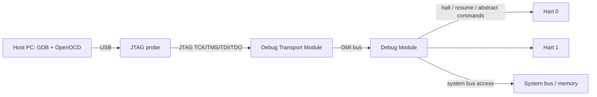

# Chapter 13 - Debug, Trace, Performance Monitoring, and RAS

[Index](00_README.md) | Prev: [Ch 12](12_Security_CFI_TEE.md) | Next: [Ch 14 - Emerging Topics](14_Emerging_Topics.md)

**Goals:** Know how to connect a debugger (JTAG, OpenOCD, GDB), how the Debug Module and Debug Mode work, how triggers implement breakpoints and watchpoints, what trace offers, how performance counters and the SBI PMU extension work, and how reliability (RAS) and non-maskable events are handled.

> Status: The **RISC-V Debug Specification** (v1.0), **Sdtrig** triggers, **E-Trace** / **N-Trace**, and **RERI** are ratified or in final stages. Exact ratification states and versions: **[verify]** at https://docs.riscv.org/ and https://riscv.org/specifications/ratified/.

---

## 13.1 Debug architecture overview



| Component | Role |
|-----------|------|
| **DTM** (Debug Transport Module) | Bridges an external transport (usually 4/5-wire **JTAG**; also cJTAG, serial, USB) to the **DMI** (Debug Module Interface) |
| **DM** (Debug Module) | Controls harts (halt/resume/reset), runs abstract commands, offers a program buffer and optional system bus access |
| **Hart in Debug Mode** | Special execution state (`D` mode, above M) where normal exceptions/interrupts are suppressed |
| **Triggers** (`Sdtrig`) | Hardware breakpoints and watchpoints (raise exception or enter Debug Mode) |
| **Trace encoder** | Optional; produces compressed instruction/data trace |

JTAG registers for the DTM: `IDCODE` (0x01), `dtmcs` (0x10), `dmi` (0x11). DMI is a small address space (7+ bits) selecting DM registers.

## 13.2 Debug Module registers (abridged)

| Register | DMI address | Purpose |
|----------|-------------|---------|
| `data0`-`data11` | 0x04-0x0F | Abstract command data |
| `dmcontrol` | 0x10 | Halt/resume/reset requests, hart selection, `dmactive`, `ndmreset` |
| `dmstatus` | 0x11 | Hart states: halted, running, unavailable, resume ack, authenticated, version |
| `hartinfo` | 0x12 | Info about the selected hart |
| `abstractcs` | 0x16 | Abstract command status (busy, `cmderr`, data/progbuf counts) |
| `command` | 0x17 | Issue an abstract command |
| `abstractauto` | 0x18 | Auto-execute commands on data access |
| `progbuf0`-`progbuf15` | 0x20-0x2F | Program buffer (instructions executed in Debug Mode) |
| `sbcs`, `sbaddress0`, `sbdata0` | 0x38, 0x39, 0x3C | System Bus Access |
| `haltsum0/1/...` | 0x40... | Halted-hart summary |

### Typical operations

| Operation | How |
|-----------|-----|
| **Halt** | Set `haltreq` in `dmcontrol`; wait for `dmstatus.allhalted` |
| **Resume** | Set `resumereq` |
| **Read/write a register** | Abstract "Access Register" command (`cmdtype=0`) with `data0` |
| **Read/write memory** | Abstract "Access Memory" (`cmdtype=2`), program buffer load/store, or **System Bus Access** (no hart needed) |
| **Single step** | Set `dcsr.step`, resume; hart re-enters Debug Mode after one instruction |
| **Reset and halt** | `resethaltreq` then `ndmreset` / `hartreset` |
| **Run arbitrary instructions** | Write into program buffer, execute with abstract command `postexec` |

## 13.3 Debug Mode and its CSRs

Debug CSRs are accessible **only in Debug Mode** (or via DM):

| CSR | Addr | Meaning |
|-----|------|---------|
| `dcsr` | 0x7B0 | Debug control and status: `xdebugver`, `ebreakm/s/u/vs/vu` (make `ebreak` enter Debug Mode), `stepie`, `stopcount`, `stoptime`, `cause`, `step`, `prv` |
| `dpc` | 0x7B1 | Debug PC (resume address) |
| `dscratch0` | 0x7B2 | Scratch |
| `dscratch1` | 0x7B3 | Scratch |

`dcsr.cause`: 1 = `ebreak`, 2 = trigger, 3 = halt request, 4 = single step, 5 = reset-halt request, 6 = halt group.

Behavior in Debug Mode:

- Interrupts and traps are not taken (an exception while running abstract/progbuf code just ends the command with an error).
- `mstatus`-based privilege checks are ignored; the hart can access everything; `dcsr.prv` holds the privilege to return to.
- `dret` leaves Debug Mode, resuming at `dpc` with privilege `dcsr.prv`.
- Instruction side effects may differ (e.g., counters may stop per `stopcount`).

## 13.4 Triggers (`Sdtrig`)

Hardware breakpoints/watchpoints implemented by a set of **trigger registers**, selected with `tselect`:

| CSR | Addr | Meaning |
|-----|------|---------|
| `tselect` | 0x7A0 | Select trigger |
| `tdata1` | 0x7A1 | Type and main control |
| `tdata2` | 0x7A2 | Match value (address/data/etc.) |
| `tdata3` | 0x7A3 | Extra (context match) |
| `tinfo` | 0x7A4 | Supported types |
| `tcontrol` | 0x7A5 | M-mode trigger control |
| `mcontext`, `scontext`, `hcontext` | 0x7A8, 0x7AA, 0x6A8 | Context for matching (e.g., process ID) |

Trigger types (`tdata1.type`): 2 `mcontrol` (legacy address/data match), **6 `mcontrol6`** (address/data match, current), 3 `icount` (instruction count), 4 `itrigger` (interrupt), 5 `etrigger` (exception), 7 `tmexttrigger` (external), 15 disabled (the field values are from the debug spec; confirm numbering **[verify]**).

**Actions:** raise a **breakpoint exception** (so an OS/GDB stub handles it) or **enter Debug Mode** (for external debuggers). Triggers can chain and match on address ranges, loads/stores/executes, privilege, or context.

RVA23S64 lists `Sdtrig` as an expansion option.

## 13.5 Software debugging tools

### OpenOCD + GDB

```
# Terminal 1: OpenOCD (config depends on probe and board)
openocd -f interface/ftdi/olimex-arm-usb-tiny-h.cfg -f target/riscv.cfg
# Terminal 2:
riscv64-unknown-elf-gdb app.elf
(gdb) target extended-remote :3333
(gdb) monitor reset halt
(gdb) load
(gdb) break main
(gdb) continue
(gdb) info registers
(gdb) x/8i $pc
(gdb) p/x $mstatus
(gdb) monitor riscv set_command_timeout_sec 30
```

Useful OpenOCD notes: `riscv set_prefer_sba on` forces System Bus Access for memory; `reset_config` depends on board; for multi-hart targets use `-rtos hwthread`.

### QEMU + GDB

```
qemu-system-riscv64 -machine virt -nographic -bios none -kernel app.elf -s -S
# other terminal
riscv64-unknown-elf-gdb app.elf -ex "target remote :1234"
```

### Semihosting

A magic `ebreak` sequence (`slli x0,x0,0x1f; ebreak; srai x0,x0,7`) requests the debugger to perform host services (file I/O, printf). Supported by OpenOCD, QEMU (`-semihosting`), and some libc builds.

### Linux debugging

`gdbserver`, `perf`, `ftrace`, `kgdb`, `/proc/cpuinfo`, `dmesg` (earlycon), `riscv_hwprobe`, and KVM debugging (`KVM_SET_GUEST_DEBUG`).

## 13.6 Trace

Trace records *what the hart actually executed* with little or no intrusion.

| Spec | Description |
|------|-------------|
| **E-Trace** (Efficient Trace for RISC-V) | Compressed **instruction trace**: reports control-flow changes (taken branches as bit-vectors, indirect jumps with target, exceptions/interrupts, privilege changes, context), plus timestamps. A decoder with the program binary reconstructs the full instruction stream. |
| **N-Trace** | Nexus 5001-style message-based trace (branch history, program correlation, data acquisition) |
| **Trace Control Interface** | Common software control of trace encoders, funnels, and sinks (SRAM, ATB/ATP, PIB) |
| **Trace connectors and sinks** | Trace to on-chip SRAM, DDR, USB, or parallel trace port |

Encoder inputs come from the hart's **retire interface**: per retired instruction group, `itype` (exception, interrupt, return, non-taken branch, taken branch, uninferable jump, ...), address, privilege, context.

Uses: performance profiling, code coverage, safety/forensics (ISO 26262), debugging heisenbugs, real-time analysis. Data trace specs are less mature **[verify]**.

## 13.7 Hardware performance monitoring

### Counter CSRs

| Group | CSRs |
|-------|------|
| Fixed counters | `cycle`, `time`, `instret` (user-readable via `mcounteren`/`scounteren`) |
| Programmable counters | `hpmcounter3`-`hpmcounter31` with event selectors `mhpmevent3`-`31` |
| Control | `mcountinhibit` (stop counters), `mcounteren`, `scounteren`, `hcounteren` |
| RV32 high halves | `cycleh`, `timeh`, `instreth`, `hpmcounterNh`, `mhpmeventNh` |

Event numbers are **platform/implementation-defined** (documented in the core's manual and encoded in Linux `perf` JSON event files). `Zicntr` = fixed counters, `Zihpm` = programmable counters (both required by RVA22/RVA23).

### Overflow, sampling, and filtering: `Sscofpmf`

Mandatory in RVA23S64. Adds to each `mhpmeventN` the bits:

| Bit | Name | Meaning |
|-----|------|---------|
| 63 | `OF` | Overflow flag (set when the counter wraps; raises the **LCOFI** interrupt, cause 13, if enabled) |
| 62 | `MINH` | Inhibit counting in M-mode |
| 61 | `SINH` | Inhibit in S-mode |
| 60 | `UINH` | Inhibit in U-mode |
| 59 | `VSINH` | Inhibit in VS-mode |
| 58 | `VUINH` | Inhibit in VU-mode |

`scountovf` (0xDA0) lets S-mode see which counters overflowed.

### Counter delegation and CTR

- **`Smcntrpmf`**: privilege-mode filtering for `cycle` and `instret`.
- **`Smcdeleg` / `Ssccfg`** (counter delegation): lets S-mode configure delegated counters directly through indirect CSR access, avoiding an SBI call per event update **[verify status]**.
- **`Smctr` / `Ssctr`** (Control Transfer Records): a hardware ring of recent branch source/target pairs (like Intel LBR / Arm BRBE) for cheap call-graph sampling **[verify status]**.

### SBI PMU extension (EID `0x504D55`, "PMU")

| FID | Function |
|-----|----------|
| 0 | `sbi_pmu_num_counters` |
| 1 | `sbi_pmu_counter_get_info` |
| 2 | `sbi_pmu_counter_config_matching` |
| 3 | `sbi_pmu_counter_start` |
| 4 | `sbi_pmu_counter_stop` |
| 5 | `sbi_pmu_counter_fw_read` |
| 6 | `sbi_pmu_counter_fw_read_hi` |
| 7 | `sbi_pmu_snapshot_set_shmem` (counter snapshot to reduce trap cost; newer versions **[verify]**) |

Firmware owns the `mhpmevent` registers (M-mode CSRs), so S-mode Linux asks the SBI to configure and start counters; firmware also counts "firmware events" (IPIs, fences, misaligned traps).

### Linux perf usage

```
perf list                                # events (hardware, SBI firmware, cache, tracepoints)
perf stat -e cycles,instructions ./app
perf record -e cycles:u -F 999 -g ./app  # sampling needs Sscofpmf overflow interrupts
perf report
```

Without overflow interrupts (`Sscofpmf`), `perf` can only count, not sample.

### What to measure

| Metric | Formula |
|--------|---------|
| IPC | `instret / cycle` |
| Branch MPKI | `1000 * branch_misses / instret` |
| L1D MPKI | `1000 * l1d_misses / instret` |
| TLB MPKI | `1000 * tlb_misses / instret` |
| Frequency estimate | `cycle / (time delta * timebase)` |

## 13.8 RAS: reliability, availability, serviceability

| Feature | Description |
|---------|-------------|
| **ECC/parity** | Caches, TLBs, register files, memories detect and correct errors |
| **`Smrnmi`** | Resumable NMIs with `mnepc`, `mncause`, `mnscratch`, `mnstatus`, and `mnret` for errors that can occur at any time, even in a trap handler |
| **RERI** (RAS Error-record Register Interface) | Standard memory-mapped **error banks** with records: control, status, address, info, supplemental info, timestamp, plus counters; lets OS/firmware locate, classify (corrected/uncorrected/deferred/critical), and log errors uniformly **[verify ratification]** |
| **Hardware-error exception** | Exception code 19 for synchronous hardware errors **[verify]** |
| **Double trap** (`Smdbltrp`, `Ssdbltrp`) | Detects a trap taken while handling a trap (e.g., a corrupted stack) and raises a critical-error exception or NMI instead of silently recursing |
| **Platform notification** | Errors reported via interrupts and ACPI APEI/GHES or device tree; Linux EDAC and `mcelog`-like handling |
| **Lockstep and safety** | Dual-core lockstep for ISO 26262 ASIL-D; safety mechanisms via vendor features |

## 13.9 Debugging checklist: "my board does nothing"

| Step | Check |
|------|-------|
| 1 | Is the reset vector correct and the boot ROM leaving the expected state? Check boot-mode straps |
| 2 | Can JTAG halt the hart? Read `misa`, `mhartid`, `mvendorid`; read memory |
| 3 | PMP set up so S-mode may touch RAM and MMIO? Read `pmpcfg0`/`pmpaddr*` |
| 4 | `mtvec` set? Cause of the last trap (`mcause`, `mepc`, `mtval`)? |
| 5 | Is the UART clock/pin mux configured? Try SBI `DBCN`/legacy putchar |
| 6 | `satp` and page tables correct (identity map for the instruction that enables MMU)? |
| 7 | Timer: `timebase-frequency` correct? `mtimecmp` or `stimecmp` programmed? Is `time` CSR emulated? |
| 8 | Interrupts: `mie/sie`, `mstatus.MIE/sstatus.SIE`, `mideleg`, PLIC/AIA priority, threshold, enable bits |
| 9 | Alignment: loads/stores to misaligned addresses on a core that traps |
| 10 | Cache/DMA: missing `cbo.*` or `fence`; non-coherent DMA buffers |

## 13.10 Chapter summary

- Debug: DTM (JTAG) -> DMI -> DM; Debug Mode with `dcsr/dpc`; abstract commands, program buffer, and system bus access.
- Triggers (`Sdtrig`) implement hardware breakpoints/watchpoints with exception or debug-mode actions.
- Trace (E-Trace/N-Trace) records compressed control flow for profiling and forensics.
- Counters: `Zicntr`/`Zihpm`; sampling requires `Sscofpmf`; Linux perf uses the SBI PMU extension.
- RAS: `Smrnmi`, RERI, double-trap, ECC, and platform error reporting.

### Check yourself

1. What are the roles of the DTM and the DM?
2. How does a program enter Debug Mode on `ebreak`?
3. Why can `perf record` fail to sample on some RISC-V boards?
4. What does `dret` do?
5. What is the purpose of `mcountinhibit`?

<details><summary>Answers</summary>

1. DTM provides transport (JTAG -> DMI); DM controls harts and offers abstract commands, program buffer, and system bus access.
2. Set `dcsr.ebreakm/s/u` (for the desired privilege) so `ebreak` enters Debug Mode instead of raising a breakpoint exception.
3. The core lacks `Sscofpmf` (no overflow interrupts), or firmware/SBI PMU support is incomplete.
4. Leaves Debug Mode: resumes at `dpc` with privilege `dcsr.prv`.
5. Stops selected counters (`cycle`, `instret`, `hpmcounter*`) from incrementing.
</details>

Next: [Chapter 14 - Emerging and Advanced Topics](14_Emerging_Topics.md)
