# How Yocto Works, End to End: Presentation Flow for the BMC Team

This is the **storyline and diagram set** for presenting Yocto in depth. Slide-level bullets and speaker notes are in the companion [60-minute deck](Yocto_for_BMC_Team_Presentation.md). Use this file to decide the order, draw the diagrams, and thread one example through the whole talk.

> Items tagged **[verify]** are OpenBMC/machine specifics that vary by tree and release. Check them in the tree you present (`bitbake -e`, `bitbake-layers show-layers`). Commands are for a Linux build host.

---

## 1. The core idea: present Yocto as a pipeline, not a glossary

Training notes usually go topic by topic: Poky, metadata, recipes, classes, layers, images, packages. That order explains *what things are called*. A BMC team needs to know *what happens*, so tell it as one pipeline and introduce each term when the pipeline reaches it.

**The question that drives the talk:**
> "How does a line in a layer become a running service on the BMC, and how do I trace it back when it is wrong?"

**The storyline in eleven acts:**

| Act | The question it answers | Terms introduced there |
| --- | --- | --- |
| 1. Why | What are we building, and why not just use a distro? | Four elements, Yocto, Poky, OpenEmbedded |
| 2. Workspace and configuration | What do we tell the build system? | `oe-init-build-env`, `bblayers.conf`, `local.conf`, `MACHINE`, `DISTRO` |
| 3. Parsing | How does BitBake turn files into knowledge? | Recipes, `.bbappend`, classes, `.inc`, overrides, providers |
| 4. Task graph | What has to be built, in which order? | `DEPENDS`, `RDEPENDS`, native/cross/target, toolchain |
| 5. Inside one recipe | What does a recipe actually do? | `do_fetch` ... `do_package_write_ipk`, `S`, `B`, `D`, sysroots |
| 6. Shared state | Why is the second build fast, and why did this rebuild? | Signatures, sstate, setscene, hash equivalence |
| 7. Image | How do packages become a root filesystem? | `IMAGE_INSTALL`, package feed, `do_rootfs`, `IMAGE_FSTYPES` |
| 8. BMC flash image | How does a rootfs become something we flash? | U-Boot, FIT, rofs/rwfs, `image-bmc`, update tarball |
| 9. Boot | What runs that output on the board? | BootROM, SPL, U-Boot, kernel, initramfs, systemd |
| 10. Trace back | A file on the BMC is wrong. Where did it come from? | `oe-pkgdata-util`, `bitbake -e`, `show-appends`, `devtool` |
| 11. Lifecycle | How do we keep this alive? | Releases, LTS, branch compatibility |

**One running example through every act:** `bmcweb` (the Redfish server) as the application path, and the **kernel** as the BSP path. At each act, show where `bmcweb` and the kernel are in the pipeline.

---

## 2. The master map (reuse it on every act's title slide)

Show this once in full, then repeat it at the start of every act with the current stage highlighted ("you are here"). The repetition is what makes a deep talk easy to follow.

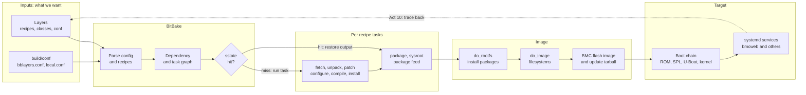

**Highlighting the current stage:** add these two lines at the end of the diagram and change the node name per act.

```text
    classDef here fill:#ffd54f,stroke:#e65100,stroke-width:3px
    class T here
```

---

## Act 1: Why Yocto (input/output machine)

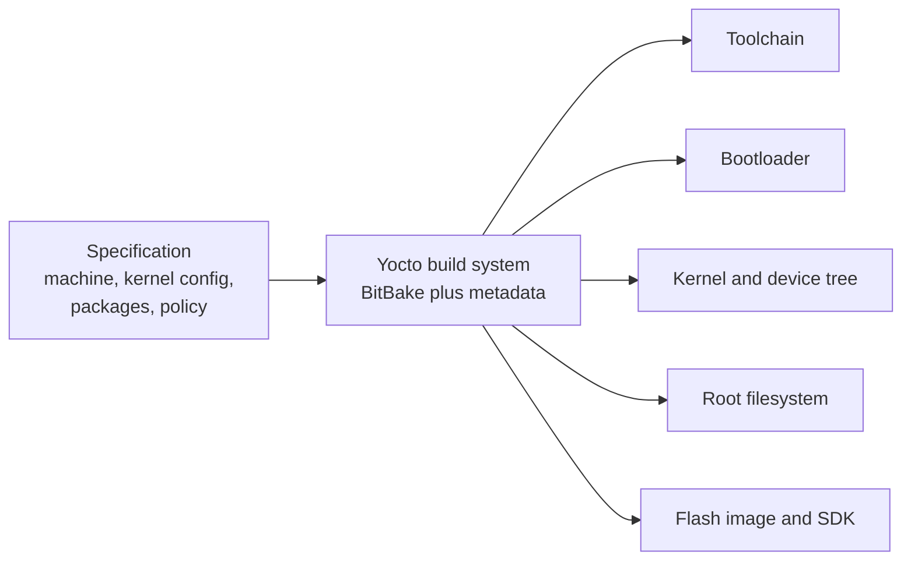

**Say:**
- An embedded Linux product is four elements: toolchain, bootloader, kernel, rootfs, plus our application. Yocto builds **all four from source**, from one description.
- Yocto is the umbrella project; Poky is its reference distro; OpenEmbedded (oe-core) is the shared metadata; BitBake is the engine. OpenBMC is **its own distro** built on oe-core and BitBake, not Poky as-is.
- A BMC is constrained (often a 32-128 MB SPI-NOR), must be updateable and secure, and must ship only what we list. That is why we build a custom distro rather than install one.

**From your notes:** four elements, "what is Yocto", history, advantages, the input/output analogy, Poky vs Yocto. Keep this act short (3-4 min).

---

## Act 2: Workspace and configuration

### 2a. What setup creates

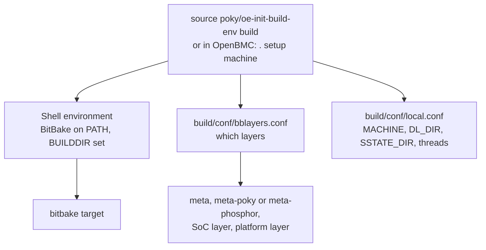

**Say:** the script is **sourced**, not executed, because it must change your current shell. That is why a new terminal says `bitbake: command not found`.

### 2b. Configuration parse order (the in-depth part)

BitBake builds one global configuration before it reads any recipe:

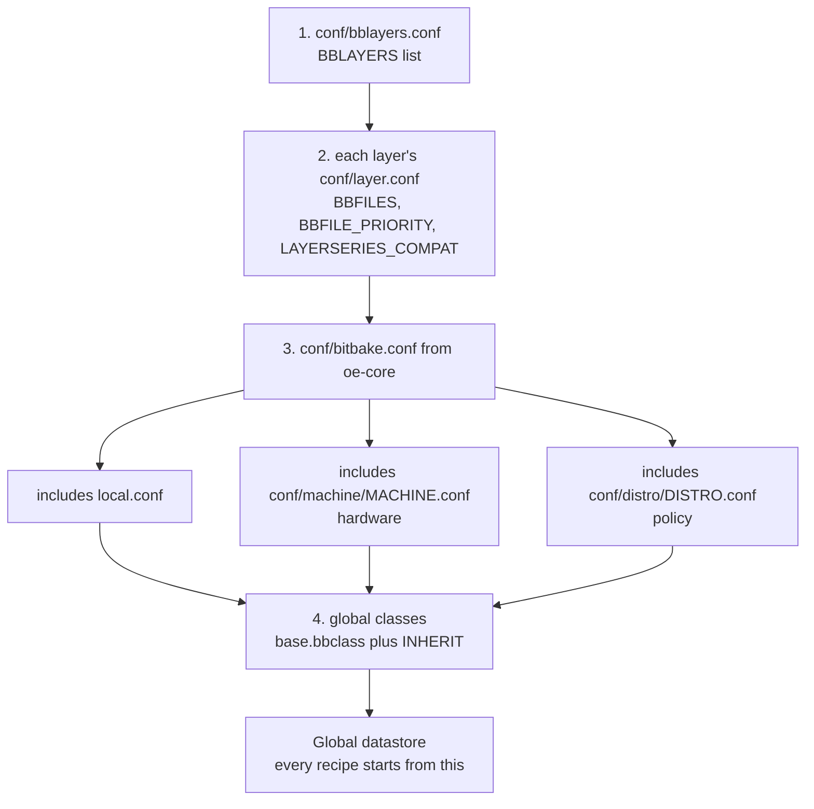

**Say:**
- **Machine** = hardware (SoC, kernel, U-Boot, device tree, flash size). **Distro** = policy (init system, features, package format). **Image** = what goes into the rootfs. Three independent knobs; every change belongs to exactly one.
- `local.conf` is per-user scratch and is not source-controlled. Anything permanent goes into a layer (machine conf, distro conf, image, or `.bbappend`).

**Operators to show on one slide:**

| Syntax | Meaning |
| --- | --- |
| `A = "x"` | Set (later assignments win) |
| `A ?= "x"` | Set only if still unset when parsed |
| `A ??= "x"` | Weakest default, applied only at the end if nothing else set it |
| `A += "x"` / `A =+ "x"` | Append / prepend with a space |
| `A:append = " x"` | Append applied at finalisation, after all `=`; needs the leading space |
| `A:qemuarm = "x"` | Override: used only when `qemuarm` is in `OVERRIDES` (machine, distro, arch...) |
| `${B}` / `:=` | Expanded when used / expanded immediately |

**Demo:** `bitbake -e bmcweb | less` then search for `^SRC_URI=`; the comment block above it shows **every file and operation** that changed the value. Newer releases also have `bitbake-getvar -r bmcweb SRC_URI`.

**From your notes:** setup steps, `local.conf`, `bblayers.conf`, `BB_NUMBER_THREADS` vs `PARALLEL_MAKE`, `DL_DIR`, `TMPDIR`, "where should local.conf content go" (answer: your distro/machine/image config in a layer).

---

## Act 3: Parsing recipes

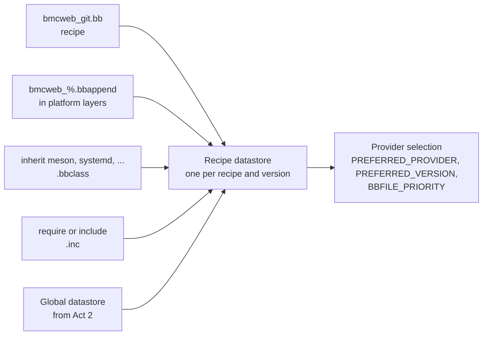

**Say:**
- BitBake parses **every** recipe matched by `BBFILES` in every layer, layers each `.bbappend` on top, and pulls in classes and includes. The result is cached, which is why the first parse is slow and later ones are fast.
- A `.bbappend` changes a recipe **without forking it**: extra patches, config, `SRC_URI`, `FILES`. In OpenBMC most platform customisation is a `.bbappend`.
- Classes hold shared logic: `inherit meson` gives a recipe its configure/compile/install steps; `inherit systemd` handles unit files.
- **Virtual providers** decide which recipe fills a role: `PREFERRED_PROVIDER_virtual/kernel` and `PREFERRED_PROVIDER_virtual/bootloader` are set by the machine config. This is how the same image gets an ASPEED kernel on one machine and a different kernel on another.

**Demo:** `bitbake-layers show-layers`, `bitbake-layers show-appends | grep -A3 bmcweb`, `bitbake-layers show-recipes "linux-*"`, `bitbake -e virtual/kernel | grep ^PN=`.

**From your notes:** metadata types (`.conf`, `.bb`, `.bbappend`, `.bbclass`, `.inc`), recipes, classes, layers, "why layers", BSP layers, `meta-ti` vs `meta-yocto-bsp`.

---

## Act 4: The dependency and task graph

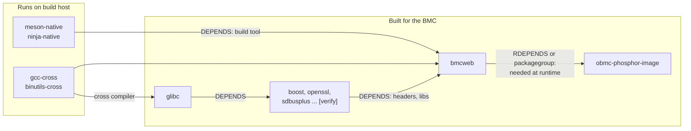

**Say:**
- BitBake does not run recipes; it runs **tasks**, and the graph is task to task. `DEPENDS = "boost"` really means "bmcweb's `do_prepare_recipe_sysroot` waits for boost's `do_populate_sysroot`".
- `DEPENDS` is build time (headers, libraries, tools). `RDEPENDS` is runtime (what must be on the target). Mixing them up is a classic bug: builds fine, fails on the BMC, or vice versa.
- Three flavours of recipe: **native** (runs on the build host, for example `meson-native`), **cross** (host tools that produce target code, for example `gcc-cross`), and **target** (runs on the BMC). The **toolchain is itself just recipes** at the bottom of the graph. That is the in-depth answer to "everything depends on the toolchain".
- BitBake runs any ready task in parallel up to `BB_NUMBER_THREADS`; inside a compile task, `PARALLEL_MAKE` controls `make -j` / `ninja -j`.

**Demo:** `bitbake -c listtasks bmcweb`, `bitbake -g obmc-phosphor-image` (writes `task-depends.dot` and `pn-buildlist`), then `grep bmcweb pn-buildlist`.

---

## Act 5: Inside one recipe (the deepest act)

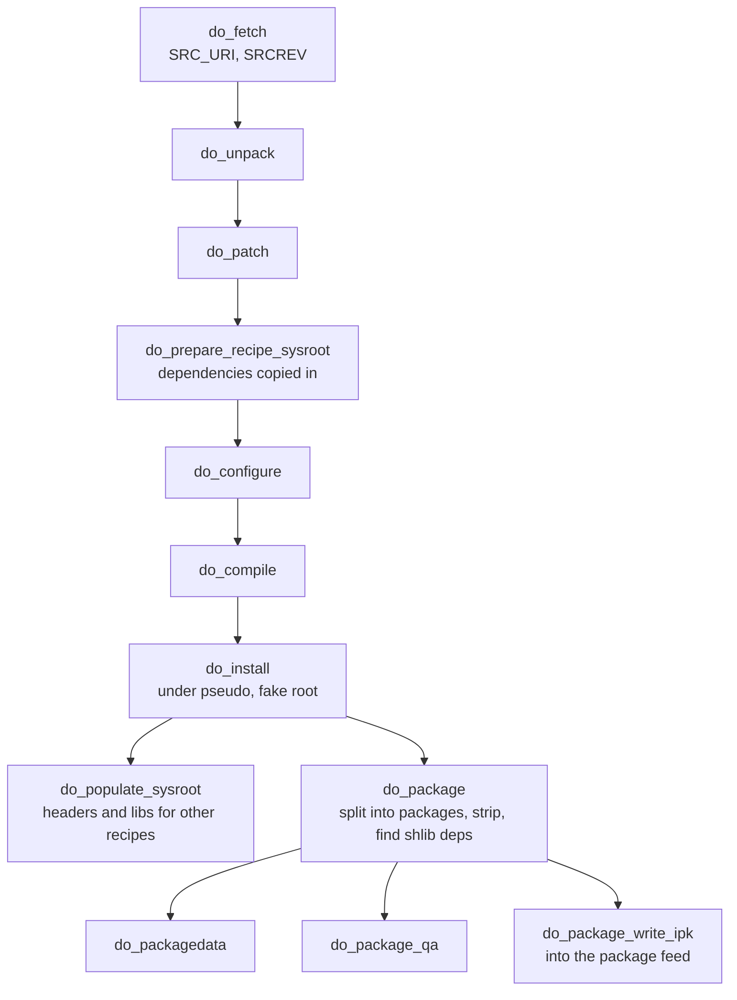

**Where each task reads and writes** (put this table on its own slide):

| Task | Reads | Writes | Typical failure |
| --- | --- | --- | --- |
| `do_fetch` | `SRC_URI`, `SRCREV` | `DL_DIR` (`downloads/`) | Proxy/network, checksum mismatch, moved branch |
| `do_unpack` | `DL_DIR` | `UNPACKDIR`, with `S` inside (5.1+; older releases used `WORKDIR`) | Wrong `S` |
| `do_patch` | Patches listed in `SRC_URI` | `S` | Patch no longer applies after a version bump |
| `do_prepare_recipe_sysroot` | Dependencies' sysroot output | `recipe-sysroot`, `recipe-sysroot-native` | Missing `DEPENDS` shows up later |
| `do_configure` | `S`, sysroots | `B` (build dir) | Library not found: add it to `DEPENDS` |
| `do_compile` | `B`, cross compiler | `B` | Real compile errors, host contamination |
| `do_install` | `B` | `D` (`${WORKDIR}/image`) | Wrong paths, files installed but not packaged |
| `do_populate_sysroot` | `D` | Shared sysroot components | Headers not exported |
| `do_package` | `D`, `PACKAGES`, `FILES:*` | `packages-split/<pkg>` | `installed-vs-shipped` QA error |
| `do_package_write_ipk` | Split packages | `tmp/deploy/ipk/<arch>/` | Rarely fails on its own |
| `do_deploy` (kernel, U-Boot) | Build output | `tmp/deploy/images/<machine>/` | Wrong `KERNEL_IMAGETYPE` or DTB name |

**Say:**
- Everything for one recipe lives in `tmp/work/<arch>/<recipe>/<version>/`. Logs and the exact scripts that ran are in its `temp/` folder: `log.do_compile`, `run.do_compile`.
- A recipe produces **many packages**: `bmcweb`, `bmcweb-dbg`, `bmcweb-dev`, and so on, decided by `PACKAGES` and `FILES:<pkg>`. Shared-library dependencies are detected automatically and become runtime dependencies.
- `do_install` runs under **pseudo** so files get root ownership in the image without the build running as root.
- The kernel and U-Boot follow the same chain, plus `do_deploy`, which puts the binaries where the image step can find them.

**Demo:** `bitbake -c compile -f bmcweb`, then open `tmp/work/.../bmcweb/.../temp/` and show `log.do_compile` and `run.do_compile`. Then `bitbake -c devshell bmcweb` to show the cross environment (`echo $CC`).

**From your notes:** the 8-step build workflow (fetch, extract, patch, configure/compile, install, package, feed, image) maps one-to-one onto this act.

---

## Act 6: Shared state and signatures

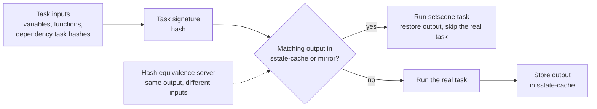

**Say:**
- Each task's signature is a hash of everything that can affect it: its code, the variables it uses, and the signatures of the tasks it depends on. Change a variable that `bmcweb` uses and only `bmcweb` and the tasks downstream of it rerun.
- `sstate-cache/` is why a second build takes minutes. Share it across the team and CI with `SSTATE_MIRRORS`, and share `DL_DIR` too.
- Hash equivalence lets BitBake reuse output when inputs changed but the output did not, which stops rebuild cascades.
- `INHERIT += "rm_work"` deletes work dirs after each recipe to save disk; use `RM_WORK_EXCLUDE += "bmcweb"` for recipes you are debugging.

**Demo:** change something in a `bmcweb` `.bbappend`, rebuild, then `bitbake-diffsigs -t bmcweb do_compile` to show **why** it reran.

---

## Act 7: From packages to a root filesystem

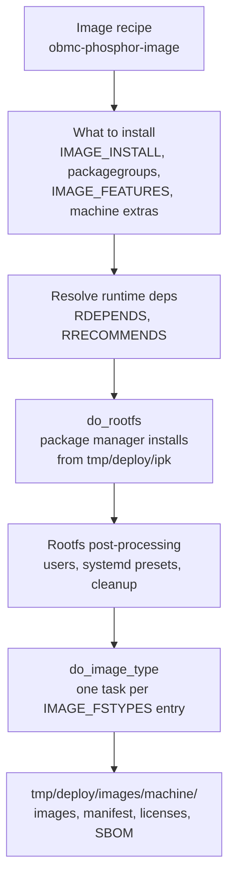

**Say:**
- The image recipe does not compile anything. It **assembles** a rootfs from the package feed produced in Act 5.
- `bmcweb` is in the image because something in the image's install list pulls it in (a packagegroup or feature) [verify which in your tree with `bitbake -g obmc-phosphor-image`]. To remove a service, change what pulls it in, never edit the rootfs by hand.
- ipk, deb and rpm are only package formats (`PACKAGE_CLASSES`). On a BMC there is usually no package manager at runtime; the whole image is updated at once.
- Every image writes a `.manifest` listing installed packages and versions. That plus license output and SPDX/SBOM is your release evidence.

**Demo:** `cat tmp/deploy/images/<machine>/obmc-phosphor-image-<machine>.manifest | grep bmcweb`.

**From your notes:** images, `IMAGE_INSTALL` (update `_append` to `:append`), packages, "images generated by Poky", deploy folder, symlinks, `IMAGE_ROOTFS_EXTRA_SPACE`.

---

## Act 8: OpenBMC flash image (where BMC differs from a dev board)

Dev-board flows end with "`dd` a `.wic` to an SD card". A BMC flow ends with a **flash layout**.

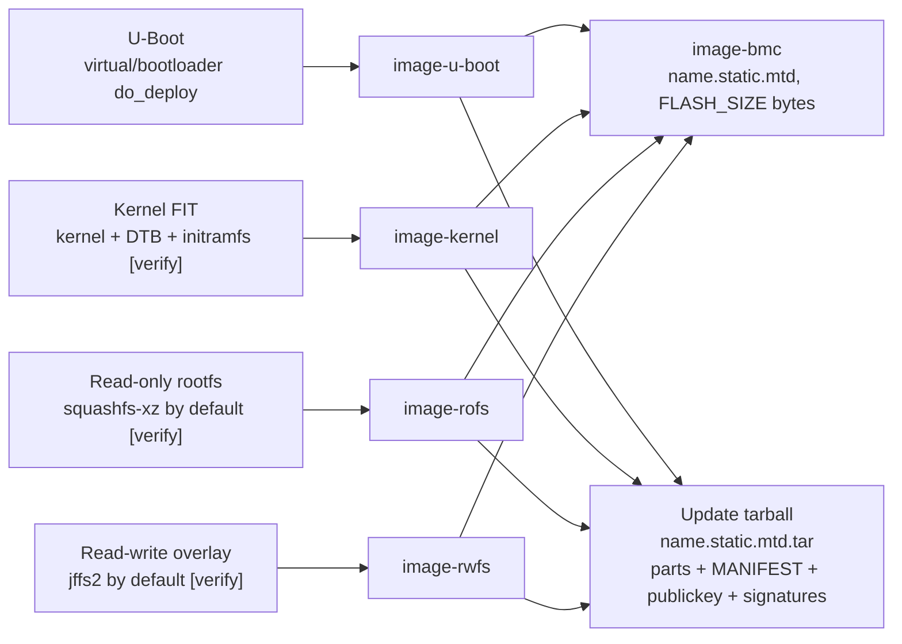

**Say:**
- `meta-phosphor`'s image class takes the normal image outputs and packs them into the machine's flash layout. For static SPI-NOR layouts it produces `*.static.mtd` (symlinked as `image-bmc`) and an update tarball `*.static.mtd.tar`. UBI and eMMC layouts have their own variants.
- **The full flash image and the update tarball are not interchangeable.** One is a raw flash dump for a programmer; the other is for the BMC's update service.
- Signing, A/B and rollback are update policy layered on top. Yocto builds the pieces; it does not decide your security policy.
- Before anyone flashes anything: confirm the target, the layout, the signing key and the recovery path. See the [flash images chapter](OpenBMC_Textbook/03_Flash_Images_and_Updates.md).

**From your notes:** SD card partitioning, copying `MLO`/`u-boot.img`/`zImage`/DTB, `.wic` and `dd`. Present them as "the dev-board version of this act", then show the BMC version.

---

## Act 9: On the target: the boot chain

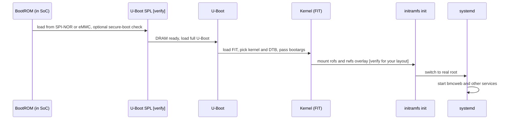

**Every boot stage maps back to a recipe:**

| Boot stage | Built by | Deployed as |
| --- | --- | --- |
| BootROM | SoC vendor, not Yocto | - |
| SPL and U-Boot | `virtual/bootloader` provider | `image-u-boot` |
| Kernel and DTB | `virtual/kernel` provider, `KERNEL_DEVICETREE` | `image-kernel` |
| Rootfs and services | Image recipe and packages | `image-rofs`, `image-rwfs` |

**Compare with the labs** (one slide, from your notes):

| Board | Chain | Why that shape |
| --- | --- | --- |
| BeagleBone Black (AM335x) | ROM -> SPL (`MLO`) -> U-Boot -> Linux | 128 KB internal RAM forces a small SPL to set up DRAM |
| Raspberry Pi 3 | GPU ROM -> `bootcode.bin` -> `start.elf` -> kernel | The GPU boots first; the ARM CPU is released last |
| BMC SoC (for example AST2600) | BootROM -> SPL -> U-Boot -> FIT kernel -> rootfs | Same staged pattern, from SPI-NOR, with secure-boot hooks |

Link to the [ASPEED boot chapter](ASPEED_BMC_SoC_Textbook/04_Boot_Security_and_Software.md) for SoC details.

---

## Act 10: Trace back (close the loop)

Walk the master map **backwards**. This is the skill the team uses every week.

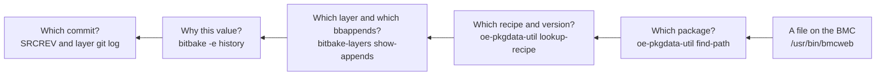

**And the debug loop when a build fails:**

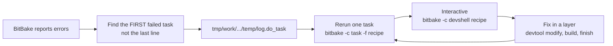

**Say:** `devtool modify bmcweb` gives you a source tree to edit and build; `devtool finish` turns your commits into patches in your layer. `devtool reset` only drops the override and does not save work.

---

## Act 11: Lifecycle (short)

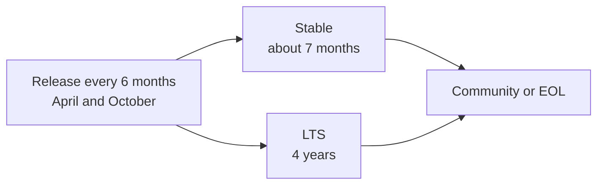

**Say:** all layers must be on the **same release branch**; each layer declares what it supports in `LAYERSERIES_COMPAT_<layer>`. Ask the room which release the team's tree is on and when it goes EOL. Current release details are on slide 23 of the [deck](Yocto_for_BMC_Team_Presentation.md); re-check them against the Yocto releases page before presenting.

---

## 3. Timing options

| Act | 45 min | 60 min | 90 min (deep dive) |
| --- | --- | --- | --- |
| 1. Why | 3 | 4 | 5 |
| 2. Configuration | 5 | 7 | 10 |
| 3. Parsing | 4 | 5 | 8 |
| 4. Task graph | 4 | 5 | 8 |
| 5. Inside one recipe | 7 | 9 | 14 |
| 6. Shared state | 3 | 4 | 7 |
| 7. Image | 4 | 5 | 8 |
| 8. Flash image | 4 | 6 | 8 |
| 9. Boot | 4 | 5 | 7 |
| 10. Trace back | 5 | 6 | 10 |
| 11. Lifecycle + Q&A | 2 | 4 | 5 |
| **Total** | **45** | **60** | **90** |

Acts 5 and 10 are the most valuable; protect their time. If short, cut Act 11 to one sentence and show Act 9's lab comparison only.

---

## 4. Where each section of your notes goes

| Notes section | Act | Treatment |
| --- | --- | --- |
| Four elements, What is Yocto, history, advantages | 1 | One slide; skip the "yocto = 10^-24" trivia or use it as an opener |
| Input/output analogy | 1 | Becomes the Act 1 diagram |
| Build host prerequisites | 2 | Update numbers (see the deck's slide 10) |
| Poky, Poky vs Yocto, OpenEmbedded, oe-core | 1 and 3 | Vocabulary table, then real meaning in Act 3 |
| Metadata, recipes, classes, layers, BSP | 3 | Parsing diagram |
| Workflow steps, `oe-init-build-env`, `local.conf`, `bblayers.conf` | 2 | Setup and parse-order diagrams |
| `BB_NUMBER_THREADS`, `PARALLEL_MAKE` | 4 | Graph parallelism |
| Yocto/OE 8-step build workflow | 5 | Task pipeline and table |
| `rm_work`, disk space | 6 | sstate and disk |
| Image, packages, `IMAGE_INSTALL`, deploy outputs | 7 | Rootfs diagram |
| QEMU, `runqemu`, `core-image-sato` | Demo | Optional: OpenBMC can also be booted in QEMU for an AST2600 machine [verify] |
| BeagleBone, Raspberry Pi, SD card, minicom | 8 and 9 | "Dev-board version" comparison |
| Releases, LTS, branches, `meta-ti` | 11 and 3 | Lifecycle and vendor BSP choice |

Outdated items in the notes (`git://` URLs, `_append`, Zeus branch, 50 GB disk, 2-year LTS, Python 3.4) are listed in the deck's *Corrections to older training material* appendix. Fix them in the slides rather than presenting them as current.

---

## 5. Demo script aligned to the flow

Run the build **before** the talk; demos should only inspect, not wait for a full build.

```sh
# Act 2: configuration
. setup <machine>                      # or: source poky/oe-init-build-env
bitbake-layers show-layers
bitbake -e bmcweb | grep -B20 '^SRC_URI='   # value plus its history

# Act 3: parsing
bitbake-layers show-appends | grep -A3 bmcweb
bitbake -e virtual/kernel | grep '^PN='

# Act 4: graph
bitbake -c listtasks bmcweb
bitbake -g obmc-phosphor-image && grep bmcweb pn-buildlist

# Act 5: one recipe
ls tmp/work/*/bmcweb/*/temp/ | head
bitbake -c devshell bmcweb             # then: echo $CC; exit

# Act 6: why did it rebuild?
bitbake-diffsigs -t bmcweb do_compile

# Act 7 and 8: outputs
ls -l tmp/deploy/images/<machine>/
grep bmcweb tmp/deploy/images/<machine>/*.manifest

# Act 10: trace back
oe-pkgdata-util find-path /usr/bin/bmcweb
oe-pkgdata-util lookup-recipe bmcweb
```

Never demo a flash write to real hardware.

---

## 6. Turning this into slides

- **One diagram per slide.** Build complex diagrams in two or three steps (progressive reveal) rather than showing the full graph at once.
- **Render the diagrams:** GitHub renders Mermaid blocks natively. In VS Code, install a Mermaid preview extension for Markdown. For PowerPoint, export each block to SVG/PNG with the Mermaid CLI: `npx @mermaid-js/mermaid-cli -i act5.mmd -o act5.svg`. Keep rendering local if diagrams contain internal layer or machine names.
- **Repeat the master map** with the current stage highlighted at the start of each act.
- **Keep the running example visible:** a small `bmcweb` icon or label on each act's slide showing where it is in the pipeline.
- **End where you started:** the closing slide is the master map with the trace-back arrow highlighted.

## Sources

- [Yocto Project Overview and Concepts Manual](https://docs.yoctoproject.org/overview-manual/concepts.html): configuration parsing, task flow, sstate.
- [Yocto Reference Manual: tasks](https://docs.yoctoproject.org/ref-manual/tasks.html) and [variables](https://docs.yoctoproject.org/ref-manual/variables.html): `UNPACKDIR`, `S`, `B`, `D`.
- [BitBake User Manual](https://docs.yoctoproject.org/bitbake/): operators, overrides, task execution.
- [OpenBMC `image_types_phosphor.bbclass`](https://github.com/openbmc/openbmc/blob/master/meta-phosphor/classes/image_types_phosphor.bbclass): `image-bmc`, `*.static.mtd`, update tarball contents.
- [Yocto releases](https://wiki.yoctoproject.org/wiki/Releases): release cadence and support windows.
